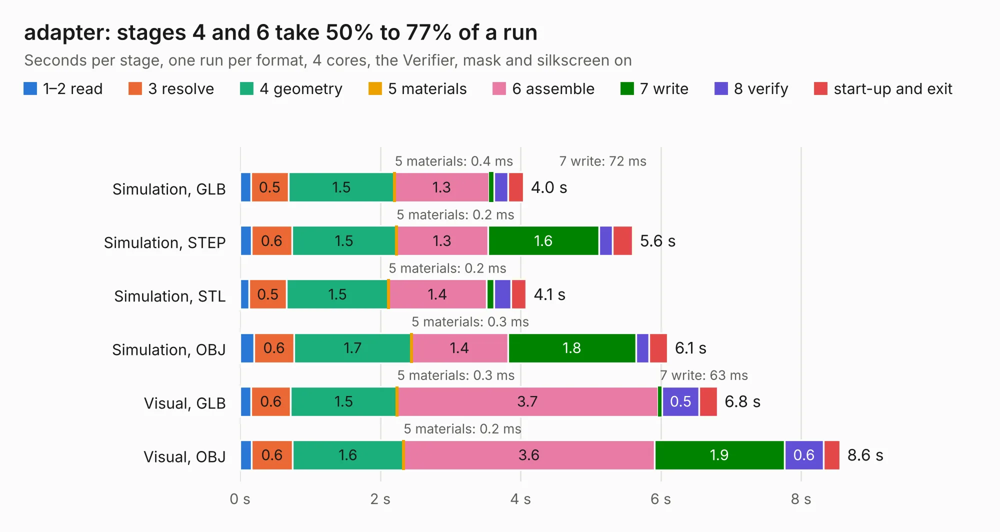

# 1402. adapter

Board 1,402 of the 3,111 of [Corpus Testing](../Corpus-Testing.md), on [Corpus Page 13](../CorpusTestingPages/Corpus-Testing-13.md#1402-adapter).

| Mode and format | 1–2 read | 3 resolve | 4 geometry | 5 materials | 6 assemble | 7 write | 8 verify | start-up and exit | Total |
|---|---:|---:|---:|---:|---:|---:|---:|---:|---:|
| Simulation, GLB | 0.2 | 0.5 | 1.5 | 0.4&nbsp;ms | 1.3 | 72&nbsp;ms | 0.2 | 0.2 | 4.0 |
| Simulation, STEP | 0.2 | 0.6 | 1.5 | 0.2&nbsp;ms | 1.3 | 1.6 | 0.2 | 0.3 | 5.6 |
| Simulation, STL | 0.1 | 0.5 | 1.5 | 0.2&nbsp;ms | 1.4 | 0.1 | 0.2 | 0.2 | 4.1 |
| Simulation, OBJ | 0.2 | 0.6 | 1.7 | 0.3&nbsp;ms | 1.4 | 1.8 | 0.2 | 0.3 | 6.1 |
| Visual, GLB | 0.2 | 0.6 | 1.5 | 0.3&nbsp;ms | 3.7 | 63&nbsp;ms | 0.5 | 0.3 | 6.8 |
| Visual, OBJ | 0.2 | 0.6 | 1.6 | 0.2&nbsp;ms | 3.6 | 1.9 | 0.6 | 0.2 | 8.6 |

<table align="center"><tr><td valign="top">

| Board | Repo: [jotego/jtcores](https://github.com/jotego/jtcores) Board: `adapter.kicad_pcb` |
|---|---|
| Folder | cores / argus / sch / adapter |
| Complexity | 199&nbsp;/&nbsp;1000 (size&nbsp;134, features&nbsp;65) |
| KESE&nbsp;features | through vias, filled zones, stack-up, dielectric εr and tanδ |
| Tested | 9th November 2026 |
| Copper&nbsp;layers | 2 |
| File&nbsp;format | KiCad 8 (20240108) |
| Parts,&nbsp;tracks,&nbsp;vias | 2, 334, 97 |
| Triangles,&nbsp;simulation | 365,054 in 51 parts |
| Verifier | PASS in all six runs |

</td><td valign="top">

<table>
<tr><th>File type</th><th>File size</th><th>Peak memory used</th></tr>
<tr><th colspan="3" align="left">Simulation</th></tr>
<tr><td>GLB</td><td align="right">13&nbsp;MB</td><td align="right">277&nbsp;MB</td></tr>
<tr><td>STEP</td><td align="right">66&nbsp;MB</td><td align="right">331&nbsp;MB</td></tr>
<tr><td>STL</td><td align="right">18&nbsp;MB</td><td align="right">287&nbsp;MB</td></tr>
<tr><td>OBJ</td><td align="right">38&nbsp;MB</td><td align="right">314&nbsp;MB</td></tr>
<tr><th colspan="3" align="left">Visual</th></tr>
<tr><td>GLB</td><td align="right">13&nbsp;MB</td><td align="right">340&nbsp;MB</td></tr>
<tr><td>OBJ</td><td align="right">38&nbsp;MB</td><td align="right">339&nbsp;MB</td></tr>
</table>

</td></tr></table>

| Previous | Next |
|:---|---:|
| [1401. ecp5-mini](b1401b_ecp5-mini_hardware-0-2_ecp5-mini.md) | [1403. odyssey](b1403b_jtcores_odyssey.md) |
