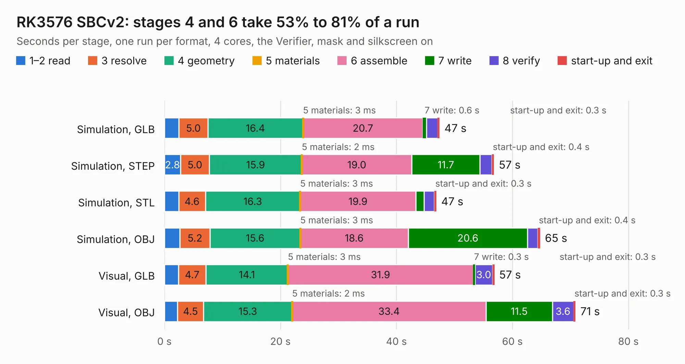

# 1402 RK3576 SBCv2

Board 1,402 of the 3,138 of [Corpus Testing](../Corpus-Testing.md), on [Corpus Page 13](../CorpusTestingPages/Corpus-Testing-13.md#1402-rk3576-sbcv2).

| Mode and format | 1–2 read | 3 resolve | 4 geometry | 5 materials | 6 assemble | 7 write | 8 verify | start-up and exit | Total |
|---|---:|---:|---:|---:|---:|---:|---:|---:|---:|
| Simulation, GLB | 2.5 | 5.0 | 16.4 | 3&nbsp;ms | 20.7 | 0.6 | 1.9 | 0.3 | 47.4 |
| Simulation, STEP | 2.8 | 5.0 | 15.9 | 2&nbsp;ms | 19.0 | 11.7 | 2.0 | 0.4 | 56.8 |
| Simulation, STL | 2.5 | 4.6 | 16.3 | 3&nbsp;ms | 19.9 | 1.4 | 1.7 | 0.3 | 46.9 |
| Simulation, OBJ | 2.7 | 5.2 | 15.6 | 3&nbsp;ms | 18.6 | 20.6 | 1.7 | 0.4 | 64.8 |
| Visual, GLB | 2.4 | 4.7 | 14.1 | 3&nbsp;ms | 31.9 | 0.3 | 3.0 | 0.3 | 56.9 |
| Visual, OBJ | 2.3 | 4.5 | 15.3 | 2&nbsp;ms | 33.4 | 11.5 | 3.6 | 0.3 | 70.9 |

<table align="center"><tr><td valign="top">

| Board | Repo: [joengineer656/open-source-sbc-board](https://github.com/joengineer656/open-source-sbc-board) Board: `RK3576 SBCv2.kicad_pcb` |
|---|---|
| Complexity | 302&nbsp;/&nbsp;1000 (size&nbsp;232, features&nbsp;70) |
| KESE&nbsp;features | slotted holes, rounded, trapezoid or chamfered pads, stack-up, dielectric εr and tanδ, copper finish, mask and silkscreen colours |
| Tested | 9th November 2026 |
| Copper&nbsp;layers | 8 |
| File&nbsp;format | KiCad 10 (20260206) |
| Parts,&nbsp;tracks,&nbsp;vias | 830, 18, 0 |
| Triangles,&nbsp;simulation | 3,262,282 in 739 parts |
| Note | mostly unrouted |
| Verifier | PASS in all six runs |

</td><td valign="top">

<table>
<tr><th>File type</th><th>File size</th><th>Peak memory used</th></tr>
<tr><th colspan="3" align="left">Simulation</th></tr>
<tr><td>GLB</td><td align="right">102&nbsp;MB</td><td align="right">1.1&nbsp;GB</td></tr>
<tr><td>STEP</td><td align="right">384&nbsp;MB</td><td align="right">1.3&nbsp;GB</td></tr>
<tr><td>STL</td><td align="right">163&nbsp;MB</td><td align="right">1.1&nbsp;GB</td></tr>
<tr><td>OBJ</td><td align="right">344&nbsp;MB</td><td align="right">2.1&nbsp;GB</td></tr>
<tr><th colspan="3" align="left">Visual</th></tr>
<tr><td>GLB</td><td align="right">65&nbsp;MB</td><td align="right">1.4&nbsp;GB</td></tr>
<tr><td>OBJ</td><td align="right">207&nbsp;MB</td><td align="right">1.4&nbsp;GB</td></tr>
</table>

</td></tr></table>

| Previous | Next |
|:---|---:|
| [1401 astra_piNas](b1401b_astra-pinas_astra-piNas.md) | [1403 OSO-SWAT-B1-jig](b1403b_Sensor-Watch_OSO-SWAT-B1-jig.md) |
