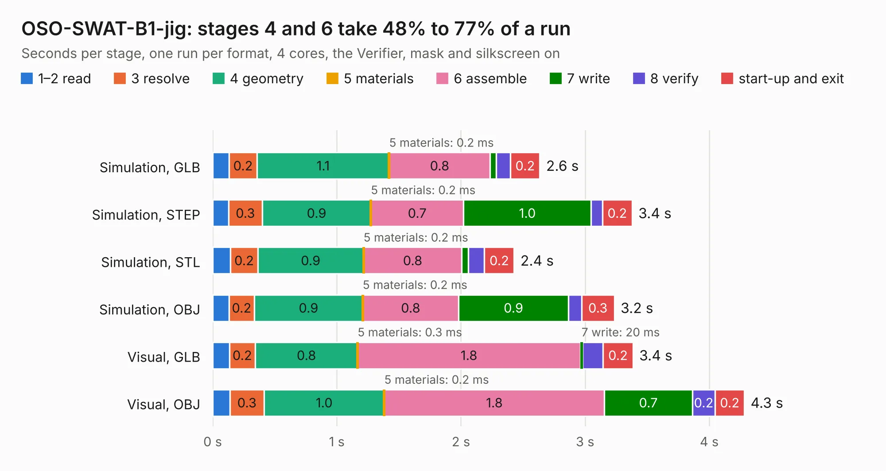

# 1403. OSO-SWAT-B1-jig

Board 1,403 of the 3,139 of [Corpus Testing](../Corpus-Testing.md), on [Corpus Page 13](../CorpusTestingPages/Corpus-Testing-13.md#1403-oso-swat-b1-jig).

| Mode and format | 1–2 read | 3 resolve | 4 geometry | 5 materials | 6 assemble | 7 write | 8 verify | start-up and exit | Total |
|---|---:|---:|---:|---:|---:|---:|---:|---:|---:|
| Simulation, GLB | 0.1 | 0.2 | 1.1 | 0.2&nbsp;ms | 0.8 | 49&nbsp;ms | 0.1 | 0.2 | 2.6 |
| Simulation, STEP | 0.1 | 0.3 | 0.9 | 0.2&nbsp;ms | 0.7 | 1.0 | 91&nbsp;ms | 0.2 | 3.4 |
| Simulation, STL | 0.1 | 0.2 | 0.9 | 0.2&nbsp;ms | 0.8 | 54&nbsp;ms | 0.1 | 0.2 | 2.4 |
| Simulation, OBJ | 0.1 | 0.2 | 0.9 | 0.2&nbsp;ms | 0.8 | 0.9 | 0.1 | 0.3 | 3.2 |
| Visual, GLB | 0.1 | 0.2 | 0.8 | 0.3&nbsp;ms | 1.8 | 20&nbsp;ms | 0.2 | 0.2 | 3.4 |
| Visual, OBJ | 0.1 | 0.3 | 1.0 | 0.2&nbsp;ms | 1.8 | 0.7 | 0.2 | 0.2 | 4.3 |

<table align="center"><tr><td valign="top">

| Board | Repo: [joeycastillo/Sensor-Watch](https://github.com/joeycastillo/Sensor-Watch) Board: `OSO-SWAT-B1-jig.kicad_pcb` |
|---|---|
| Folder | PCB / Main Boards / OSO-SWAT-B1 / OSO-SWAT-B1-jig |
| Complexity | 45&nbsp;/&nbsp;1000 (size&nbsp;45, features&nbsp;0) |
| Tested | 9th November 2026 |
| Copper&nbsp;layers | 2 |
| File&nbsp;format | KiCad 10 (20260206) |
| Parts,&nbsp;tracks,&nbsp;vias | 12, 0, 0 |
| Triangles,&nbsp;simulation | 162,116 in 52 parts |
| Verifier | PASS in all six runs |

</td><td valign="top">

<table>
<tr><th>File type</th><th>File size</th><th>Peak memory used</th></tr>
<tr><th colspan="3" align="left">Simulation</th></tr>
<tr><td>GLB</td><td align="right">5.4&nbsp;MB</td><td align="right">199&nbsp;MB</td></tr>
<tr><td>STEP</td><td align="right">19&nbsp;MB</td><td align="right">209&nbsp;MB</td></tr>
<tr><td>STL</td><td align="right">8.1&nbsp;MB</td><td align="right">192&nbsp;MB</td></tr>
<tr><td>OBJ</td><td align="right">16&nbsp;MB</td><td align="right">197&nbsp;MB</td></tr>
<tr><th colspan="3" align="left">Visual</th></tr>
<tr><td>GLB</td><td align="right">3.7&nbsp;MB</td><td align="right">172&nbsp;MB</td></tr>
<tr><td>OBJ</td><td align="right">10&nbsp;MB</td><td align="right">172&nbsp;MB</td></tr>
</table>

</td></tr></table>

| Previous | Next |
|:---|---:|
| [1402. RK3576 SBCv2](b1402b_open-source-sbc-board_RK3576-SBCv2.md) | [1404. OSO-SWAT-B1](b1404b_Sensor-Watch_OSO-SWAT-B1.md) |
