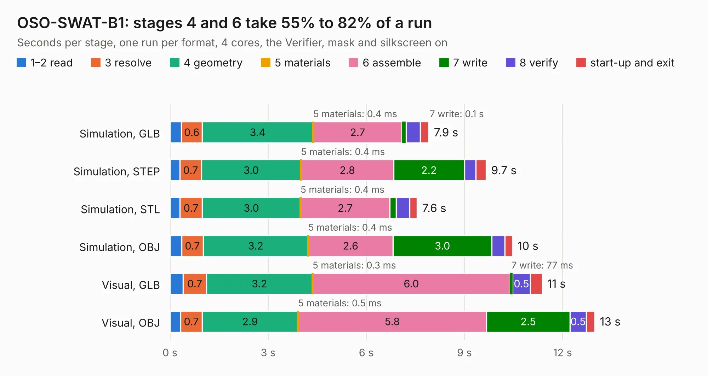

# 1404. OSO-SWAT-B1

Board 1,404 of the 3,139 of [Corpus Testing](../Corpus-Testing.md), on [Corpus Page 13](../CorpusTestingPages/Corpus-Testing-13.md#1404-oso-swat-b1).

| Mode and format | 1–2 read | 3 resolve | 4 geometry | 5 materials | 6 assemble | 7 write | 8 verify | start-up and exit | Total |
|---|---:|---:|---:|---:|---:|---:|---:|---:|---:|
| Simulation, GLB | 0.4 | 0.6 | 3.4 | 0.4&nbsp;ms | 2.7 | 0.1 | 0.4 | 0.3 | 7.9 |
| Simulation, STEP | 0.3 | 0.7 | 3.0 | 0.4&nbsp;ms | 2.8 | 2.2 | 0.4 | 0.3 | 9.7 |
| Simulation, STL | 0.3 | 0.7 | 3.0 | 0.4&nbsp;ms | 2.7 | 0.2 | 0.4 | 0.2 | 7.6 |
| Simulation, OBJ | 0.4 | 0.7 | 3.2 | 0.4&nbsp;ms | 2.6 | 3.0 | 0.4 | 0.2 | 10.5 |
| Visual, GLB | 0.4 | 0.7 | 3.2 | 0.3&nbsp;ms | 6.0 | 77&nbsp;ms | 0.5 | 0.4 | 11.4 |
| Visual, OBJ | 0.3 | 0.7 | 2.9 | 0.5&nbsp;ms | 5.8 | 2.5 | 0.5 | 0.3 | 13.0 |

<table align="center"><tr><td valign="top">

| Board | Repo: [joeycastillo/Sensor-Watch](https://github.com/joeycastillo/Sensor-Watch) Board: `OSO-SWAT-B1.kicad_pcb` |
|---|---|
| Folder | PCB / Main Boards / OSO-SWAT-B1 |
| Complexity | 280&nbsp;/&nbsp;1000 (size&nbsp;200, features&nbsp;80) |
| KESE&nbsp;features | through vias, rounded, trapezoid or chamfered pads, filled zones, stack-up, dielectric εr and tanδ, mask and silkscreen colours |
| Tested | 9th November 2026 |
| Copper&nbsp;layers | 2 |
| File&nbsp;format | KiCad 10 (20260206) |
| Parts,&nbsp;tracks,&nbsp;vias | 23, 530, 79 |
| Triangles,&nbsp;simulation | 477,106 in 77 parts |
| Verifier | PASS in all six runs |

</td><td valign="top">

<table>
<tr><th>File type</th><th>File size</th><th>Peak memory used</th></tr>
<tr><th colspan="3" align="left">Simulation</th></tr>
<tr><td>GLB</td><td align="right">17&nbsp;MB</td><td align="right">308&nbsp;MB</td></tr>
<tr><td>STEP</td><td align="right">90&nbsp;MB</td><td align="right">367&nbsp;MB</td></tr>
<tr><td>STL</td><td align="right">24&nbsp;MB</td><td align="right">305&nbsp;MB</td></tr>
<tr><td>OBJ</td><td align="right">50&nbsp;MB</td><td align="right">394&nbsp;MB</td></tr>
<tr><th colspan="3" align="left">Visual</th></tr>
<tr><td>GLB</td><td align="right">15&nbsp;MB</td><td align="right">383&nbsp;MB</td></tr>
<tr><td>OBJ</td><td align="right">45&nbsp;MB</td><td align="right">388&nbsp;MB</td></tr>
</table>

</td></tr></table>

| Previous | Next |
|:---|---:|
| [1403. OSO-SWAT-B1-jig](b1403b_Sensor-Watch_OSO-SWAT-B1-jig.md) | [1405. OSO-SWAT-C1-jig](b1405b_Sensor-Watch_OSO-SWAT-C1-jig.md) |
