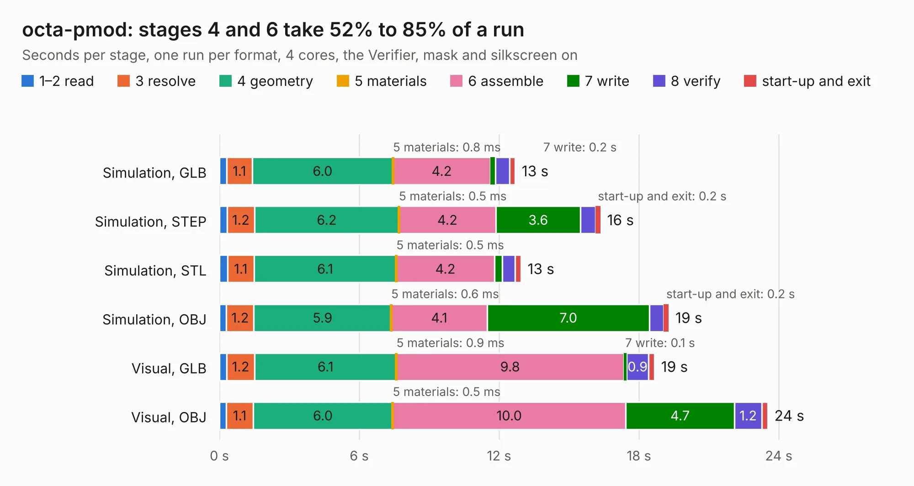

# 1405. octa-pmod

Board 1,405 of the 3,121 of [Corpus Testing](../Corpus-Testing.md), on [Corpus Page 14](../CorpusTestingPages/Corpus-Testing-14.md#1405-octa-pmod).

| Mode and format | 1–2 read | 3 resolve | 4 geometry | 5 materials | 6 assemble | 7 write | 8 verify | start-up and exit | Total |
|---|---:|---:|---:|---:|---:|---:|---:|---:|---:|
| Simulation, GLB | 0.3 | 1.1 | 6.0 | 0.8&nbsp;ms | 4.2 | 0.2 | 0.6 | 0.2 | 12.7 |
| Simulation, STEP | 0.3 | 1.2 | 6.2 | 0.5&nbsp;ms | 4.2 | 3.6 | 0.6 | 0.2 | 16.4 |
| Simulation, STL | 0.3 | 1.1 | 6.1 | 0.5&nbsp;ms | 4.2 | 0.3 | 0.6 | 0.2 | 12.9 |
| Simulation, OBJ | 0.3 | 1.2 | 5.9 | 0.6&nbsp;ms | 4.1 | 7.0 | 0.6 | 0.2 | 19.3 |
| Visual, GLB | 0.3 | 1.2 | 6.1 | 0.9&nbsp;ms | 9.8 | 0.1 | 0.9 | 0.3 | 18.7 |
| Visual, OBJ | 0.3 | 1.1 | 6.0 | 0.5&nbsp;ms | 10.0 | 4.7 | 1.2 | 0.3 | 23.5 |

<table align="center"><tr><td valign="top">

| Board | Repo: [joshajohnson/ecp5-mini](https://github.com/joshajohnson/ecp5-mini) Board: `octa-pmod.kicad_pcb` |
|---|---|
| Folder | breakouts / octa-pmod-horizontal-0.2 |
| Complexity | 256&nbsp;/&nbsp;1000 (size&nbsp;151, features&nbsp;105) |
| KESE&nbsp;features | through vias, rounded, trapezoid or chamfered pads, filled zones, curved board outline, stack-up, dielectric εr and tanδ, copper finish, mask and silkscreen colours |
| Tested | 9th November 2026 |
| Copper&nbsp;layers | 2 |
| File&nbsp;format | KiCad 6 (20201220) |
| Parts,&nbsp;tracks,&nbsp;vias | 16, 528, 6 |
| Triangles,&nbsp;simulation | 1,211,224 in 78 parts |
| Verifier | PASS in all six runs |

</td><td valign="top">

<table>
<tr><th>File type</th><th>File size</th><th>Peak memory used</th></tr>
<tr><th colspan="3" align="left">Simulation</th></tr>
<tr><td>GLB</td><td align="right">41&nbsp;MB</td><td align="right">491&nbsp;MB</td></tr>
<tr><td>STEP</td><td align="right">181&nbsp;MB</td><td align="right">594&nbsp;MB</td></tr>
<tr><td>STL</td><td align="right">61&nbsp;MB</td><td align="right">501&nbsp;MB</td></tr>
<tr><td>OBJ</td><td align="right">123&nbsp;MB</td><td align="right">853&nbsp;MB</td></tr>
<tr><th colspan="3" align="left">Visual</th></tr>
<tr><td>GLB</td><td align="right">27&nbsp;MB</td><td align="right">648&nbsp;MB</td></tr>
<tr><td>OBJ</td><td align="right">81&nbsp;MB</td><td align="right">664&nbsp;MB</td></tr>
</table>

</td></tr></table>

| Previous | Next |
|:---|---:|
| [1404. octa-pmod](b1404b_ecp5-mini_breakouts-octa-pmod-horizontal-0-1_octa-pmod.md) | [1406. quad-pmod](b1406b_ecp5-mini_breakouts-quad-pmod-0-1_quad-pmod.md) |
