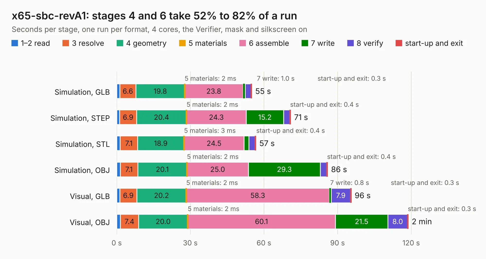

# 1405. x65-sbc-revA1

Board 1,405 of the 3,110 of [Corpus Testing](../Corpus-Testing.md), on [Corpus Page 14](../CorpusTestingPages/Corpus-Testing-14.md#1405-x65-sbc-reva1).

| Mode and format | 1–2 read | 3 resolve | 4 geometry | 5 materials | 6 assemble | 7 write | 8 verify | start-up and exit | Total |
|---|---:|---:|---:|---:|---:|---:|---:|---:|---:|
| Simulation, GLB | 1.3 | 6.6 | 19.8 | 2&nbsp;ms | 23.8 | 1.0 | 2.3 | 0.3 | 55.0 |
| Simulation, STEP | 1.2 | 6.9 | 20.4 | 2&nbsp;ms | 24.3 | 15.2 | 2.5 | 0.4 | 70.9 |
| Simulation, STL | 1.4 | 7.1 | 18.9 | 3&nbsp;ms | 24.5 | 2.0 | 2.5 | 0.4 | 56.7 |
| Simulation, OBJ | 1.4 | 7.1 | 20.1 | 2&nbsp;ms | 25.0 | 29.3 | 2.6 | 0.4 | 86.0 |
| Visual, GLB | 1.3 | 6.9 | 20.2 | 2&nbsp;ms | 58.3 | 0.8 | 7.9 | 0.3 | 95.6 |
| Visual, OBJ | 1.5 | 7.4 | 20.0 | 2&nbsp;ms | 60.1 | 21.5 | 8.0 | 0.3 | 118.8 |

<table align="center"><tr><td valign="top">

| Board | Repo: [jsyk/x65](https://github.com/jsyk/x65) Board: `x65-sbc-revA1.kicad_pcb` |
|---|---|
| Folder | pcb / x65-sbc-revA1 |
| Complexity | 442&nbsp;/&nbsp;1000 (size&nbsp;297, features&nbsp;145) |
| KESE&nbsp;features | through vias, slotted holes, custom pads, rounded, trapezoid or chamfered pads, filled zones, copper drawings, copper text, curved board outline, knockout text, stack-up, dielectric εr and tanδ |
| Tested | 9th November 2026 |
| Copper&nbsp;layers | 4 |
| File&nbsp;format | KiCad 7 (20221018) |
| Parts,&nbsp;tracks,&nbsp;vias | 332, 4,603, 625 |
| Triangles,&nbsp;simulation | 5,576,678 in 376 parts |
| Verifier | PASS in all six runs |

</td><td valign="top">

<table>
<tr><th>File type</th><th>File size</th><th>Peak memory used</th></tr>
<tr><th colspan="3" align="left">Simulation</th></tr>
<tr><td>GLB</td><td align="right">191&nbsp;MB</td><td align="right">1.6&nbsp;GB</td></tr>
<tr><td>STEP</td><td align="right">831&nbsp;MB</td><td align="right">2.1&nbsp;GB</td></tr>
<tr><td>STL</td><td align="right">279&nbsp;MB</td><td align="right">1.6&nbsp;GB</td></tr>
<tr><td>OBJ</td><td align="right">595&nbsp;MB</td><td align="right">3.6&nbsp;GB</td></tr>
<tr><th colspan="3" align="left">Visual</th></tr>
<tr><td>GLB</td><td align="right">137&nbsp;MB</td><td align="right">2.3&nbsp;GB</td></tr>
<tr><td>OBJ</td><td align="right">433&nbsp;MB</td><td align="right">2.8&nbsp;GB</td></tr>
</table>

</td></tr></table>

| Previous | Next |
|:---|---:|
| [1404. QBusH723Z](b1404b_MSCP_QBusH723Z.md) | [1406. x65-sbc-revB1](b1406b_x65_x65-sbc-revB1.md) |
