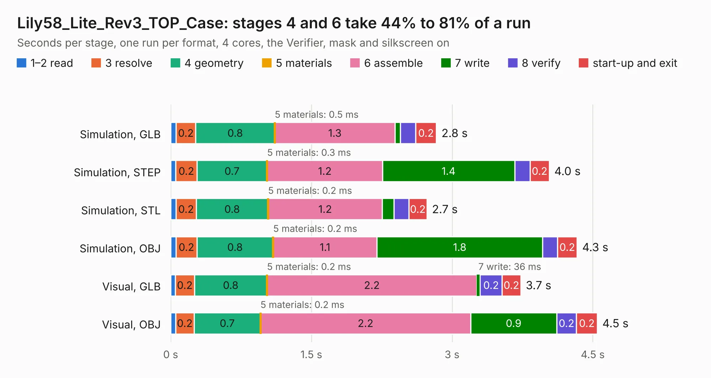

# 1406. Lily58_Lite_Rev3_TOP_Case

Board 1,406 of the 3,106 of [Corpus Testing](../Corpus-Testing.md), on [Corpus Page 14](../CorpusTestingPages/Corpus-Testing-14.md#1406-lily58_lite_rev3_top_case).

| Mode and format | 1–2 read | 3 resolve | 4 geometry | 5 materials | 6 assemble | 7 write | 8 verify | start-up and exit | Total |
|---|---:|---:|---:|---:|---:|---:|---:|---:|---:|
| Simulation, GLB | 59&nbsp;ms | 0.2 | 0.8 | 0.5&nbsp;ms | 1.3 | 58&nbsp;ms | 0.2 | 0.2 | 2.8 |
| Simulation, STEP | 55&nbsp;ms | 0.2 | 0.7 | 0.3&nbsp;ms | 1.2 | 1.4 | 0.2 | 0.2 | 4.0 |
| Simulation, STL | 57&nbsp;ms | 0.2 | 0.8 | 0.2&nbsp;ms | 1.2 | 0.1 | 0.2 | 0.2 | 2.7 |
| Simulation, OBJ | 58&nbsp;ms | 0.2 | 0.8 | 0.2&nbsp;ms | 1.1 | 1.8 | 0.2 | 0.2 | 4.3 |
| Visual, GLB | 49&nbsp;ms | 0.2 | 0.8 | 0.2&nbsp;ms | 2.2 | 36&nbsp;ms | 0.2 | 0.2 | 3.7 |
| Visual, OBJ | 52&nbsp;ms | 0.2 | 0.7 | 0.2&nbsp;ms | 2.2 | 0.9 | 0.2 | 0.2 | 4.5 |

<table align="center"><tr><td valign="top">

| Board | Repo: [kata0510/Lily58](https://github.com/kata0510/Lily58) Board: `Lily58_Lite_Rev3_TOP_Case.kicad_pcb` |
|---|---|
| Folder | case / top-plate |
| Complexity | 94&nbsp;/&nbsp;1000 (size&nbsp;54, features&nbsp;40) |
| KESE&nbsp;features | rounded, trapezoid or chamfered pads, filled zones, curved board outline |
| Tested | 9th November 2026 |
| Copper&nbsp;layers | 2 |
| File&nbsp;format | KiCad 8 (20240108) |
| Parts,&nbsp;tracks,&nbsp;vias | 29, 0, 0 |
| Triangles,&nbsp;simulation | 405,304 in 68 parts |
| Verifier | PASS in all six runs |

</td><td valign="top">

<table>
<tr><th>File type</th><th>File size</th><th>Peak memory used</th></tr>
<tr><th colspan="3" align="left">Simulation</th></tr>
<tr><td>GLB</td><td align="right">13&nbsp;MB</td><td align="right">277&nbsp;MB</td></tr>
<tr><td>STEP</td><td align="right">63&nbsp;MB</td><td align="right">283&nbsp;MB</td></tr>
<tr><td>STL</td><td align="right">20&nbsp;MB</td><td align="right">277&nbsp;MB</td></tr>
<tr><td>OBJ</td><td align="right">40&nbsp;MB</td><td align="right">295&nbsp;MB</td></tr>
<tr><th colspan="3" align="left">Visual</th></tr>
<tr><td>GLB</td><td align="right">7.6&nbsp;MB</td><td align="right">233&nbsp;MB</td></tr>
<tr><td>OBJ</td><td align="right">22&nbsp;MB</td><td align="right">235&nbsp;MB</td></tr>
</table>

</td></tr></table>

| Previous | Next |
|:---|---:|
| [1405. ZYNQ7020_AD9364_V2](b1405b_zynq7010-7020-ad9363_ZYNQ7020-AD9364-V2.md) | [1407. Lily58_Lite_Rev3](b1407b_Lily58_Lily58-Lite-Rev3.md) |
