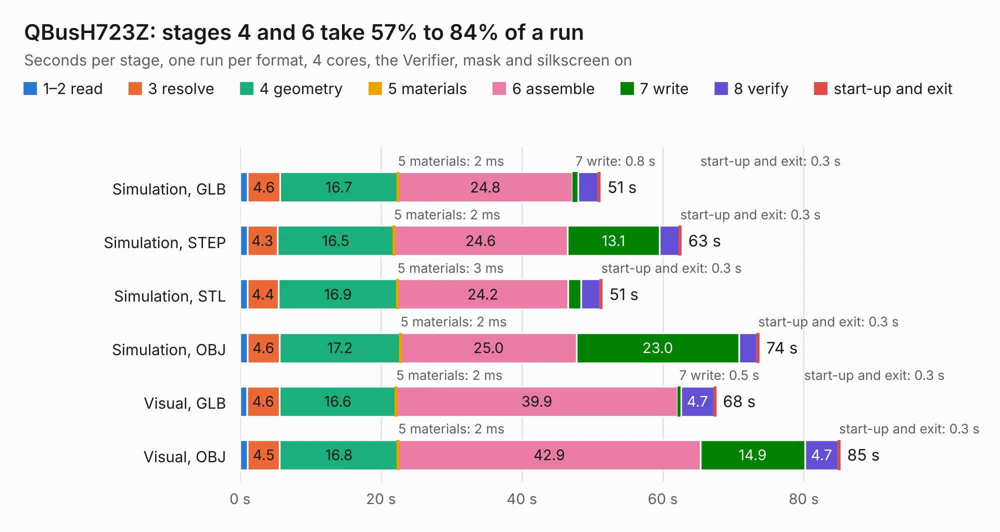

# 1410. QBusH723Z

Board 1,410 of the 3,117 of [Corpus Testing](../Corpus-Testing.md), on [Corpus Page 14](../CorpusTestingPages/Corpus-Testing-14.md#1410-qbush723z).

| Mode and format | 1–2 read | 3 resolve | 4 geometry | 5 materials | 6 assemble | 7 write | 8 verify | start-up and exit | Total |
|---|---:|---:|---:|---:|---:|---:|---:|---:|---:|
| Simulation, GLB | 1.1 | 4.6 | 16.7 | 2&nbsp;ms | 24.8 | 0.8 | 2.8 | 0.3 | 51.1 |
| Simulation, STEP | 1.0 | 4.3 | 16.5 | 2&nbsp;ms | 24.6 | 13.1 | 2.8 | 0.3 | 62.6 |
| Simulation, STL | 1.1 | 4.4 | 16.9 | 3&nbsp;ms | 24.2 | 1.8 | 2.7 | 0.3 | 51.4 |
| Simulation, OBJ | 1.0 | 4.6 | 17.2 | 2&nbsp;ms | 25.0 | 23.0 | 2.6 | 0.3 | 73.7 |
| Visual, GLB | 1.0 | 4.6 | 16.6 | 2&nbsp;ms | 39.9 | 0.5 | 4.7 | 0.3 | 67.5 |
| Visual, OBJ | 1.1 | 4.5 | 16.8 | 2&nbsp;ms | 42.9 | 14.9 | 4.7 | 0.3 | 85.1 |

<table align="center"><tr><td valign="top">

| Board | Repo: [jrengdahl/MSCP](https://github.com/jrengdahl/MSCP) Board: `QBusH723Z.kicad_pcb` |
|---|---|
| Folder | QBusH723Z-JLCPCB-0.1 |
| Complexity | 402&nbsp;/&nbsp;1000 (size&nbsp;277, features&nbsp;125) |
| KESE&nbsp;features | through vias, slotted holes, custom pads, rounded, trapezoid or chamfered pads, arc tracks, filled zones, copper drawings, stack-up, dielectric εr and tanδ |
| Tested | 9th November 2026 |
| Copper&nbsp;layers | 4 |
| File&nbsp;format | KiCad 8 (20240108) |
| Parts,&nbsp;tracks,&nbsp;vias | 213, 2,741, 719 |
| Triangles,&nbsp;simulation | 5,270,402 in 348 parts |
| Verifier | PASS in all six runs |

</td><td valign="top">

<table>
<tr><th>File type</th><th>File size</th><th>Peak memory used</th></tr>
<tr><th colspan="3" align="left">Simulation</th></tr>
<tr><td>GLB</td><td align="right">179&nbsp;MB</td><td align="right">1.7&nbsp;GB</td></tr>
<tr><td>STEP</td><td align="right">751&nbsp;MB</td><td align="right">2.0&nbsp;GB</td></tr>
<tr><td>STL</td><td align="right">264&nbsp;MB</td><td align="right">1.6&nbsp;GB</td></tr>
<tr><td>OBJ</td><td align="right">559&nbsp;MB</td><td align="right">3.3&nbsp;GB</td></tr>
<tr><th colspan="3" align="left">Visual</th></tr>
<tr><td>GLB</td><td align="right">119&nbsp;MB</td><td align="right">2.0&nbsp;GB</td></tr>
<tr><td>OBJ</td><td align="right">385&nbsp;MB</td><td align="right">2.4&nbsp;GB</td></tr>
</table>

</td></tr></table>

| Previous | Next |
|:---|---:|
| [1409. adapter](b1409b_jtcores_cores-wc-sch-adapter_adapter.md) | [1411. x65-sbc-revA1](b1411b_x65_x65-sbc-revA1.md) |
