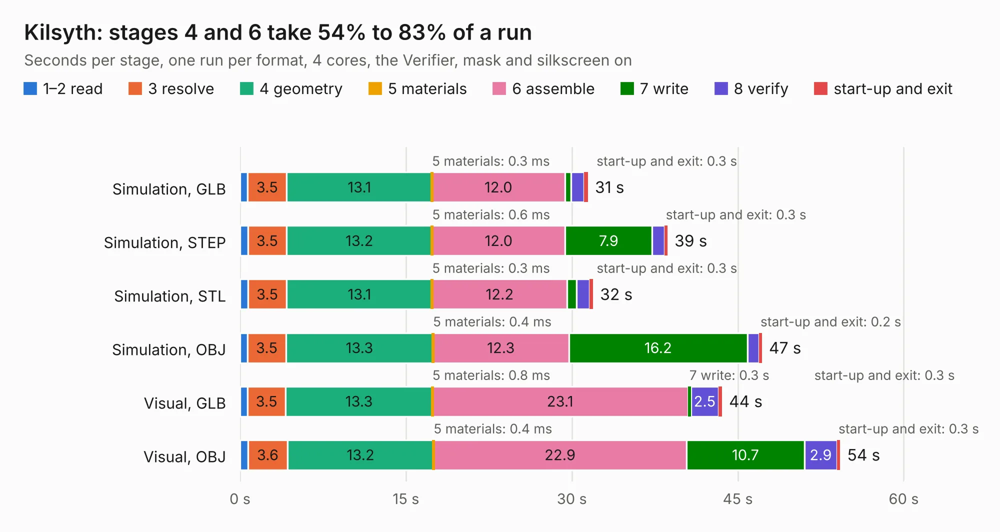

# 1411. Kilsyth

Board 1,411 of the 3,103 of [Corpus Testing](../Corpus-Testing.md), on [Corpus Page 14](../CorpusTestingPages/Corpus-Testing-14.md#1411-kilsyth).

| Mode and format | 1–2 read | 3 resolve | 4 geometry | 5 materials | 6 assemble | 7 write | 8 verify | start-up and exit | Total |
|---|---:|---:|---:|---:|---:|---:|---:|---:|---:|
| Simulation, GLB | 0.7 | 3.5 | 13.1 | 0.3&nbsp;ms | 12.0 | 0.6 | 1.2 | 0.3 | 31.4 |
| Simulation, STEP | 0.7 | 3.5 | 13.2 | 0.6&nbsp;ms | 12.0 | 7.9 | 1.1 | 0.3 | 38.6 |
| Simulation, STL | 0.7 | 3.5 | 13.1 | 0.3&nbsp;ms | 12.2 | 0.9 | 1.2 | 0.3 | 31.9 |
| Simulation, OBJ | 0.7 | 3.5 | 13.3 | 0.4&nbsp;ms | 12.3 | 16.2 | 1.1 | 0.2 | 47.2 |
| Visual, GLB | 0.7 | 3.5 | 13.3 | 0.8&nbsp;ms | 23.1 | 0.3 | 2.5 | 0.3 | 43.6 |
| Visual, OBJ | 0.7 | 3.6 | 13.2 | 0.4&nbsp;ms | 22.9 | 10.7 | 2.9 | 0.3 | 54.2 |

<table align="center"><tr><td valign="top">

| Board | Repo: [kbeckmann/Kilsyth](https://github.com/kbeckmann/Kilsyth) Board: `Kilsyth.kicad_pcb` |
|---|---|
| Folder | hardware / RevB |
| Complexity | 335&nbsp;/&nbsp;1000 (size&nbsp;270, features&nbsp;65) |
| KESE&nbsp;features | through vias, slotted holes, rounded, trapezoid or chamfered pads, filled zones, curved board outline |
| Tested | 9th November 2026 |
| Copper&nbsp;layers | 4 |
| File&nbsp;format | KiCad 5 (20171130) |
| Parts,&nbsp;tracks,&nbsp;vias | 145, 1,393, 378 |
| Triangles,&nbsp;simulation | 2,713,328 in 113 parts |
| Verifier | PASS in all six runs |

</td><td valign="top">

<table>
<tr><th>File type</th><th>File size</th><th>Peak memory used</th></tr>
<tr><th colspan="3" align="left">Simulation</th></tr>
<tr><td>GLB</td><td align="right">93&nbsp;MB</td><td align="right">871&nbsp;MB</td></tr>
<tr><td>STEP</td><td align="right">406&nbsp;MB</td><td align="right">1.2&nbsp;GB</td></tr>
<tr><td>STL</td><td align="right">136&nbsp;MB</td><td align="right">831&nbsp;MB</td></tr>
<tr><td>OBJ</td><td align="right">286&nbsp;MB</td><td align="right">1.8&nbsp;GB</td></tr>
<tr><th colspan="3" align="left">Visual</th></tr>
<tr><td>GLB</td><td align="right">60&nbsp;MB</td><td align="right">1.3&nbsp;GB</td></tr>
<tr><td>OBJ</td><td align="right">187&nbsp;MB</td><td align="right">1.3&nbsp;GB</td></tr>
</table>

</td></tr></table>

| Previous | Next |
|:---|---:|
| [1410. Kilsyth](b1410b_Kilsyth_hardware-RevA_Kilsyth.md) | [1412. usb-c-breakout](b1412b_Kilsyth_usb-c-breakout.md) |
