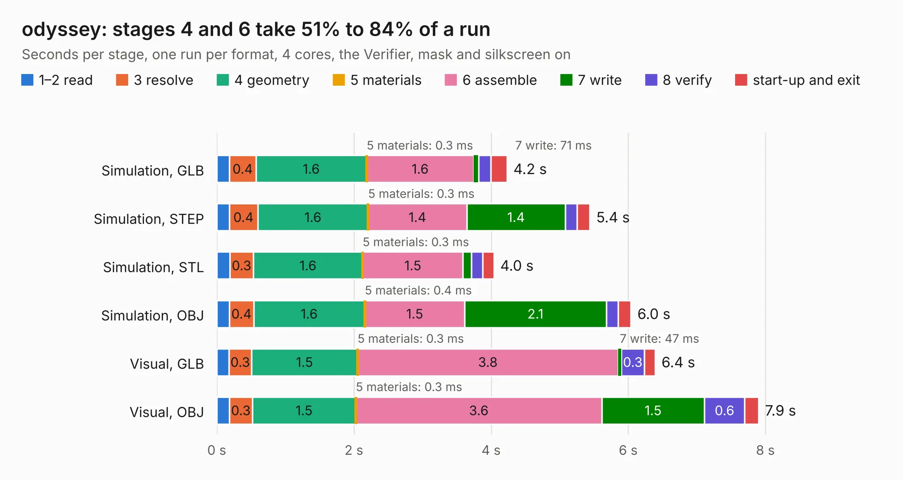

# 1413. odyssey

Board 1,413 of the 3,123 of [Corpus Testing](../Corpus-Testing.md), on [Corpus Page 14](../CorpusTestingPages/Corpus-Testing-14.md#1413-odyssey).

| Mode and format | 1–2 read | 3 resolve | 4 geometry | 5 materials | 6 assemble | 7 write | 8 verify | start-up and exit | Total |
|---|---:|---:|---:|---:|---:|---:|---:|---:|---:|
| Simulation, GLB | 0.2 | 0.4 | 1.6 | 0.3&nbsp;ms | 1.6 | 71&nbsp;ms | 0.2 | 0.2 | 4.2 |
| Simulation, STEP | 0.2 | 0.4 | 1.6 | 0.3&nbsp;ms | 1.4 | 1.4 | 0.2 | 0.2 | 5.4 |
| Simulation, STL | 0.2 | 0.3 | 1.6 | 0.3&nbsp;ms | 1.5 | 0.1 | 0.2 | 0.2 | 4.0 |
| Simulation, OBJ | 0.2 | 0.4 | 1.6 | 0.4&nbsp;ms | 1.5 | 2.1 | 0.2 | 0.2 | 6.0 |
| Visual, GLB | 0.2 | 0.3 | 1.5 | 0.3&nbsp;ms | 3.8 | 47&nbsp;ms | 0.3 | 0.2 | 6.4 |
| Visual, OBJ | 0.2 | 0.3 | 1.5 | 0.3&nbsp;ms | 3.6 | 1.5 | 0.6 | 0.2 | 7.9 |

<table align="center"><tr><td valign="top">

| Board | Repo: [jotego/jtcores](https://github.com/jotego/jtcores) Board: `odyssey.kicad_pcb` |
|---|---|
| Folder | cores / odyssey / sch |
| Complexity | 250&nbsp;/&nbsp;1000 (size&nbsp;175, features&nbsp;75) |
| KESE&nbsp;features | through vias, rounded, trapezoid or chamfered pads, filled zones, stack-up, dielectric εr and tanδ |
| Tested | 9th November 2026 |
| Copper&nbsp;layers | 2 |
| File&nbsp;format | KiCad 7 (20221018) |
| Parts,&nbsp;tracks,&nbsp;vias | 22, 1,140, 257 |
| Triangles,&nbsp;simulation | 486,536 in 107 parts |
| Verifier | PASS in all six runs |

</td><td valign="top">

<table>
<tr><th>File type</th><th>File size</th><th>Peak memory used</th></tr>
<tr><th colspan="3" align="left">Simulation</th></tr>
<tr><td>GLB</td><td align="right">16&nbsp;MB</td><td align="right">299&nbsp;MB</td></tr>
<tr><td>STEP</td><td align="right">66&nbsp;MB</td><td align="right">354&nbsp;MB</td></tr>
<tr><td>STL</td><td align="right">24&nbsp;MB</td><td align="right">298&nbsp;MB</td></tr>
<tr><td>OBJ</td><td align="right">50&nbsp;MB</td><td align="right">378&nbsp;MB</td></tr>
<tr><th colspan="3" align="left">Visual</th></tr>
<tr><td>GLB</td><td align="right">13&nbsp;MB</td><td align="right">450&nbsp;MB</td></tr>
<tr><td>OBJ</td><td align="right">40&nbsp;MB</td><td align="right">396&nbsp;MB</td></tr>
</table>

</td></tr></table>

| Previous | Next |
|:---|---:|
| [1412. adapter](b1412b_jtcores_cores-argus-sch-adapter_adapter.md) | [1414. adapter](b1414b_jtcores_cores-wc-sch-adapter_adapter.md) |
