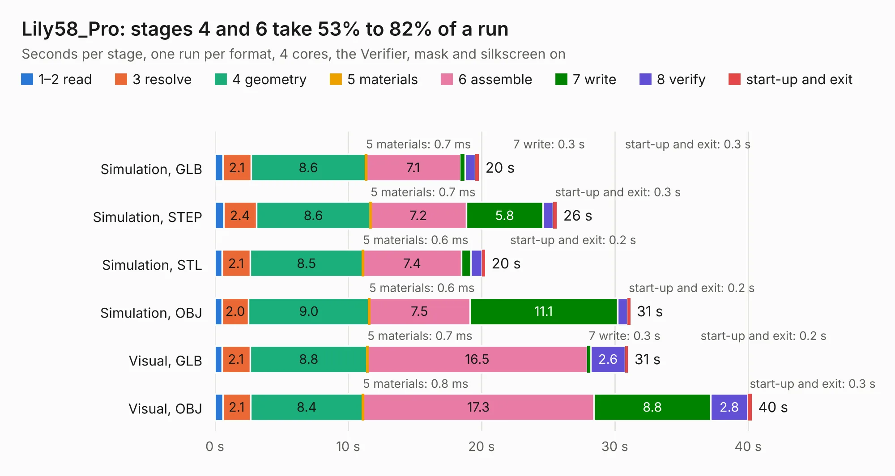

# 1414. Lily58_Pro

Board 1,414 of the 3,109 of [Corpus Testing](../Corpus-Testing.md), on [Corpus Page 14](../CorpusTestingPages/Corpus-Testing-14.md#1414-lily58_pro).

| Mode and format | 1–2 read | 3 resolve | 4 geometry | 5 materials | 6 assemble | 7 write | 8 verify | start-up and exit | Total |
|---|---:|---:|---:|---:|---:|---:|---:|---:|---:|
| Simulation, GLB | 0.6 | 2.1 | 8.6 | 0.7&nbsp;ms | 7.1 | 0.3 | 0.8 | 0.3 | 19.8 |
| Simulation, STEP | 0.7 | 2.4 | 8.6 | 0.7&nbsp;ms | 7.2 | 5.8 | 0.8 | 0.3 | 25.7 |
| Simulation, STL | 0.5 | 2.1 | 8.5 | 0.6&nbsp;ms | 7.4 | 0.7 | 0.8 | 0.2 | 20.3 |
| Simulation, OBJ | 0.5 | 2.0 | 9.0 | 0.6&nbsp;ms | 7.5 | 11.1 | 0.7 | 0.2 | 31.2 |
| Visual, GLB | 0.5 | 2.1 | 8.8 | 0.7&nbsp;ms | 16.5 | 0.3 | 2.6 | 0.2 | 31.0 |
| Visual, OBJ | 0.6 | 2.1 | 8.4 | 0.8&nbsp;ms | 17.3 | 8.8 | 2.8 | 0.3 | 40.3 |

<table align="center"><tr><td valign="top">

| Board | Repo: [kata0510/Lily58](https://github.com/kata0510/Lily58) Board: `Lily58_Pro.kicad_pcb` |
|---|---|
| Folder | Pro / PCB |
| Complexity | 234&nbsp;/&nbsp;1000 (size&nbsp;189, features&nbsp;45) |
| KESE&nbsp;features | through vias, slotted holes, filled zones |
| Tested | 9th November 2026 |
| Copper&nbsp;layers | 2 |
| File&nbsp;format | KiCad 5 (20171130) |
| Parts,&nbsp;tracks,&nbsp;vias | 74, 1,658, 149 |
| Triangles,&nbsp;simulation | 2,025,324 in 69 parts |
| Verifier | PASS in all six runs |

</td><td valign="top">

<table>
<tr><th>File type</th><th>File size</th><th>Peak memory used</th></tr>
<tr><th colspan="3" align="left">Simulation</th></tr>
<tr><td>GLB</td><td align="right">71&nbsp;MB</td><td align="right">888&nbsp;MB</td></tr>
<tr><td>STEP</td><td align="right">389&nbsp;MB</td><td align="right">912&nbsp;MB</td></tr>
<tr><td>STL</td><td align="right">101&nbsp;MB</td><td align="right">891&nbsp;MB</td></tr>
<tr><td>OBJ</td><td align="right">217&nbsp;MB</td><td align="right">1.4&nbsp;GB</td></tr>
<tr><th colspan="3" align="left">Visual</th></tr>
<tr><td>GLB</td><td align="right">57&nbsp;MB</td><td align="right">1.0&nbsp;GB</td></tr>
<tr><td>OBJ</td><td align="right">177&nbsp;MB</td><td align="right">1.3&nbsp;GB</td></tr>
</table>

</td></tr></table>

| Previous | Next |
|:---|---:|
| [1413. Lily58_Pro_TOP](b1413b_Lily58_Lily58-Pro-TOP.md) | [1415. Pro_V2](b1415b_Lily58_Pro-V2.md) |
