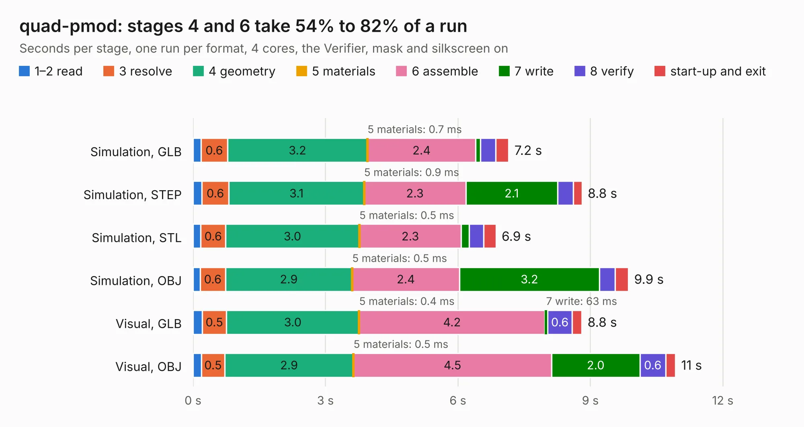

# 1414. quad-pmod

Board 1,414 of the 3,132 of [Corpus Testing](../Corpus-Testing.md), on [Corpus Page 14](../CorpusTestingPages/Corpus-Testing-14.md#1414-quad-pmod).

| Mode and format | 1–2 read | 3 resolve | 4 geometry | 5 materials | 6 assemble | 7 write | 8 verify | start-up and exit | Total |
|---|---:|---:|---:|---:|---:|---:|---:|---:|---:|
| Simulation, GLB | 0.2 | 0.6 | 3.2 | 0.7&nbsp;ms | 2.4 | 0.1 | 0.3 | 0.3 | 7.2 |
| Simulation, STEP | 0.2 | 0.6 | 3.1 | 0.9&nbsp;ms | 2.3 | 2.1 | 0.4 | 0.2 | 8.8 |
| Simulation, STL | 0.2 | 0.6 | 3.0 | 0.5&nbsp;ms | 2.3 | 0.2 | 0.3 | 0.3 | 6.9 |
| Simulation, OBJ | 0.2 | 0.6 | 2.9 | 0.5&nbsp;ms | 2.4 | 3.2 | 0.4 | 0.3 | 9.9 |
| Visual, GLB | 0.2 | 0.5 | 3.0 | 0.4&nbsp;ms | 4.2 | 63&nbsp;ms | 0.6 | 0.2 | 8.8 |
| Visual, OBJ | 0.2 | 0.5 | 2.9 | 0.5&nbsp;ms | 4.5 | 2.0 | 0.6 | 0.2 | 10.9 |

<table align="center"><tr><td valign="top">

| Board | Repo: [joshajohnson/ecp5-mini](https://github.com/joshajohnson/ecp5-mini) Board: `quad-pmod.kicad_pcb` |
|---|---|
| Folder | breakouts / quad-pmod-0.1 |
| Complexity | 219&nbsp;/&nbsp;1000 (size&nbsp;129, features&nbsp;90) |
| KESE&nbsp;features | rounded, trapezoid or chamfered pads, filled zones, curved board outline, stack-up, dielectric εr and tanδ, copper finish, mask and silkscreen colours |
| Tested | 9th November 2026 |
| Copper&nbsp;layers | 2 |
| File&nbsp;format | KiCad 6 (20201002) |
| Parts,&nbsp;tracks,&nbsp;vias | 8, 218, 0 |
| Triangles,&nbsp;simulation | 730,390 in 78 parts |
| Verifier | PASS in all six runs |

</td><td valign="top">

<table>
<tr><th>File type</th><th>File size</th><th>Peak memory used</th></tr>
<tr><th colspan="3" align="left">Simulation</th></tr>
<tr><td>GLB</td><td align="right">23&nbsp;MB</td><td align="right">336&nbsp;MB</td></tr>
<tr><td>STEP</td><td align="right">96&nbsp;MB</td><td align="right">414&nbsp;MB</td></tr>
<tr><td>STL</td><td align="right">37&nbsp;MB</td><td align="right">352&nbsp;MB</td></tr>
<tr><td>OBJ</td><td align="right">73&nbsp;MB</td><td align="right">517&nbsp;MB</td></tr>
<tr><th colspan="3" align="left">Visual</th></tr>
<tr><td>GLB</td><td align="right">14&nbsp;MB</td><td align="right">423&nbsp;MB</td></tr>
<tr><td>OBJ</td><td align="right">42&nbsp;MB</td><td align="right">421&nbsp;MB</td></tr>
</table>

</td></tr></table>

| Previous | Next |
|:---|---:|
| [1413. octa-pmod](b1413b_ecp5-mini_breakouts-octa-pmod-horizontal-0-2_octa-pmod.md) | [1415. quad-pmod](b1415b_ecp5-mini_breakouts-quad-pmod-0-2_quad-pmod.md) |
