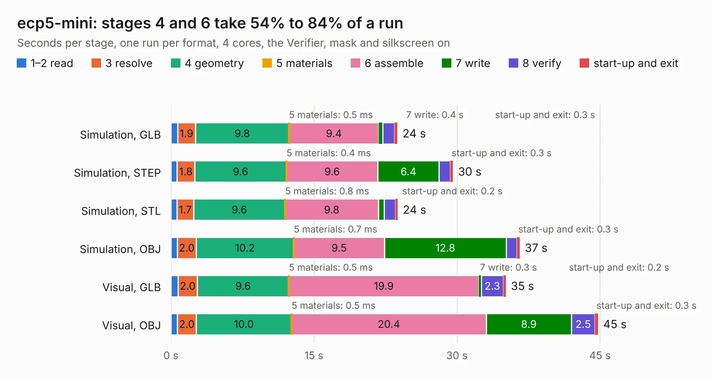

# 1414. ecp5-mini

Board 1,414 of the 3,129 of [Corpus Testing](../Corpus-Testing.md), on [Corpus Page 14](../CorpusTestingPages/Corpus-Testing-14.md#1414-ecp5-mini).

| Mode and format | 1–2 read | 3 resolve | 4 geometry | 5 materials | 6 assemble | 7 write | 8 verify | start-up and exit | Total |
|---|---:|---:|---:|---:|---:|---:|---:|---:|---:|
| Simulation, GLB | 0.7 | 1.9 | 9.8 | 0.5&nbsp;ms | 9.4 | 0.4 | 1.3 | 0.3 | 23.8 |
| Simulation, STEP | 0.7 | 1.8 | 9.6 | 0.4&nbsp;ms | 9.6 | 6.4 | 1.2 | 0.3 | 29.6 |
| Simulation, STL | 0.6 | 1.7 | 9.6 | 0.8&nbsp;ms | 9.8 | 0.6 | 1.2 | 0.2 | 23.8 |
| Simulation, OBJ | 0.7 | 2.0 | 10.2 | 0.7&nbsp;ms | 9.5 | 12.8 | 1.1 | 0.3 | 36.6 |
| Visual, GLB | 0.7 | 2.0 | 9.6 | 0.5&nbsp;ms | 19.9 | 0.3 | 2.3 | 0.2 | 35.1 |
| Visual, OBJ | 0.7 | 2.0 | 10.0 | 0.5&nbsp;ms | 20.4 | 8.9 | 2.5 | 0.3 | 44.8 |

<table align="center"><tr><td valign="top">

| Board | Repo: [joshajohnson/ecp5-mini](https://github.com/joshajohnson/ecp5-mini) Board: `ecp5-mini.kicad_pcb` |
|---|---|
| Folder | hardware / 0.2 |
| Complexity | 423&nbsp;/&nbsp;1000 (size&nbsp;273, features&nbsp;150) |
| KESE&nbsp;features | through vias, slotted holes, custom pads, rounded, trapezoid or chamfered pads, filled zones, copper drawings, copper text, curved board outline, stack-up, dielectric εr and tanδ, copper finish, mask and silkscreen colours |
| Tested | 9th November 2026 |
| Copper&nbsp;layers | 4 |
| File&nbsp;format | KiCad 6 (20210228) |
| Parts,&nbsp;tracks,&nbsp;vias | 102, 3,883, 210 |
| Triangles,&nbsp;simulation | 2,372,054 in 162 parts |
| Verifier | PASS in all six runs |

</td><td valign="top">

<table>
<tr><th>File type</th><th>File size</th><th>Peak memory used</th></tr>
<tr><th colspan="3" align="left">Simulation</th></tr>
<tr><td>GLB</td><td align="right">80&nbsp;MB</td><td align="right">999&nbsp;MB</td></tr>
<tr><td>STEP</td><td align="right">394&nbsp;MB</td><td align="right">984&nbsp;MB</td></tr>
<tr><td>STL</td><td align="right">119&nbsp;MB</td><td align="right">968&nbsp;MB</td></tr>
<tr><td>OBJ</td><td align="right">248&nbsp;MB</td><td align="right">1.6&nbsp;GB</td></tr>
<tr><th colspan="3" align="left">Visual</th></tr>
<tr><td>GLB</td><td align="right">53&nbsp;MB</td><td align="right">1.1&nbsp;GB</td></tr>
<tr><td>OBJ</td><td align="right">166&nbsp;MB</td><td align="right">1.2&nbsp;GB</td></tr>
</table>

</td></tr></table>

| Previous | Next |
|:---|---:|
| [1413. ecp5-mini](b1413b_ecp5-mini_hardware-0-1_ecp5-mini.md) | [1415. adapter](b1415b_jtcores_cores-argus-sch-adapter_adapter.md) |
