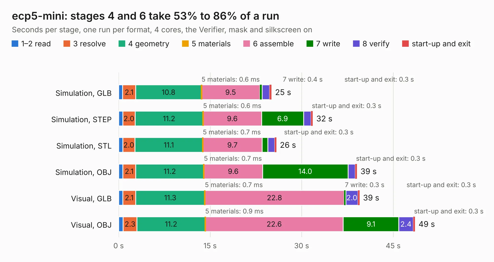

# 1415. ecp5-mini

Board 1,415 of the 3,131 of [Corpus Testing](../Corpus-Testing.md), on [Corpus Page 14](../CorpusTestingPages/Corpus-Testing-14.md#1415-ecp5-mini).

| Mode and format | 1–2 read | 3 resolve | 4 geometry | 5 materials | 6 assemble | 7 write | 8 verify | start-up and exit | Total |
|---|---:|---:|---:|---:|---:|---:|---:|---:|---:|
| Simulation, GLB | 0.7 | 2.1 | 10.8 | 0.6&nbsp;ms | 9.5 | 0.4 | 1.2 | 0.3 | 25.1 |
| Simulation, STEP | 0.7 | 2.0 | 11.2 | 0.6&nbsp;ms | 9.6 | 6.9 | 1.2 | 0.3 | 31.8 |
| Simulation, STL | 0.7 | 2.0 | 11.1 | 0.7&nbsp;ms | 9.7 | 0.9 | 1.2 | 0.3 | 25.9 |
| Simulation, OBJ | 0.7 | 2.1 | 11.2 | 0.7&nbsp;ms | 9.6 | 14.0 | 1.2 | 0.3 | 39.1 |
| Visual, GLB | 0.7 | 2.1 | 11.3 | 0.7&nbsp;ms | 22.8 | 0.3 | 2.0 | 0.3 | 39.5 |
| Visual, OBJ | 0.7 | 2.3 | 11.2 | 0.9&nbsp;ms | 22.6 | 9.1 | 2.4 | 0.3 | 48.6 |

<table align="center"><tr><td valign="top">

| Board | Repo: [joshajohnson/ecp5-mini](https://github.com/joshajohnson/ecp5-mini) Board: `ecp5-mini.kicad_pcb` |
|---|---|
| Folder | hardware / 0.1 |
| Complexity | 400&nbsp;/&nbsp;1000 (size&nbsp;275, features&nbsp;125) |
| KESE&nbsp;features | through vias, slotted holes, rounded, trapezoid or chamfered pads, filled zones, copper text, curved board outline, stack-up, dielectric εr and tanδ, copper finish, mask and silkscreen colours |
| Tested | 9th November 2026 |
| Copper&nbsp;layers | 4 |
| File&nbsp;format | KiCad 6 (20200909) |
| Parts,&nbsp;tracks,&nbsp;vias | 103, 4,312, 222 |
| Triangles,&nbsp;simulation | 2,419,314 in 263 parts |
| Verifier | PASS in all six runs |

</td><td valign="top">

<table>
<tr><th>File type</th><th>File size</th><th>Peak memory used</th></tr>
<tr><th colspan="3" align="left">Simulation</th></tr>
<tr><td>GLB</td><td align="right">81&nbsp;MB</td><td align="right">811&nbsp;MB</td></tr>
<tr><td>STEP</td><td align="right">377&nbsp;MB</td><td align="right">1.0&nbsp;GB</td></tr>
<tr><td>STL</td><td align="right">121&nbsp;MB</td><td align="right">828&nbsp;MB</td></tr>
<tr><td>OBJ</td><td align="right">252&nbsp;MB</td><td align="right">1.6&nbsp;GB</td></tr>
<tr><th colspan="3" align="left">Visual</th></tr>
<tr><td>GLB</td><td align="right">52&nbsp;MB</td><td align="right">1.2&nbsp;GB</td></tr>
<tr><td>OBJ</td><td align="right">163&nbsp;MB</td><td align="right">1.2&nbsp;GB</td></tr>
</table>

</td></tr></table>

| Previous | Next |
|:---|---:|
| [1414. quad-pmod](b1414b_ecp5-mini_breakouts-quad-pmod-0-2_quad-pmod.md) | [1416. ecp5-mini](b1416b_ecp5-mini_hardware-0-2_ecp5-mini.md) |
