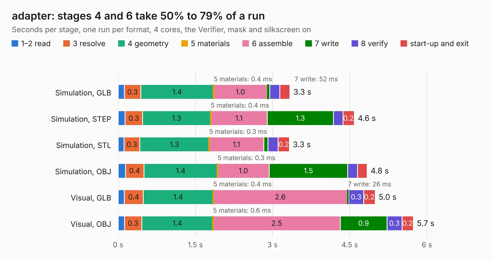

# 1416. adapter

Board 1,416 of the 3,128 of [Corpus Testing](../Corpus-Testing.md), on [Corpus Page 14](../CorpusTestingPages/Corpus-Testing-14.md#1416-adapter).

| Mode and format | 1–2 read | 3 resolve | 4 geometry | 5 materials | 6 assemble | 7 write | 8 verify | start-up and exit | Total |
|---|---:|---:|---:|---:|---:|---:|---:|---:|---:|
| Simulation, GLB | 0.1 | 0.3 | 1.4 | 0.4&nbsp;ms | 1.0 | 52&nbsp;ms | 0.2 | 0.2 | 3.3 |
| Simulation, STEP | 0.1 | 0.3 | 1.3 | 0.4&nbsp;ms | 1.1 | 1.3 | 0.2 | 0.2 | 4.6 |
| Simulation, STL | 0.1 | 0.3 | 1.3 | 0.3&nbsp;ms | 1.1 | 83&nbsp;ms | 0.2 | 0.2 | 3.3 |
| Simulation, OBJ | 0.1 | 0.4 | 1.4 | 0.3&nbsp;ms | 1.0 | 1.5 | 0.2 | 0.2 | 4.8 |
| Visual, GLB | 0.1 | 0.4 | 1.4 | 0.4&nbsp;ms | 2.6 | 26&nbsp;ms | 0.3 | 0.2 | 5.0 |
| Visual, OBJ | 0.1 | 0.3 | 1.4 | 0.6&nbsp;ms | 2.5 | 0.9 | 0.3 | 0.2 | 5.7 |

<table align="center"><tr><td valign="top">

| Board | Repo: [jotego/jtcores](https://github.com/jotego/jtcores) Board: `adapter.kicad_pcb` |
|---|---|
| Folder | cores / wc / sch / adapter |
| Complexity | 38&nbsp;/&nbsp;1000 (size&nbsp;38, features&nbsp;0) |
| Tested | 9th November 2026 |
| Copper&nbsp;layers | 2 |
| File&nbsp;format | KiCad 8 (20240108) |
| Parts,&nbsp;tracks,&nbsp;vias | 6, 0, 0 |
| Triangles,&nbsp;simulation | 308,694 in 123 parts |
| Verifier | PASS in all six runs |

</td><td valign="top">

<table>
<tr><th>File type</th><th>File size</th><th>Peak memory used</th></tr>
<tr><th colspan="3" align="left">Simulation</th></tr>
<tr><td>GLB</td><td align="right">9.9&nbsp;MB</td><td align="right">228&nbsp;MB</td></tr>
<tr><td>STEP</td><td align="right">32&nbsp;MB</td><td align="right">262&nbsp;MB</td></tr>
<tr><td>STL</td><td align="right">15&nbsp;MB</td><td align="right">228&nbsp;MB</td></tr>
<tr><td>OBJ</td><td align="right">31&nbsp;MB</td><td align="right">250&nbsp;MB</td></tr>
<tr><th colspan="3" align="left">Visual</th></tr>
<tr><td>GLB</td><td align="right">6.5&nbsp;MB</td><td align="right">275&nbsp;MB</td></tr>
<tr><td>OBJ</td><td align="right">19&nbsp;MB</td><td align="right">277&nbsp;MB</td></tr>
</table>

</td></tr></table>

| Previous | Next |
|:---|---:|
| [1415. odyssey](b1415b_jtcores_odyssey.md) | [1417. QBusH723Z](b1417b_MSCP_QBusH723Z.md) |
