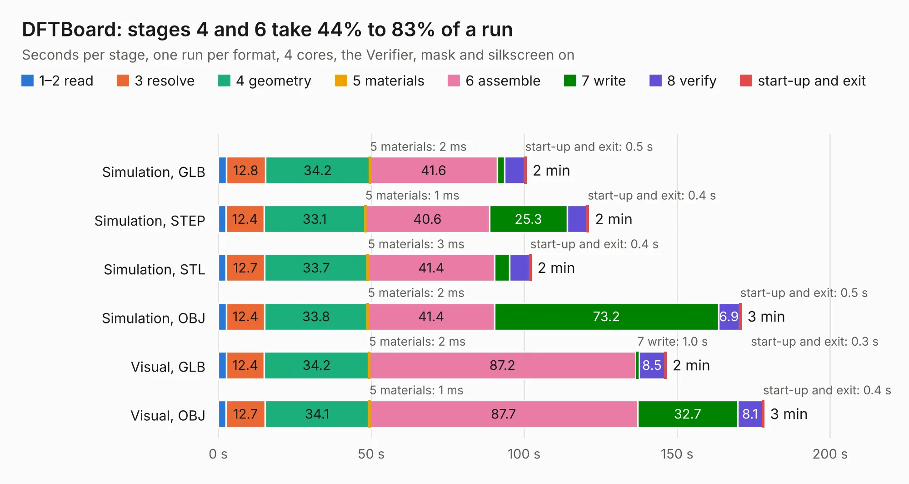

# 1416. DFTBoard

Board 1,416 of the 3,120 of [Corpus Testing](../Corpus-Testing.md), on [Corpus Page 14](../CorpusTestingPages/Corpus-Testing-14.md#1416-dftboard).

| Mode and format | 1–2 read | 3 resolve | 4 geometry | 5 materials | 6 assemble | 7 write | 8 verify | start-up and exit | Total |
|---|---:|---:|---:|---:|---:|---:|---:|---:|---:|
| Simulation, GLB | 2.6 | 12.8 | 34.2 | 2&nbsp;ms | 41.6 | 2.3 | 6.6 | 0.5 | 100.6 |
| Simulation, STEP | 2.5 | 12.4 | 33.1 | 1&nbsp;ms | 40.6 | 25.3 | 6.5 | 0.4 | 121.0 |
| Simulation, STL | 2.5 | 12.7 | 33.7 | 3&nbsp;ms | 41.4 | 4.9 | 6.5 | 0.4 | 102.2 |
| Simulation, OBJ | 2.7 | 12.4 | 33.8 | 2&nbsp;ms | 41.4 | 73.2 | 6.9 | 0.5 | 170.8 |
| Visual, GLB | 2.6 | 12.4 | 34.2 | 2&nbsp;ms | 87.2 | 1.0 | 8.5 | 0.3 | 146.4 |
| Visual, OBJ | 2.6 | 12.7 | 34.1 | 1&nbsp;ms | 87.7 | 32.7 | 8.1 | 0.4 | 178.2 |

<table align="center"><tr><td valign="top">

| Board | Repo: [julianfl0w/zynqpcb](https://github.com/julianfl0w/zynqpcb) Board: `DFTBoard.kicad_pcb` |
|---|---|
| Complexity | 395&nbsp;/&nbsp;1000 (size&nbsp;335, features&nbsp;60) |
| KESE&nbsp;features | through vias, custom pads, rounded, trapezoid or chamfered pads, filled zones |
| Tested | 9th November 2026 |
| Copper&nbsp;layers | 8 |
| File&nbsp;format | KiCad 5 (20171130) |
| Parts,&nbsp;tracks,&nbsp;vias | 295, 12,613, 964 |
| Triangles,&nbsp;simulation | 11,448,918 in 320 parts |
| Verifier | PASS in all six runs |

</td><td valign="top">

<table>
<tr><th>File type</th><th>File size</th><th>Peak memory used</th></tr>
<tr><th colspan="3" align="left">Simulation</th></tr>
<tr><td>GLB</td><td align="right">391&nbsp;MB</td><td align="right">2.4&nbsp;GB</td></tr>
<tr><td>STEP</td><td align="right">1.3&nbsp;GB</td><td align="right">3.3&nbsp;GB</td></tr>
<tr><td>STL</td><td align="right">572&nbsp;MB</td><td align="right">2.4&nbsp;GB</td></tr>
<tr><td>OBJ</td><td align="right">1.3&nbsp;GB</td><td align="right">7.2&nbsp;GB</td></tr>
<tr><th colspan="3" align="left">Visual</th></tr>
<tr><td>GLB</td><td align="right">179&nbsp;MB</td><td align="right">3.0&nbsp;GB</td></tr>
<tr><td>OBJ</td><td align="right">591&nbsp;MB</td><td align="right">3.8&nbsp;GB</td></tr>
</table>

</td></tr></table>

| Previous | Next |
|:---|---:|
| [1415. x65-sbc-revB1](b1415b_x65_x65-sbc-revB1.md) | [1417. PCB](b1417b_m-2-fpga-accelerator_PCB.md) |
