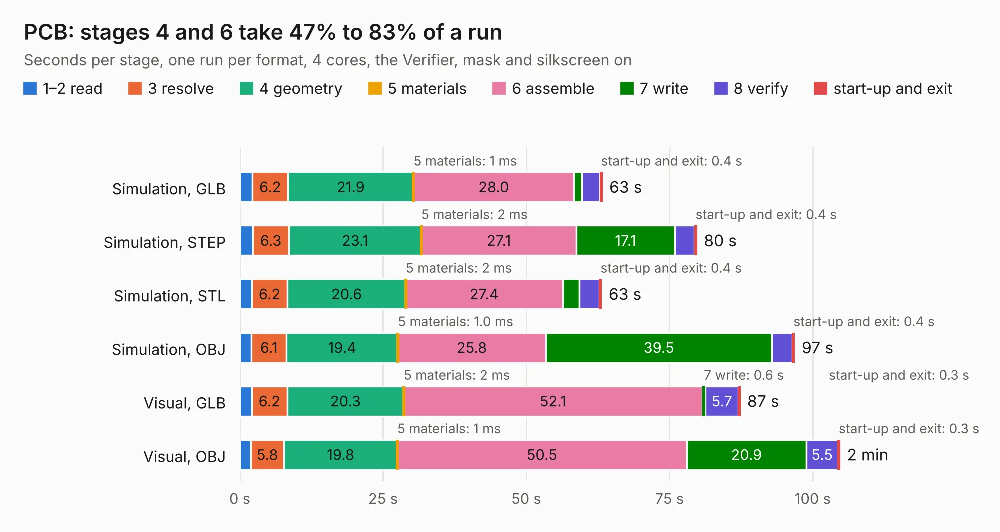

# 1417. PCB

Board 1,417 of the 3,121 of [Corpus Testing](../Corpus-Testing.md), on [Corpus Page 14](../CorpusTestingPages/Corpus-Testing-14.md#1417-pcb).

| Mode and format | 1–2 read | 3 resolve | 4 geometry | 5 materials | 6 assemble | 7 write | 8 verify | start-up and exit | Total |
|---|---:|---:|---:|---:|---:|---:|---:|---:|---:|
| Simulation, GLB | 2.2 | 6.2 | 21.9 | 1&nbsp;ms | 28.0 | 1.3 | 3.2 | 0.4 | 63.3 |
| Simulation, STEP | 2.3 | 6.3 | 23.1 | 2&nbsp;ms | 27.1 | 17.1 | 3.5 | 0.4 | 79.8 |
| Simulation, STL | 2.1 | 6.2 | 20.6 | 2&nbsp;ms | 27.4 | 2.9 | 3.6 | 0.4 | 63.1 |
| Simulation, OBJ | 2.0 | 6.1 | 19.4 | 1.0&nbsp;ms | 25.8 | 39.5 | 3.6 | 0.4 | 96.8 |
| Visual, GLB | 2.1 | 6.2 | 20.3 | 2&nbsp;ms | 52.1 | 0.6 | 5.7 | 0.3 | 87.3 |
| Visual, OBJ | 1.9 | 5.8 | 19.8 | 1&nbsp;ms | 50.5 | 20.9 | 5.5 | 0.3 | 104.7 |

<table align="center"><tr><td valign="top">

| Board | Repo: [kaipereira/m.2-fpga-accelerator](https://github.com/kaipereira/m.2-fpga-accelerator) Board: `PCB.kicad_pcb` |
|---|---|
| Folder | PCB |
| Complexity | 414&nbsp;/&nbsp;1000 (size&nbsp;314, features&nbsp;100) |
| KESE&nbsp;features | through vias, slotted holes, rounded, trapezoid or chamfered pads, arc tracks, filled zones, stack-up, dielectric εr and tanδ |
| Tested | 9th November 2026 |
| Copper&nbsp;layers | 6 |
| File&nbsp;format | KiCad 10 (20260206) |
| Parts,&nbsp;tracks,&nbsp;vias | 277, 6,345, 829 |
| Triangles,&nbsp;simulation | 6,455,524 in 441 parts |
| Verifier | PASS in all six runs |

</td><td valign="top">

<table>
<tr><th>File type</th><th>File size</th><th>Peak memory used</th></tr>
<tr><th colspan="3" align="left">Simulation</th></tr>
<tr><td>GLB</td><td align="right">217&nbsp;MB</td><td align="right">1.9&nbsp;GB</td></tr>
<tr><td>STEP</td><td align="right">936&nbsp;MB</td><td align="right">2.5&nbsp;GB</td></tr>
<tr><td>STL</td><td align="right">323&nbsp;MB</td><td align="right">1.9&nbsp;GB</td></tr>
<tr><td>OBJ</td><td align="right">685&nbsp;MB</td><td align="right">4.1&nbsp;GB</td></tr>
<tr><th colspan="3" align="left">Visual</th></tr>
<tr><td>GLB</td><td align="right">122&nbsp;MB</td><td align="right">2.1&nbsp;GB</td></tr>
<tr><td>OBJ</td><td align="right">396&nbsp;MB</td><td align="right">2.6&nbsp;GB</td></tr>
</table>

</td></tr></table>

| Previous | Next |
|:---|---:|
| [1416. DFTBoard](b1416b_zynqpcb_DFTBoard.md) | [1418. ZYNQ7020_AD9364_V2](b1418b_zynq7010-7020-ad9363_ZYNQ7020-AD9364-V2.md) |
