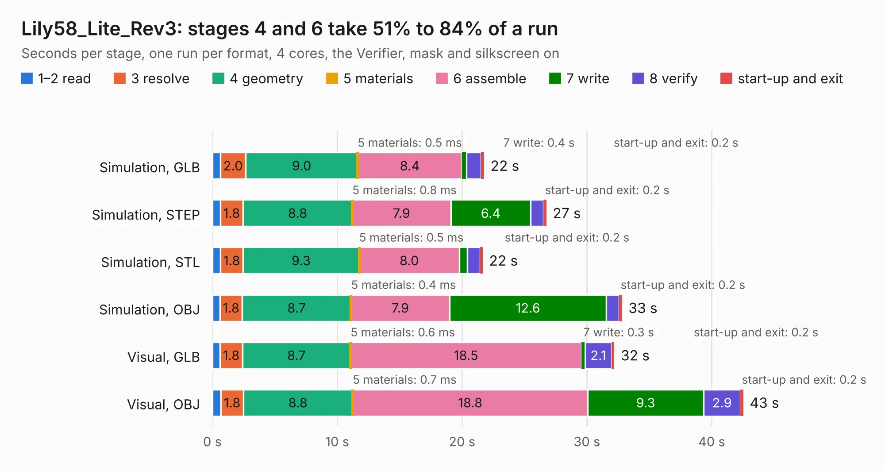

# 1419. Lily58_Lite_Rev3

Board 1,419 of the 3,119 of [Corpus Testing](../Corpus-Testing.md), on [Corpus Page 14](../CorpusTestingPages/Corpus-Testing-14.md#1419-lily58_lite_rev3).

| Mode and format | 1–2 read | 3 resolve | 4 geometry | 5 materials | 6 assemble | 7 write | 8 verify | start-up and exit | Total |
|---|---:|---:|---:|---:|---:|---:|---:|---:|---:|
| Simulation, GLB | 0.6 | 2.0 | 9.0 | 0.5&nbsp;ms | 8.4 | 0.4 | 1.2 | 0.2 | 21.8 |
| Simulation, STEP | 0.6 | 1.8 | 8.8 | 0.8&nbsp;ms | 7.9 | 6.4 | 1.0 | 0.2 | 26.8 |
| Simulation, STL | 0.6 | 1.8 | 9.3 | 0.5&nbsp;ms | 8.0 | 0.6 | 1.0 | 0.2 | 21.7 |
| Simulation, OBJ | 0.6 | 1.8 | 8.7 | 0.4&nbsp;ms | 7.9 | 12.6 | 1.0 | 0.2 | 32.8 |
| Visual, GLB | 0.6 | 1.8 | 8.7 | 0.6&nbsp;ms | 18.5 | 0.3 | 2.1 | 0.2 | 32.2 |
| Visual, OBJ | 0.7 | 1.8 | 8.8 | 0.7&nbsp;ms | 18.8 | 9.3 | 2.9 | 0.2 | 42.5 |

<table align="center"><tr><td valign="top">

| Board | Repo: [kata0510/Lily58](https://github.com/kata0510/Lily58) Board: `Lily58_Lite_Rev3.kicad_pcb` |
|---|---|
| Folder | Lite_Rev3 |
| Complexity | 240&nbsp;/&nbsp;1000 (size&nbsp;175, features&nbsp;65) |
| KESE&nbsp;features | through vias, slotted holes, rounded, trapezoid or chamfered pads, filled zones, curved board outline |
| Tested | 9th November 2026 |
| Copper&nbsp;layers | 2 |
| File&nbsp;format | KiCad 8 (20240108) |
| Parts,&nbsp;tracks,&nbsp;vias | 102, 637, 29 |
| Triangles,&nbsp;simulation | 2,400,690 in 116 parts |
| Verifier | PASS in all six runs |

</td><td valign="top">

<table>
<tr><th>File type</th><th>File size</th><th>Peak memory used</th></tr>
<tr><th colspan="3" align="left">Simulation</th></tr>
<tr><td>GLB</td><td align="right">81&nbsp;MB</td><td align="right">951&nbsp;MB</td></tr>
<tr><td>STEP</td><td align="right">336&nbsp;MB</td><td align="right">1.0&nbsp;GB</td></tr>
<tr><td>STL</td><td align="right">120&nbsp;MB</td><td align="right">987&nbsp;MB</td></tr>
<tr><td>OBJ</td><td align="right">250&nbsp;MB</td><td align="right">1.5&nbsp;GB</td></tr>
<tr><th colspan="3" align="left">Visual</th></tr>
<tr><td>GLB</td><td align="right">60&nbsp;MB</td><td align="right">1.4&nbsp;GB</td></tr>
<tr><td>OBJ</td><td align="right">184&nbsp;MB</td><td align="right">1.3&nbsp;GB</td></tr>
</table>

</td></tr></table>

| Previous | Next |
|:---|---:|
| [1418. Lily58_Lite_Rev3_TOP_Case](b1418b_Lily58_Lily58-Lite-Rev3-TOP-Case.md) | [1420. Lily58](b1420b_Lily58_Lily58.md) |
