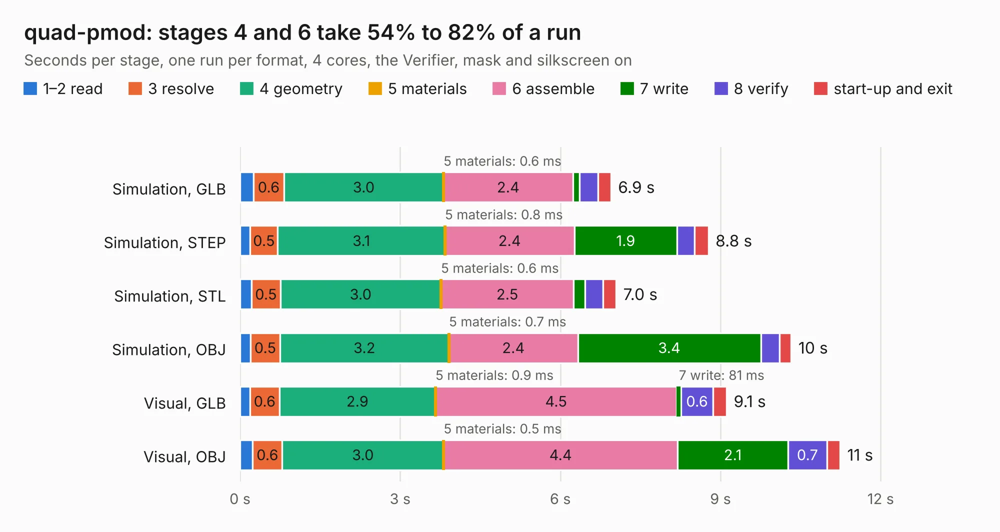

# 1419. quad-pmod

Board 1,419 of the 3,139 of [Corpus Testing](../Corpus-Testing.md), on [Corpus Page 14](../CorpusTestingPages/Corpus-Testing-14.md#1419-quad-pmod).

| Mode and format | 1–2 read | 3 resolve | 4 geometry | 5 materials | 6 assemble | 7 write | 8 verify | start-up and exit | Total |
|---|---:|---:|---:|---:|---:|---:|---:|---:|---:|
| Simulation, GLB | 0.3 | 0.6 | 3.0 | 0.6&nbsp;ms | 2.4 | 0.1 | 0.3 | 0.2 | 6.9 |
| Simulation, STEP | 0.2 | 0.5 | 3.1 | 0.8&nbsp;ms | 2.4 | 1.9 | 0.3 | 0.3 | 8.8 |
| Simulation, STL | 0.2 | 0.5 | 3.0 | 0.6&nbsp;ms | 2.5 | 0.2 | 0.3 | 0.2 | 7.0 |
| Simulation, OBJ | 0.2 | 0.5 | 3.2 | 0.7&nbsp;ms | 2.4 | 3.4 | 0.4 | 0.2 | 10.3 |
| Visual, GLB | 0.2 | 0.6 | 2.9 | 0.9&nbsp;ms | 4.5 | 81&nbsp;ms | 0.6 | 0.3 | 9.1 |
| Visual, OBJ | 0.2 | 0.6 | 3.0 | 0.5&nbsp;ms | 4.4 | 2.1 | 0.7 | 0.2 | 11.2 |

<table align="center"><tr><td valign="top">

| Board | Repo: [joshajohnson/ecp5-mini](https://github.com/joshajohnson/ecp5-mini) Board: `quad-pmod.kicad_pcb` |
|---|---|
| Folder | breakouts / quad-pmod-0.2 |
| Complexity | 224&nbsp;/&nbsp;1000 (size&nbsp;134, features&nbsp;90) |
| KESE&nbsp;features | rounded, trapezoid or chamfered pads, filled zones, curved board outline, stack-up, dielectric εr and tanδ, copper finish, mask and silkscreen colours |
| Tested | 9th November 2026 |
| Copper&nbsp;layers | 2 |
| File&nbsp;format | KiCad 6 (20201220) |
| Parts,&nbsp;tracks,&nbsp;vias | 8, 303, 0 |
| Triangles,&nbsp;simulation | 758,724 in 47 parts |
| Verifier | PASS in all six runs |

</td><td valign="top">

<table>
<tr><th>File type</th><th>File size</th><th>Peak memory used</th></tr>
<tr><th colspan="3" align="left">Simulation</th></tr>
<tr><td>GLB</td><td align="right">25&nbsp;MB</td><td align="right">352&nbsp;MB</td></tr>
<tr><td>STEP</td><td align="right">104&nbsp;MB</td><td align="right">422&nbsp;MB</td></tr>
<tr><td>STL</td><td align="right">38&nbsp;MB</td><td align="right">345&nbsp;MB</td></tr>
<tr><td>OBJ</td><td align="right">76&nbsp;MB</td><td align="right">539&nbsp;MB</td></tr>
<tr><th colspan="3" align="left">Visual</th></tr>
<tr><td>GLB</td><td align="right">15&nbsp;MB</td><td align="right">433&nbsp;MB</td></tr>
<tr><td>OBJ</td><td align="right">44&nbsp;MB</td><td align="right">434&nbsp;MB</td></tr>
</table>

</td></tr></table>

| Previous | Next |
|:---|---:|
| [1418. quad-pmod](b1418b_ecp5-mini_breakouts-quad-pmod-0-1_quad-pmod.md) | [1420. ecp5-mini](b1420b_ecp5-mini_hardware-0-1_ecp5-mini.md) |
