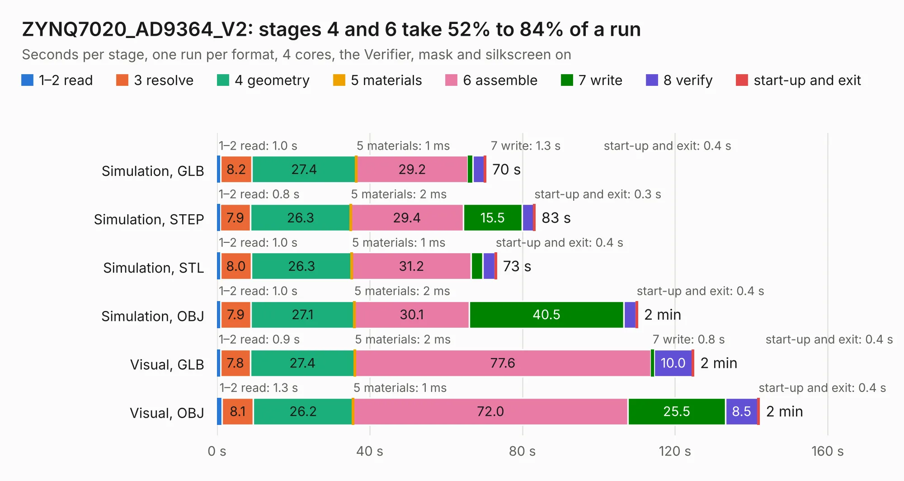

# 1419. ZYNQ7020_AD9364_V2

Board 1,419 of the 3,122 of [Corpus Testing](../Corpus-Testing.md), on [Corpus Page 14](../CorpusTestingPages/Corpus-Testing-14.md#1419-zynq7020_ad9364_v2).

| Mode and format | 1–2 read | 3 resolve | 4 geometry | 5 materials | 6 assemble | 7 write | 8 verify | start-up and exit | Total |
|---|---:|---:|---:|---:|---:|---:|---:|---:|---:|
| Simulation, GLB | 1.0 | 8.2 | 27.4 | 1&nbsp;ms | 29.2 | 1.3 | 3.0 | 0.4 | 70.4 |
| Simulation, STEP | 0.8 | 7.9 | 26.3 | 2&nbsp;ms | 29.4 | 15.5 | 3.0 | 0.3 | 83.3 |
| Simulation, STL | 1.0 | 8.0 | 26.3 | 1&nbsp;ms | 31.2 | 3.1 | 3.2 | 0.4 | 73.2 |
| Simulation, OBJ | 1.0 | 7.9 | 27.1 | 2&nbsp;ms | 30.1 | 40.5 | 3.2 | 0.4 | 110.2 |
| Visual, GLB | 0.9 | 7.8 | 27.4 | 2&nbsp;ms | 77.6 | 0.8 | 10.0 | 0.4 | 124.9 |
| Visual, OBJ | 1.3 | 8.1 | 26.2 | 1&nbsp;ms | 72.0 | 25.5 | 8.5 | 0.4 | 142.1 |

<table align="center"><tr><td valign="top">

| Board | Repo: [kangyuzhe666/zynq7010-7020_ad9363](https://github.com/kangyuzhe666/zynq7010-7020_ad9363) Board: `ZYNQ7020_AD9364_V2.kicad_pcb` |
|---|---|
| Folder | kicad |
| Complexity | 318&nbsp;/&nbsp;1000 (size&nbsp;248, features&nbsp;70) |
| KESE&nbsp;features | through vias, slotted holes, drill offsets, arc tracks, copper drawings, curved board outline |
| Tested | 9th November 2026 |
| Copper&nbsp;layers | 4 |
| File&nbsp;format | KiCad 6 (20201116) |
| Parts,&nbsp;tracks,&nbsp;vias | 287, 6,546, 1,628 |
| Triangles,&nbsp;simulation | 7,777,178 in 292 parts |
| Verifier | PASS in all six runs |

</td><td valign="top">

<table>
<tr><th>File type</th><th>File size</th><th>Peak memory used</th></tr>
<tr><th colspan="3" align="left">Simulation</th></tr>
<tr><td>GLB</td><td align="right">264&nbsp;MB</td><td align="right">1.9&nbsp;GB</td></tr>
<tr><td>STEP</td><td align="right">929&nbsp;MB</td><td align="right">2.8&nbsp;GB</td></tr>
<tr><td>STL</td><td align="right">389&nbsp;MB</td><td align="right">2.0&nbsp;GB</td></tr>
<tr><td>OBJ</td><td align="right">829&nbsp;MB</td><td align="right">4.8&nbsp;GB</td></tr>
<tr><th colspan="3" align="left">Visual</th></tr>
<tr><td>GLB</td><td align="right">176&nbsp;MB</td><td align="right">2.8&nbsp;GB</td></tr>
<tr><td>OBJ</td><td align="right">574&nbsp;MB</td><td align="right">3.6&nbsp;GB</td></tr>
</table>

</td></tr></table>

| Previous | Next |
|:---|---:|
| [1418. PCB](b1418b_m-2-fpga-accelerator_PCB.md) | [1420. Lily58_Lite_Rev3_TOP_Case](b1420b_Lily58_Lily58-Lite-Rev3-TOP-Case.md) |
