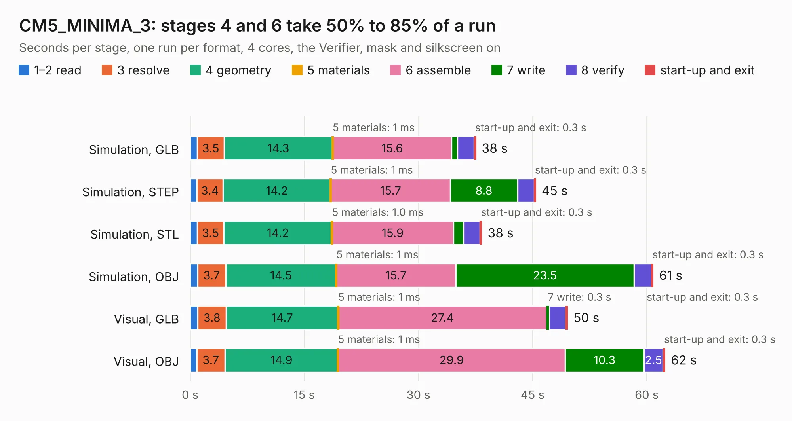

# 1420. CM5_MINIMA_3

Board 1,420 of the 3,105 of [Corpus Testing](../Corpus-Testing.md), on [Corpus Page 14](../CorpusTestingPages/Corpus-Testing-14.md#1420-cm5_minima_3).

| Mode and format | 1–2 read | 3 resolve | 4 geometry | 5 materials | 6 assemble | 7 write | 8 verify | start-up and exit | Total |
|---|---:|---:|---:|---:|---:|---:|---:|---:|---:|
| Simulation, GLB | 0.9 | 3.5 | 14.3 | 1&nbsp;ms | 15.6 | 0.8 | 2.2 | 0.3 | 37.6 |
| Simulation, STEP | 0.9 | 3.4 | 14.2 | 1&nbsp;ms | 15.7 | 8.8 | 2.2 | 0.3 | 45.4 |
| Simulation, STL | 0.9 | 3.5 | 14.2 | 1.0&nbsp;ms | 15.9 | 1.3 | 2.2 | 0.3 | 38.4 |
| Simulation, OBJ | 1.0 | 3.7 | 14.5 | 1&nbsp;ms | 15.7 | 23.5 | 2.2 | 0.3 | 60.9 |
| Visual, GLB | 1.0 | 3.8 | 14.7 | 1&nbsp;ms | 27.4 | 0.3 | 2.2 | 0.3 | 49.6 |
| Visual, OBJ | 0.9 | 3.7 | 14.9 | 1&nbsp;ms | 29.9 | 10.3 | 2.5 | 0.3 | 62.4 |

<table align="center"><tr><td valign="top">

| Board | Repo: [KiCad/kicad-source-mirror](https://github.com/KiCad/kicad-source-mirror) Board: `CM5_MINIMA_3.kicad_pcb` |
|---|---|
| Folder | demos / cm5_minima |
| Complexity | 348&nbsp;/&nbsp;1000 (size&nbsp;223, features&nbsp;125) |
| KESE&nbsp;features | through vias, slotted holes, rounded, trapezoid or chamfered pads, arc tracks, filled zones, curved board outline, stack-up, dielectric εr and tanδ, copper finish |
| Tested | 9th November 2026 |
| Copper&nbsp;layers | 6 |
| File&nbsp;format | KiCad 10 (20250513) |
| Parts,&nbsp;tracks,&nbsp;vias | 72, 2,084, 444 |
| Triangles,&nbsp;simulation | 4,184,934 in 236 parts |
| Verifier | PASS in all six runs |

</td><td valign="top">

<table>
<tr><th>File type</th><th>File size</th><th>Peak memory used</th></tr>
<tr><th colspan="3" align="left">Simulation</th></tr>
<tr><td>GLB</td><td align="right">143&nbsp;MB</td><td align="right">1.3&nbsp;GB</td></tr>
<tr><td>STEP</td><td align="right">541&nbsp;MB</td><td align="right">1.5&nbsp;GB</td></tr>
<tr><td>STL</td><td align="right">209&nbsp;MB</td><td align="right">1.1&nbsp;GB</td></tr>
<tr><td>OBJ</td><td align="right">451&nbsp;MB</td><td align="right">2.7&nbsp;GB</td></tr>
<tr><th colspan="3" align="left">Visual</th></tr>
<tr><td>GLB</td><td align="right">67&nbsp;MB</td><td align="right">1.3&nbsp;GB</td></tr>
<tr><td>OBJ</td><td align="right">211&nbsp;MB</td><td align="right">1.4&nbsp;GB</td></tr>
</table>

</td></tr></table>

| Previous | Next |
|:---|---:|
| [1419. tobo](b1419b_echomods_tobo.md) | [1421. complex_hierarchy](b1421b_kicad-source-mirror_complex-hierarchy.md) |
