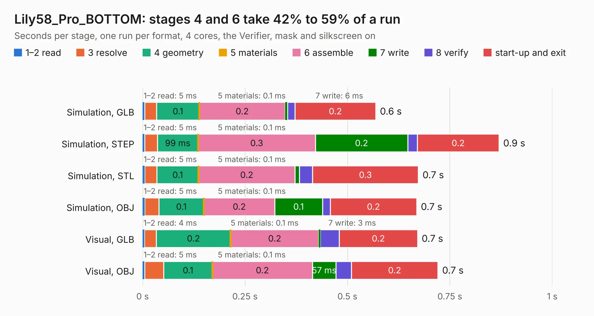

# 1425. Lily58_Pro_BOTTOM

Board 1,425 of the 3,125 of [Corpus Testing](../Corpus-Testing.md), on [Corpus Page 14](../CorpusTestingPages/Corpus-Testing-14.md#1425-lily58_pro_bottom).

| Mode and format | 1–2 read | 3 resolve | 4 geometry | 5 materials | 6 assemble | 7 write | 8 verify | start-up and exit | Total |
|---|---:|---:|---:|---:|---:|---:|---:|---:|---:|
| Simulation, GLB | 5&nbsp;ms | 29&nbsp;ms | 0.1 | 0.1&nbsp;ms | 0.2 | 6&nbsp;ms | 19&nbsp;ms | 0.2 | 0.6 |
| Simulation, STEP | 5&nbsp;ms | 31&nbsp;ms | 99&nbsp;ms | 0.1&nbsp;ms | 0.3 | 0.2 | 23&nbsp;ms | 0.2 | 0.9 |
| Simulation, STL | 5&nbsp;ms | 30&nbsp;ms | 0.1 | 0.1&nbsp;ms | 0.2 | 11&nbsp;ms | 32&nbsp;ms | 0.3 | 0.7 |
| Simulation, OBJ | 5&nbsp;ms | 35&nbsp;ms | 0.1 | 0.1&nbsp;ms | 0.2 | 0.1 | 19&nbsp;ms | 0.2 | 0.7 |
| Visual, GLB | 4&nbsp;ms | 30&nbsp;ms | 0.2 | 0.1&nbsp;ms | 0.2 | 3&nbsp;ms | 47&nbsp;ms | 0.2 | 0.7 |
| Visual, OBJ | 5&nbsp;ms | 47&nbsp;ms | 0.1 | 0.1&nbsp;ms | 0.2 | 57&nbsp;ms | 38&nbsp;ms | 0.2 | 0.7 |

<table align="center"><tr><td valign="top">

| Board | Repo: [kata0510/Lily58](https://github.com/kata0510/Lily58) Board: `Lily58_Pro_BOTTOM.kicad_pcb` |
|---|---|
| Folder | Pro / Case |
| Complexity | 17&nbsp;/&nbsp;1000 (size&nbsp;17, features&nbsp;0) |
| Tested | 9th November 2026 |
| Copper&nbsp;layers | 2 |
| File&nbsp;format | KiCad 5 (20171130) |
| Parts,&nbsp;tracks,&nbsp;vias | 0, 0, 0 |
| Triangles,&nbsp;simulation | 32,200 in 10 parts |
| Note | no components |
| Verifier | PASS in all six runs |

</td><td valign="top">

<table>
<tr><th>File type</th><th>File size</th><th>Peak memory used</th></tr>
<tr><th colspan="3" align="left">Simulation</th></tr>
<tr><td>GLB</td><td align="right">1.0&nbsp;MB</td><td align="right">43&nbsp;MB</td></tr>
<tr><td>STEP</td><td align="right">4.5&nbsp;MB</td><td align="right">46&nbsp;MB</td></tr>
<tr><td>STL</td><td align="right">1.6&nbsp;MB</td><td align="right">45&nbsp;MB</td></tr>
<tr><td>OBJ</td><td align="right">2.9&nbsp;MB</td><td align="right">51&nbsp;MB</td></tr>
<tr><th colspan="3" align="left">Visual</th></tr>
<tr><td>GLB</td><td align="right">447&nbsp;kB</td><td align="right">61&nbsp;MB</td></tr>
<tr><td>OBJ</td><td align="right">1.2&nbsp;MB</td><td align="right">70&nbsp;MB</td></tr>
</table>

</td></tr></table>

| Previous | Next |
|:---|---:|
| [1424. Lily58](b1424b_Lily58_Lily58.md) | [1426. Lily58_Pro_TOP](b1426b_Lily58_Lily58-Pro-TOP.md) |
