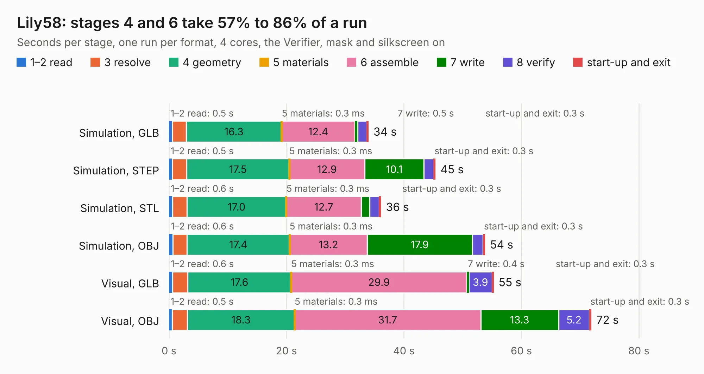

# 1426. Lily58

Board 1,426 of the 3,129 of [Corpus Testing](../Corpus-Testing.md), on [Corpus Page 14](../CorpusTestingPages/Corpus-Testing-14.md#1426-lily58).

| Mode and format | 1–2 read | 3 resolve | 4 geometry | 5 materials | 6 assemble | 7 write | 8 verify | start-up and exit | Total |
|---|---:|---:|---:|---:|---:|---:|---:|---:|---:|
| Simulation, GLB | 0.5 | 2.4 | 16.3 | 0.3&nbsp;ms | 12.4 | 0.5 | 1.6 | 0.3 | 34.0 |
| Simulation, STEP | 0.5 | 2.5 | 17.5 | 0.3&nbsp;ms | 12.9 | 10.1 | 1.7 | 0.3 | 45.4 |
| Simulation, STL | 0.6 | 2.4 | 17.0 | 0.3&nbsp;ms | 12.7 | 1.4 | 1.6 | 0.3 | 36.1 |
| Simulation, OBJ | 0.6 | 2.4 | 17.4 | 0.3&nbsp;ms | 13.2 | 17.9 | 1.8 | 0.3 | 53.8 |
| Visual, GLB | 0.6 | 2.6 | 17.6 | 0.3&nbsp;ms | 29.9 | 0.4 | 3.9 | 0.3 | 55.3 |
| Visual, OBJ | 0.5 | 2.6 | 18.3 | 0.3&nbsp;ms | 31.7 | 13.3 | 5.2 | 0.3 | 71.9 |

<table align="center"><tr><td valign="top">

| Board | Repo: [kata0510/Lily58](https://github.com/kata0510/Lily58) Board: `Lily58.kicad_pcb` |
|---|---|
| Folder | pcb |
| Complexity | 223&nbsp;/&nbsp;1000 (size&nbsp;178, features&nbsp;45) |
| KESE&nbsp;features | through vias, slotted holes, filled zones |
| Tested | 9th November 2026 |
| Copper&nbsp;layers | 2 |
| File&nbsp;format | KiCad 5 (20171130) |
| Parts,&nbsp;tracks,&nbsp;vias | 75, 991, 28 |
| Triangles,&nbsp;simulation | 2,925,400 in 69 parts |
| Verifier | PASS in all six runs |

</td><td valign="top">

<table>
<tr><th>File type</th><th>File size</th><th>Peak memory used</th></tr>
<tr><th colspan="3" align="left">Simulation</th></tr>
<tr><td>GLB</td><td align="right">100&nbsp;MB</td><td align="right">1.0&nbsp;GB</td></tr>
<tr><td>STEP</td><td align="right">533&nbsp;MB</td><td align="right">1.2&nbsp;GB</td></tr>
<tr><td>STL</td><td align="right">146&nbsp;MB</td><td align="right">1.0&nbsp;GB</td></tr>
<tr><td>OBJ</td><td align="right">311&nbsp;MB</td><td align="right">1.9&nbsp;GB</td></tr>
<tr><th colspan="3" align="left">Visual</th></tr>
<tr><td>GLB</td><td align="right">63&nbsp;MB</td><td align="right">1.4&nbsp;GB</td></tr>
<tr><td>OBJ</td><td align="right">195&nbsp;MB</td><td align="right">1.4&nbsp;GB</td></tr>
</table>

</td></tr></table>

| Previous | Next |
|:---|---:|
| [1425. Lily58_Lite_Rev3](b1425b_Lily58_Lily58-Lite-Rev3.md) | [1427. Lily58_Pro_BOTTOM](b1427b_Lily58_Lily58-Pro-BOTTOM.md) |
