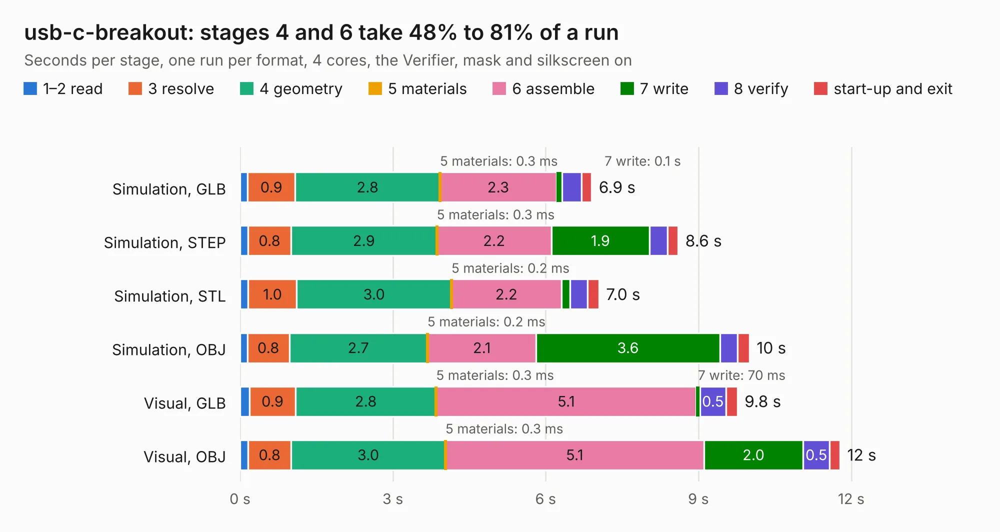

# 1428. usb-c-breakout

Board 1,428 of the 3,121 of [Corpus Testing](../Corpus-Testing.md), on [Corpus Page 14](../CorpusTestingPages/Corpus-Testing-14.md#1428-usb-c-breakout).

| Mode and format | 1–2 read | 3 resolve | 4 geometry | 5 materials | 6 assemble | 7 write | 8 verify | start-up and exit | Total |
|---|---:|---:|---:|---:|---:|---:|---:|---:|---:|
| Simulation, GLB | 0.1 | 0.9 | 2.8 | 0.3&nbsp;ms | 2.3 | 0.1 | 0.4 | 0.2 | 6.9 |
| Simulation, STEP | 0.2 | 0.8 | 2.9 | 0.3&nbsp;ms | 2.2 | 1.9 | 0.4 | 0.2 | 8.6 |
| Simulation, STL | 0.2 | 1.0 | 3.0 | 0.2&nbsp;ms | 2.2 | 0.2 | 0.3 | 0.2 | 7.0 |
| Simulation, OBJ | 0.1 | 0.8 | 2.7 | 0.2&nbsp;ms | 2.1 | 3.6 | 0.3 | 0.2 | 10.0 |
| Visual, GLB | 0.2 | 0.9 | 2.8 | 0.3&nbsp;ms | 5.1 | 70&nbsp;ms | 0.5 | 0.2 | 9.8 |
| Visual, OBJ | 0.2 | 0.8 | 3.0 | 0.3&nbsp;ms | 5.1 | 2.0 | 0.5 | 0.2 | 11.8 |

<table align="center"><tr><td valign="top">

| Board | Repo: [kbeckmann/Kilsyth](https://github.com/kbeckmann/Kilsyth) Board: `usb-c-breakout.kicad_pcb` |
|---|---|
| Folder | hardware / usb-c-breakout |
| Complexity | 245&nbsp;/&nbsp;1000 (size&nbsp;180, features&nbsp;65) |
| KESE&nbsp;features | through vias, slotted holes, rounded, trapezoid or chamfered pads, filled zones, curved board outline |
| Tested | 9th November 2026 |
| Copper&nbsp;layers | 4 |
| File&nbsp;format | KiCad 5 (20171130) |
| Parts,&nbsp;tracks,&nbsp;vias | 33, 602, 41 |
| Triangles,&nbsp;simulation | 823,370 in 66 parts |
| Verifier | PASS in all six runs |

</td><td valign="top">

<table>
<tr><th>File type</th><th>File size</th><th>Peak memory used</th></tr>
<tr><th colspan="3" align="left">Simulation</th></tr>
<tr><td>GLB</td><td align="right">29&nbsp;MB</td><td align="right">340&nbsp;MB</td></tr>
<tr><td>STEP</td><td align="right">124&nbsp;MB</td><td align="right">398&nbsp;MB</td></tr>
<tr><td>STL</td><td align="right">41&nbsp;MB</td><td align="right">336&nbsp;MB</td></tr>
<tr><td>OBJ</td><td align="right">84&nbsp;MB</td><td align="right">583&nbsp;MB</td></tr>
<tr><th colspan="3" align="left">Visual</th></tr>
<tr><td>GLB</td><td align="right">15&nbsp;MB</td><td align="right">401&nbsp;MB</td></tr>
<tr><td>OBJ</td><td align="right">45&nbsp;MB</td><td align="right">406&nbsp;MB</td></tr>
</table>

</td></tr></table>

| Previous | Next |
|:---|---:|
| [1427. Kilsyth](b1427b_Kilsyth_hardware-RevB_Kilsyth.md) | [1429. doj](b1429b_echomods_doj-source-v1-1-kicad_doj.md) |
