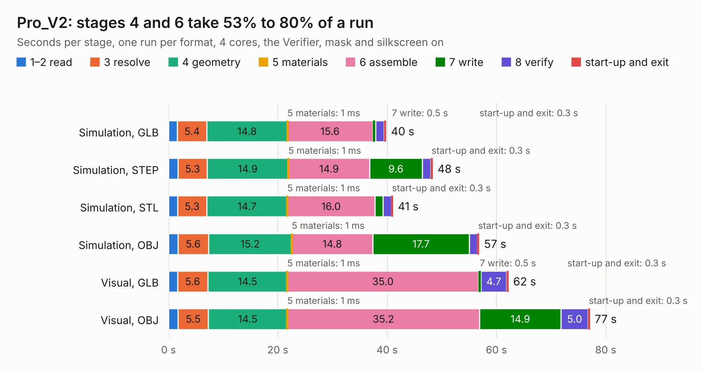

# 1428. Pro_V2

Board 1,428 of the 3,125 of [Corpus Testing](../Corpus-Testing.md), on [Corpus Page 14](../CorpusTestingPages/Corpus-Testing-14.md#1428-pro_v2).

| Mode and format | 1–2 read | 3 resolve | 4 geometry | 5 materials | 6 assemble | 7 write | 8 verify | start-up and exit | Total |
|---|---:|---:|---:|---:|---:|---:|---:|---:|---:|
| Simulation, GLB | 1.6 | 5.4 | 14.8 | 1&nbsp;ms | 15.6 | 0.5 | 1.6 | 0.3 | 39.8 |
| Simulation, STEP | 1.7 | 5.3 | 14.9 | 1&nbsp;ms | 14.9 | 9.6 | 1.6 | 0.3 | 48.3 |
| Simulation, STL | 1.6 | 5.3 | 14.7 | 1&nbsp;ms | 16.0 | 1.4 | 1.5 | 0.3 | 41.1 |
| Simulation, OBJ | 1.7 | 5.6 | 15.2 | 1&nbsp;ms | 14.8 | 17.7 | 1.5 | 0.3 | 56.8 |
| Visual, GLB | 1.6 | 5.6 | 14.5 | 1&nbsp;ms | 35.0 | 0.5 | 4.7 | 0.3 | 62.1 |
| Visual, OBJ | 1.8 | 5.5 | 14.5 | 1&nbsp;ms | 35.2 | 14.9 | 5.0 | 0.3 | 77.1 |

<table align="center"><tr><td valign="top">

| Board | Repo: [kata0510/Lily58](https://github.com/kata0510/Lily58) Board: `Pro_V2.kicad_pcb` |
|---|---|
| Folder | Pro_V2 |
| Complexity | 394&nbsp;/&nbsp;1000 (size&nbsp;259, features&nbsp;135) |
| KESE&nbsp;features | through vias, slotted holes, custom pads, rounded, trapezoid or chamfered pads, filled zones, copper drawings, curved board outline, TrueType text, stack-up, dielectric εr and tanδ |
| Tested | 9th November 2026 |
| Copper&nbsp;layers | 2 |
| File&nbsp;format | KiCad 9 (20241229) |
| Parts,&nbsp;tracks,&nbsp;vias | 260, 2,389, 497 |
| Triangles,&nbsp;simulation | 3,913,124 in 252 parts |
| Verifier | PASS in all six runs |

</td><td valign="top">

<table>
<tr><th>File type</th><th>File size</th><th>Peak memory used</th></tr>
<tr><th colspan="3" align="left">Simulation</th></tr>
<tr><td>GLB</td><td align="right">138&nbsp;MB</td><td align="right">1.7&nbsp;GB</td></tr>
<tr><td>STEP</td><td align="right">746&nbsp;MB</td><td align="right">1.7&nbsp;GB</td></tr>
<tr><td>STL</td><td align="right">196&nbsp;MB</td><td align="right">1.7&nbsp;GB</td></tr>
<tr><td>OBJ</td><td align="right">425&nbsp;MB</td><td align="right">2.6&nbsp;GB</td></tr>
<tr><th colspan="3" align="left">Visual</th></tr>
<tr><td>GLB</td><td align="right">121&nbsp;MB</td><td align="right">2.1&nbsp;GB</td></tr>
<tr><td>OBJ</td><td align="right">380&nbsp;MB</td><td align="right">2.5&nbsp;GB</td></tr>
</table>

</td></tr></table>

| Previous | Next |
|:---|---:|
| [1427. Lily58_Pro](b1427b_Lily58_Lily58-Pro.md) | [1429. Kilsyth](b1429b_Kilsyth_hardware-RevA_Kilsyth.md) |
