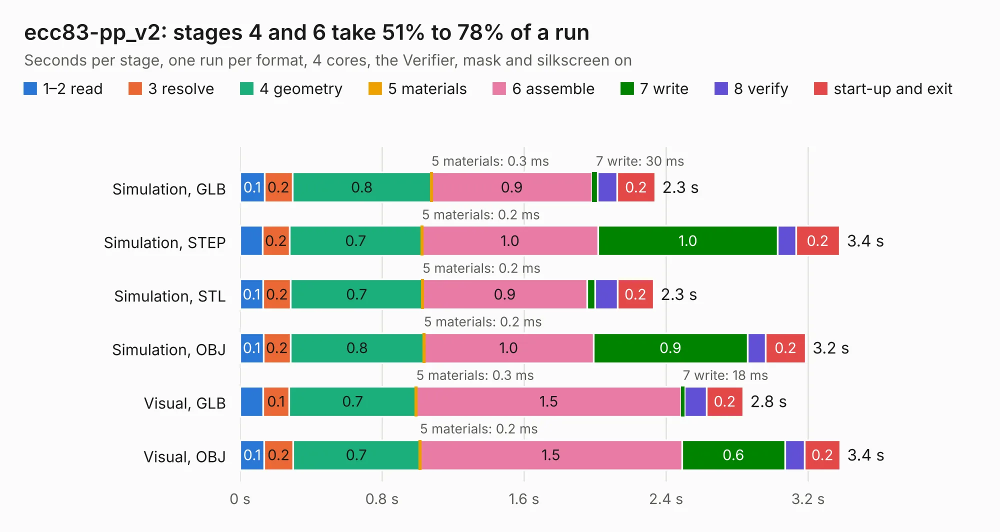

# 1428. ecc83-pp_v2

Board 1,428 of the 3,110 of [Corpus Testing](../Corpus-Testing.md), on [Corpus Page 14](../CorpusTestingPages/Corpus-Testing-14.md#1428-ecc83-pp_v2).

| Mode and format | 1–2 read | 3 resolve | 4 geometry | 5 materials | 6 assemble | 7 write | 8 verify | start-up and exit | Total |
|---|---:|---:|---:|---:|---:|---:|---:|---:|---:|
| Simulation, GLB | 0.1 | 0.2 | 0.8 | 0.3&nbsp;ms | 0.9 | 30&nbsp;ms | 0.1 | 0.2 | 2.3 |
| Simulation, STEP | 0.1 | 0.2 | 0.7 | 0.2&nbsp;ms | 1.0 | 1.0 | 0.1 | 0.2 | 3.4 |
| Simulation, STL | 0.1 | 0.2 | 0.7 | 0.2&nbsp;ms | 0.9 | 45&nbsp;ms | 0.1 | 0.2 | 2.3 |
| Simulation, OBJ | 0.1 | 0.2 | 0.8 | 0.2&nbsp;ms | 1.0 | 0.9 | 0.1 | 0.2 | 3.2 |
| Visual, GLB | 0.1 | 0.1 | 0.7 | 0.3&nbsp;ms | 1.5 | 18&nbsp;ms | 0.1 | 0.2 | 2.8 |
| Visual, OBJ | 0.1 | 0.2 | 0.7 | 0.2&nbsp;ms | 1.5 | 0.6 | 0.1 | 0.2 | 3.4 |

<table align="center"><tr><td valign="top">

| Board | Repo: [KiCad/kicad-source-mirror](https://github.com/KiCad/kicad-source-mirror) Board: `ecc83-pp_v2.kicad_pcb` |
|---|---|
| Folder | demos / ecc83 |
| Complexity | 174&nbsp;/&nbsp;1000 (size&nbsp;109, features&nbsp;65) |
| KESE&nbsp;features | slotted holes, filled zones, stack-up, dielectric εr and tanδ, mask and silkscreen colours |
| Tested | 9th November 2026 |
| Copper&nbsp;layers | 2 |
| File&nbsp;format | KiCad 9 (20241229) |
| Parts,&nbsp;tracks,&nbsp;vias | 11, 53, 0 |
| Triangles,&nbsp;simulation | 167,764 in 24 parts |
| Verifier | PASS in all six runs |

</td><td valign="top">

<table>
<tr><th>File type</th><th>File size</th><th>Peak memory used</th></tr>
<tr><th colspan="3" align="left">Simulation</th></tr>
<tr><td>GLB</td><td align="right">5.6&nbsp;MB</td><td align="right">195&nbsp;MB</td></tr>
<tr><td>STEP</td><td align="right">25&nbsp;MB</td><td align="right">212&nbsp;MB</td></tr>
<tr><td>STL</td><td align="right">8.4&nbsp;MB</td><td align="right">199&nbsp;MB</td></tr>
<tr><td>OBJ</td><td align="right">16&nbsp;MB</td><td align="right">196&nbsp;MB</td></tr>
<tr><th colspan="3" align="left">Visual</th></tr>
<tr><td>GLB</td><td align="right">3.4&nbsp;MB</td><td align="right">169&nbsp;MB</td></tr>
<tr><td>OBJ</td><td align="right">9.5&nbsp;MB</td><td align="right">167&nbsp;MB</td></tr>
</table>

</td></tr></table>

| Previous | Next |
|:---|---:|
| [1427. ecc83-pp](b1427b_kicad-source-mirror_ecc83-pp.md) | [1429. interf_u](b1429b_kicad-source-mirror_interf-u.md) |
