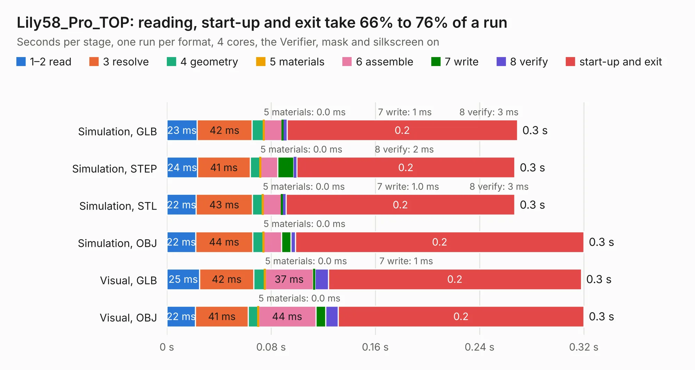

# 1429. Lily58_Pro_TOP

Board 1,429 of the 3,130 of [Corpus Testing](../Corpus-Testing.md), on [Corpus Page 14](../CorpusTestingPages/Corpus-Testing-14.md#1429-lily58_pro_top).

| Mode and format | 1–2 read | 3 resolve | 4 geometry | 5 materials | 6 assemble | 7 write | 8 verify | start-up and exit | Total |
|---|---:|---:|---:|---:|---:|---:|---:|---:|---:|
| Simulation, GLB | 23&nbsp;ms | 42&nbsp;ms | 9&nbsp;ms | 0.0&nbsp;ms | 14&nbsp;ms | 1&nbsp;ms | 3&nbsp;ms | 0.2 | 0.3 |
| Simulation, STEP | 24&nbsp;ms | 41&nbsp;ms | 8&nbsp;ms | 0.0&nbsp;ms | 13&nbsp;ms | 12&nbsp;ms | 2&nbsp;ms | 0.2 | 0.3 |
| Simulation, STL | 22&nbsp;ms | 43&nbsp;ms | 8&nbsp;ms | 0.0&nbsp;ms | 14&nbsp;ms | 1.0&nbsp;ms | 3&nbsp;ms | 0.2 | 0.3 |
| Simulation, OBJ | 22&nbsp;ms | 44&nbsp;ms | 8&nbsp;ms | 0.0&nbsp;ms | 14&nbsp;ms | 7&nbsp;ms | 4&nbsp;ms | 0.2 | 0.3 |
| Visual, GLB | 25&nbsp;ms | 42&nbsp;ms | 9&nbsp;ms | 0.0&nbsp;ms | 37&nbsp;ms | 1&nbsp;ms | 10&nbsp;ms | 0.2 | 0.3 |
| Visual, OBJ | 22&nbsp;ms | 41&nbsp;ms | 8&nbsp;ms | 0.0&nbsp;ms | 44&nbsp;ms | 7&nbsp;ms | 10&nbsp;ms | 0.2 | 0.3 |

<table align="center"><tr><td valign="top">

| Board | Repo: [kata0510/Lily58](https://github.com/kata0510/Lily58) Board: `Lily58_Pro_TOP.kicad_pcb` |
|---|---|
| Folder | Pro / Case |
| Complexity | 37&nbsp;/&nbsp;1000 (size&nbsp;17, features&nbsp;20) |
| KESE&nbsp;features | filled zones |
| Tested | 9th November 2026 |
| Copper&nbsp;layers | 2 |
| File&nbsp;format | KiCad 5 (20171130) |
| Parts,&nbsp;tracks,&nbsp;vias | 0, 0, 0 |
| Triangles,&nbsp;simulation | 1,048 in 3 parts |
| Note | no components |
| Verifier | PASS in all six runs |

</td><td valign="top">

<table>
<tr><th>File type</th><th>File size</th><th>Peak memory used</th></tr>
<tr><th colspan="3" align="left">Simulation</th></tr>
<tr><td>GLB</td><td align="right">53&nbsp;kB</td><td align="right">40&nbsp;MB</td></tr>
<tr><td>STEP</td><td align="right">353&nbsp;kB</td><td align="right">40&nbsp;MB</td></tr>
<tr><td>STL</td><td align="right">53&nbsp;kB</td><td align="right">40&nbsp;MB</td></tr>
<tr><td>OBJ</td><td align="right">158&nbsp;kB</td><td align="right">40&nbsp;MB</td></tr>
<tr><th colspan="3" align="left">Visual</th></tr>
<tr><td>GLB</td><td align="right">69&nbsp;kB</td><td align="right">44&nbsp;MB</td></tr>
<tr><td>OBJ</td><td align="right">165&nbsp;kB</td><td align="right">44&nbsp;MB</td></tr>
</table>

</td></tr></table>

| Previous | Next |
|:---|---:|
| [1428. Lily58_Pro_BOTTOM](b1428b_Lily58_Lily58-Pro-BOTTOM.md) | [1430. Lily58_Pro](b1430b_Lily58_Lily58-Pro.md) |
