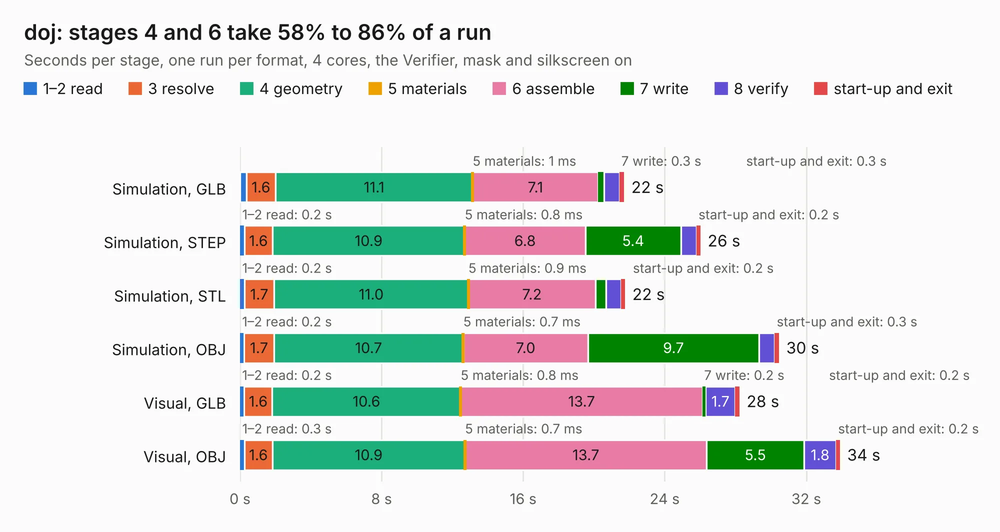

# 1429. doj

Board 1,429 of the 3,121 of [Corpus Testing](../Corpus-Testing.md), on [Corpus Page 14](../CorpusTestingPages/Corpus-Testing-14.md#1429-doj).

| Mode and format | 1–2 read | 3 resolve | 4 geometry | 5 materials | 6 assemble | 7 write | 8 verify | start-up and exit | Total |
|---|---:|---:|---:|---:|---:|---:|---:|---:|---:|
| Simulation, GLB | 0.4 | 1.6 | 11.1 | 1&nbsp;ms | 7.1 | 0.3 | 0.9 | 0.3 | 21.7 |
| Simulation, STEP | 0.2 | 1.6 | 10.9 | 0.8&nbsp;ms | 6.8 | 5.4 | 0.9 | 0.2 | 26.0 |
| Simulation, STL | 0.2 | 1.7 | 11.0 | 0.9&nbsp;ms | 7.2 | 0.6 | 0.9 | 0.2 | 21.8 |
| Simulation, OBJ | 0.2 | 1.7 | 10.7 | 0.7&nbsp;ms | 7.0 | 9.7 | 0.9 | 0.3 | 30.5 |
| Visual, GLB | 0.2 | 1.6 | 10.6 | 0.8&nbsp;ms | 13.7 | 0.2 | 1.7 | 0.2 | 28.2 |
| Visual, OBJ | 0.3 | 1.6 | 10.9 | 0.7&nbsp;ms | 13.7 | 5.5 | 1.8 | 0.2 | 33.9 |

<table align="center"><tr><td valign="top">

| Board | Repo: [kelu124/echomods](https://github.com/kelu124/echomods) Board: `doj.kicad_pcb` |
|---|---|
| Folder | doj / source / v1.1-kicad |
| Complexity | 197&nbsp;/&nbsp;1000 (size&nbsp;152, features&nbsp;45) |
| KESE&nbsp;features | through vias, slotted holes, filled zones |
| Tested | 9th November 2026 |
| Copper&nbsp;layers | 2 |
| File&nbsp;format | KiCad 4 (4) |
| Parts,&nbsp;tracks,&nbsp;vias | 17, 530, 8 |
| Triangles,&nbsp;simulation | 2,267,576 in 123 parts |
| Verifier | PASS in all six runs |

</td><td valign="top">

<table>
<tr><th>File type</th><th>File size</th><th>Peak memory used</th></tr>
<tr><th colspan="3" align="left">Simulation</th></tr>
<tr><td>GLB</td><td align="right">77&nbsp;MB</td><td align="right">871&nbsp;MB</td></tr>
<tr><td>STEP</td><td align="right">395&nbsp;MB</td><td align="right">901&nbsp;MB</td></tr>
<tr><td>STL</td><td align="right">113&nbsp;MB</td><td align="right">828&nbsp;MB</td></tr>
<tr><td>OBJ</td><td align="right">240&nbsp;MB</td><td align="right">1.5&nbsp;GB</td></tr>
<tr><th colspan="3" align="left">Visual</th></tr>
<tr><td>GLB</td><td align="right">45&nbsp;MB</td><td align="right">885&nbsp;MB</td></tr>
<tr><td>OBJ</td><td align="right">137&nbsp;MB</td><td align="right">978&nbsp;MB</td></tr>
</table>

</td></tr></table>

| Previous | Next |
|:---|---:|
| [1428. usb-c-breakout](b1428b_Kilsyth_usb-c-breakout.md) | [1430. doj](b1430b_echomods_doj-source-v1-2-kicad_doj.md) |
