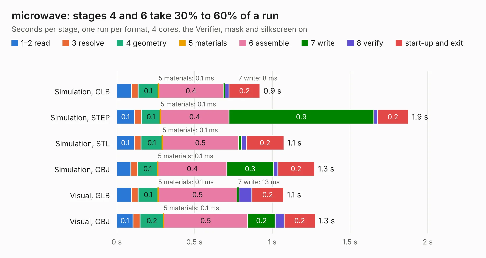

# 1429. microwave

Board 1,429 of the 3,108 of [Corpus Testing](../Corpus-Testing.md), on [Corpus Page 14](../CorpusTestingPages/Corpus-Testing-14.md#1429-microwave).

| Mode and format | 1–2 read | 3 resolve | 4 geometry | 5 materials | 6 assemble | 7 write | 8 verify | start-up and exit | Total |
|---|---:|---:|---:|---:|---:|---:|---:|---:|---:|
| Simulation, GLB | 94&nbsp;ms | 43&nbsp;ms | 0.1 | 0.1&nbsp;ms | 0.4 | 8&nbsp;ms | 27&nbsp;ms | 0.2 | 0.9 |
| Simulation, STEP | 0.1 | 44&nbsp;ms | 0.1 | 0.1&nbsp;ms | 0.4 | 0.9 | 25&nbsp;ms | 0.2 | 1.9 |
| Simulation, STL | 0.1 | 45&nbsp;ms | 0.1 | 0.1&nbsp;ms | 0.5 | 21&nbsp;ms | 29&nbsp;ms | 0.2 | 1.1 |
| Simulation, OBJ | 91&nbsp;ms | 42&nbsp;ms | 0.1 | 0.1&nbsp;ms | 0.4 | 0.3 | 26&nbsp;ms | 0.2 | 1.3 |
| Visual, GLB | 94&nbsp;ms | 44&nbsp;ms | 0.1 | 0.1&nbsp;ms | 0.5 | 13&nbsp;ms | 82&nbsp;ms | 0.2 | 1.1 |
| Visual, OBJ | 0.1 | 46&nbsp;ms | 0.2 | 0.1&nbsp;ms | 0.5 | 0.2 | 58&nbsp;ms | 0.2 | 1.3 |

<table align="center"><tr><td valign="top">

| Board | Repo: [KiCad/kicad-source-mirror](https://github.com/KiCad/kicad-source-mirror) Board: `microwave.kicad_pcb` |
|---|---|
| Folder | demos / microwave |
| Complexity | 34&nbsp;/&nbsp;1000 (size&nbsp;34, features&nbsp;0) |
| Tested | 9th November 2026 |
| Copper&nbsp;layers | 2 |
| File&nbsp;format | KiCad 9 (20241229) |
| Parts,&nbsp;tracks,&nbsp;vias | 4, 0, 0 |
| Triangles,&nbsp;simulation | 54,124 in 5 parts |
| Verifier | PASS in all six runs |

</td><td valign="top">

<table>
<tr><th>File type</th><th>File size</th><th>Peak memory used</th></tr>
<tr><th colspan="3" align="left">Simulation</th></tr>
<tr><td>GLB</td><td align="right">1.8&nbsp;MB</td><td align="right">81&nbsp;MB</td></tr>
<tr><td>STEP</td><td align="right">14&nbsp;MB</td><td align="right">205&nbsp;MB</td></tr>
<tr><td>STL</td><td align="right">2.7&nbsp;MB</td><td align="right">80&nbsp;MB</td></tr>
<tr><td>OBJ</td><td align="right">5.0&nbsp;MB</td><td align="right">92&nbsp;MB</td></tr>
<tr><th colspan="3" align="left">Visual</th></tr>
<tr><td>GLB</td><td align="right">1.1&nbsp;MB</td><td align="right">98&nbsp;MB</td></tr>
<tr><td>OBJ</td><td align="right">3.0&nbsp;MB</td><td align="right">106&nbsp;MB</td></tr>
</table>

</td></tr></table>

| Previous | Next |
|:---|---:|
| [1428. kit-dev-coldfire-xilinx_5213](b1428b_kicad-source-mirror_kit-dev-coldfire-xilinx-5213.md) | [1430. multichannel_mixer-unrouted](b1430b_kicad-source-mirror_multichannel-mixer-unrouted.md) |
