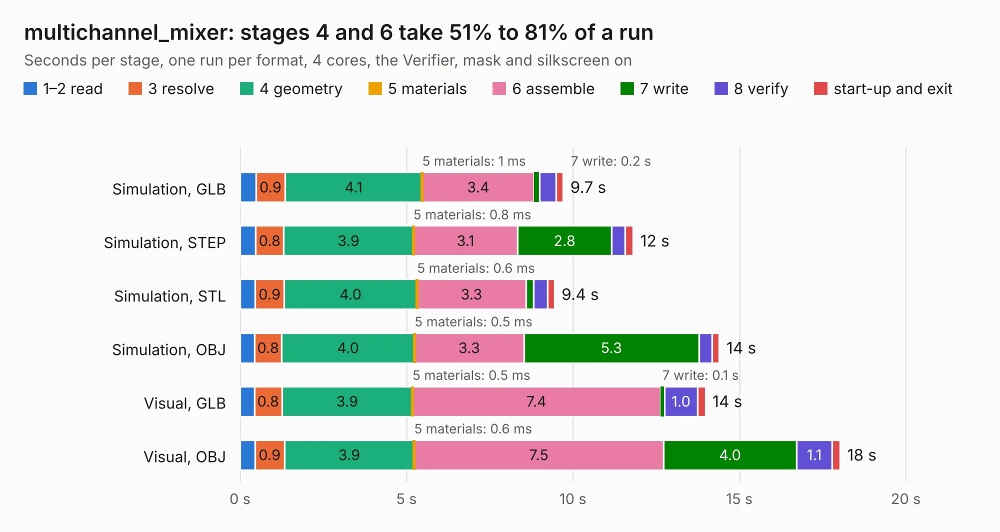

# 1429. multichannel_mixer

Board 1,429 of the 3,106 of [Corpus Testing](../Corpus-Testing.md), on [Corpus Page 14](../CorpusTestingPages/Corpus-Testing-14.md#1429-multichannel_mixer).

| Mode and format | 1–2 read | 3 resolve | 4 geometry | 5 materials | 6 assemble | 7 write | 8 verify | start-up and exit | Total |
|---|---:|---:|---:|---:|---:|---:|---:|---:|---:|
| Simulation, GLB | 0.5 | 0.9 | 4.1 | 1&nbsp;ms | 3.4 | 0.2 | 0.5 | 0.2 | 9.7 |
| Simulation, STEP | 0.5 | 0.8 | 3.9 | 0.8&nbsp;ms | 3.1 | 2.8 | 0.4 | 0.2 | 11.8 |
| Simulation, STL | 0.5 | 0.9 | 4.0 | 0.6&nbsp;ms | 3.3 | 0.2 | 0.4 | 0.2 | 9.4 |
| Simulation, OBJ | 0.4 | 0.8 | 4.0 | 0.5&nbsp;ms | 3.3 | 5.3 | 0.4 | 0.2 | 14.4 |
| Visual, GLB | 0.4 | 0.8 | 3.9 | 0.5&nbsp;ms | 7.4 | 0.1 | 1.0 | 0.2 | 14.0 |
| Visual, OBJ | 0.4 | 0.9 | 3.9 | 0.6&nbsp;ms | 7.5 | 4.0 | 1.1 | 0.2 | 18.0 |

<table align="center"><tr><td valign="top">

| Board | Repo: [KiCad/kicad-source-mirror](https://github.com/KiCad/kicad-source-mirror) Board: `multichannel_mixer.kicad_pcb` |
|---|---|
| Folder | demos / multichannel |
| Complexity | 230&nbsp;/&nbsp;1000 (size&nbsp;175, features&nbsp;55) |
| KESE&nbsp;features | through vias, slotted holes, rounded, trapezoid or chamfered pads, filled zones |
| Tested | 9th November 2026 |
| Copper&nbsp;layers | 2 |
| File&nbsp;format | KiCad 9 (20241229) |
| Parts,&nbsp;tracks,&nbsp;vias | 114, 576, 29 |
| Triangles,&nbsp;simulation | 1,027,228 in 92 parts |
| Verifier | PASS in all six runs |

</td><td valign="top">

<table>
<tr><th>File type</th><th>File size</th><th>Peak memory used</th></tr>
<tr><th colspan="3" align="left">Simulation</th></tr>
<tr><td>GLB</td><td align="right">34&nbsp;MB</td><td align="right">449&nbsp;MB</td></tr>
<tr><td>STEP</td><td align="right">171&nbsp;MB</td><td align="right">548&nbsp;MB</td></tr>
<tr><td>STL</td><td align="right">51&nbsp;MB</td><td align="right">456&nbsp;MB</td></tr>
<tr><td>OBJ</td><td align="right">104&nbsp;MB</td><td align="right">741&nbsp;MB</td></tr>
<tr><th colspan="3" align="left">Visual</th></tr>
<tr><td>GLB</td><td align="right">26&nbsp;MB</td><td align="right">621&nbsp;MB</td></tr>
<tr><td>OBJ</td><td align="right">78&nbsp;MB</td><td align="right">649&nbsp;MB</td></tr>
</table>

</td></tr></table>

| Previous | Next |
|:---|---:|
| [1428. multichannel_mixer-unrouted](b1428b_kicad-source-mirror_multichannel-mixer-unrouted.md) | [1430. One-Air-Max](b1430b_kicad-source-mirror_One-Air-Max.md) |
