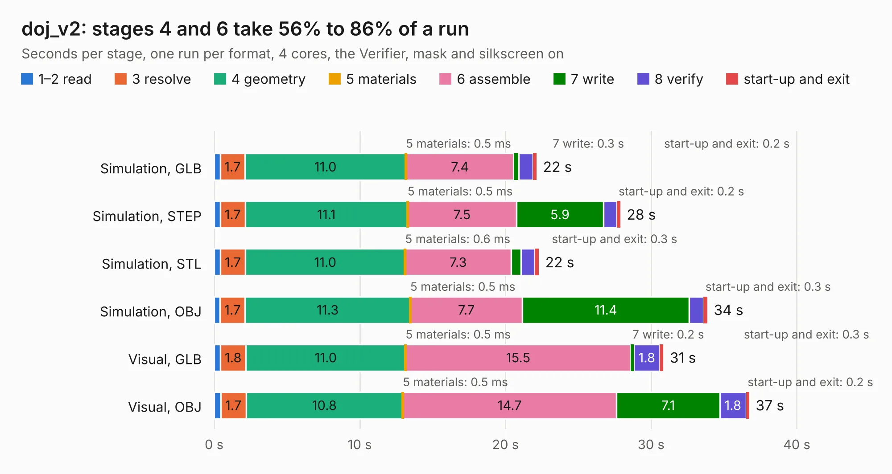

# 1431. doj_v2

Board 1,431 of the 3,121 of [Corpus Testing](../Corpus-Testing.md), on [Corpus Page 14](../CorpusTestingPages/Corpus-Testing-14.md#1431-doj_v2).

| Mode and format | 1–2 read | 3 resolve | 4 geometry | 5 materials | 6 assemble | 7 write | 8 verify | start-up and exit | Total |
|---|---:|---:|---:|---:|---:|---:|---:|---:|---:|
| Simulation, GLB | 0.4 | 1.7 | 11.0 | 0.5&nbsp;ms | 7.4 | 0.3 | 1.0 | 0.2 | 22.1 |
| Simulation, STEP | 0.4 | 1.7 | 11.1 | 0.5&nbsp;ms | 7.5 | 5.9 | 0.9 | 0.2 | 27.9 |
| Simulation, STL | 0.4 | 1.7 | 11.0 | 0.6&nbsp;ms | 7.3 | 0.7 | 1.0 | 0.3 | 22.3 |
| Simulation, OBJ | 0.4 | 1.7 | 11.3 | 0.5&nbsp;ms | 7.7 | 11.4 | 1.0 | 0.3 | 33.9 |
| Visual, GLB | 0.4 | 1.8 | 11.0 | 0.5&nbsp;ms | 15.5 | 0.2 | 1.8 | 0.3 | 30.8 |
| Visual, OBJ | 0.5 | 1.7 | 10.8 | 0.5&nbsp;ms | 14.7 | 7.1 | 1.8 | 0.2 | 36.7 |

<table align="center"><tr><td valign="top">

| Board | Repo: [kelu124/echomods](https://github.com/kelu124/echomods) Board: `doj_v2.kicad_pcb` |
|---|---|
| Folder | doj / source / v2.0-kicad |
| Complexity | 208&nbsp;/&nbsp;1000 (size&nbsp;153, features&nbsp;55) |
| KESE&nbsp;features | through vias, slotted holes, rounded, trapezoid or chamfered pads, filled zones |
| Tested | 9th November 2026 |
| Copper&nbsp;layers | 2 |
| File&nbsp;format | KiCad 5 (20170123) |
| Parts,&nbsp;tracks,&nbsp;vias | 22, 497, 9 |
| Triangles,&nbsp;simulation | 1,926,826 in 53 parts |
| Verifier | PASS in all six runs |

</td><td valign="top">

<table>
<tr><th>File type</th><th>File size</th><th>Peak memory used</th></tr>
<tr><th colspan="3" align="left">Simulation</th></tr>
<tr><td>GLB</td><td align="right">67&nbsp;MB</td><td align="right">670&nbsp;MB</td></tr>
<tr><td>STEP</td><td align="right">331&nbsp;MB</td><td align="right">782&nbsp;MB</td></tr>
<tr><td>STL</td><td align="right">96&nbsp;MB</td><td align="right">706&nbsp;MB</td></tr>
<tr><td>OBJ</td><td align="right">204&nbsp;MB</td><td align="right">1.3&nbsp;GB</td></tr>
<tr><th colspan="3" align="left">Visual</th></tr>
<tr><td>GLB</td><td align="right">41&nbsp;MB</td><td align="right">811&nbsp;MB</td></tr>
<tr><td>OBJ</td><td align="right">124&nbsp;MB</td><td align="right">885&nbsp;MB</td></tr>
</table>

</td></tr></table>

| Previous | Next |
|:---|---:|
| [1430. doj](b1430b_echomods_doj-source-v1-2-kicad_doj.md) | [1432. goblin](b1432b_echomods_goblin.md) |
