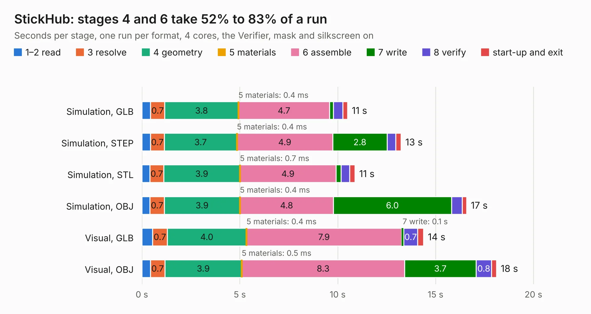

# 1431. StickHub

Board 1,431 of the 3,102 of [Corpus Testing](../Corpus-Testing.md), on [Corpus Page 14](../CorpusTestingPages/Corpus-Testing-14.md#1431-stickhub).

| Mode and format | 1–2 read | 3 resolve | 4 geometry | 5 materials | 6 assemble | 7 write | 8 verify | start-up and exit | Total |
|---|---:|---:|---:|---:|---:|---:|---:|---:|---:|
| Simulation, GLB | 0.4 | 0.7 | 3.8 | 0.4&nbsp;ms | 4.7 | 0.2 | 0.5 | 0.2 | 10.5 |
| Simulation, STEP | 0.4 | 0.7 | 3.7 | 0.4&nbsp;ms | 4.9 | 2.8 | 0.4 | 0.3 | 13.2 |
| Simulation, STL | 0.4 | 0.7 | 3.9 | 0.7&nbsp;ms | 4.9 | 0.3 | 0.4 | 0.3 | 10.9 |
| Simulation, OBJ | 0.4 | 0.7 | 3.9 | 0.4&nbsp;ms | 4.8 | 6.0 | 0.5 | 0.2 | 16.6 |
| Visual, GLB | 0.5 | 0.7 | 4.0 | 0.4&nbsp;ms | 7.9 | 0.1 | 0.7 | 0.3 | 14.4 |
| Visual, OBJ | 0.4 | 0.7 | 3.9 | 0.5&nbsp;ms | 8.3 | 3.7 | 0.8 | 0.2 | 18.1 |

<table align="center"><tr><td valign="top">

| Board | Repo: [KiCad/kicad-source-mirror](https://github.com/KiCad/kicad-source-mirror) Board: `StickHub.kicad_pcb` |
|---|---|
| Folder | demos / stickhub |
| Complexity | 366&nbsp;/&nbsp;1000 (size&nbsp;226, features&nbsp;140) |
| KESE&nbsp;features | through vias, slotted holes, custom pads, rounded, trapezoid or chamfered pads, arc tracks, filled zones, copper drawings, curved board outline, stack-up, dielectric εr and tanδ, mask and silkscreen colours |
| Tested | 9th November 2026 |
| Copper&nbsp;layers | 2 |
| File&nbsp;format | KiCad 10 (20250907) |
| Parts,&nbsp;tracks,&nbsp;vias | 88, 1,293, 87 |
| Triangles,&nbsp;simulation | 930,590 in 58 parts |
| Verifier | PASS in all six runs |

</td><td valign="top">

<table>
<tr><th>File type</th><th>File size</th><th>Peak memory used</th></tr>
<tr><th colspan="3" align="left">Simulation</th></tr>
<tr><td>GLB</td><td align="right">32&nbsp;MB</td><td align="right">384&nbsp;MB</td></tr>
<tr><td>STEP</td><td align="right">166&nbsp;MB</td><td align="right">505&nbsp;MB</td></tr>
<tr><td>STL</td><td align="right">47&nbsp;MB</td><td align="right">396&nbsp;MB</td></tr>
<tr><td>OBJ</td><td align="right">95&nbsp;MB</td><td align="right">663&nbsp;MB</td></tr>
<tr><th colspan="3" align="left">Visual</th></tr>
<tr><td>GLB</td><td align="right">21&nbsp;MB</td><td align="right">547&nbsp;MB</td></tr>
<tr><td>OBJ</td><td align="right">62&nbsp;MB</td><td align="right">516&nbsp;MB</td></tr>
</table>

</td></tr></table>

| Previous | Next |
|:---|---:|
| [1430. sonde xilinx](b1430b_kicad-source-mirror_sonde-xilinx.md) | [1432. tinytapeout-demo](b1432b_kicad-source-mirror_tinytapeout-demo.md) |
