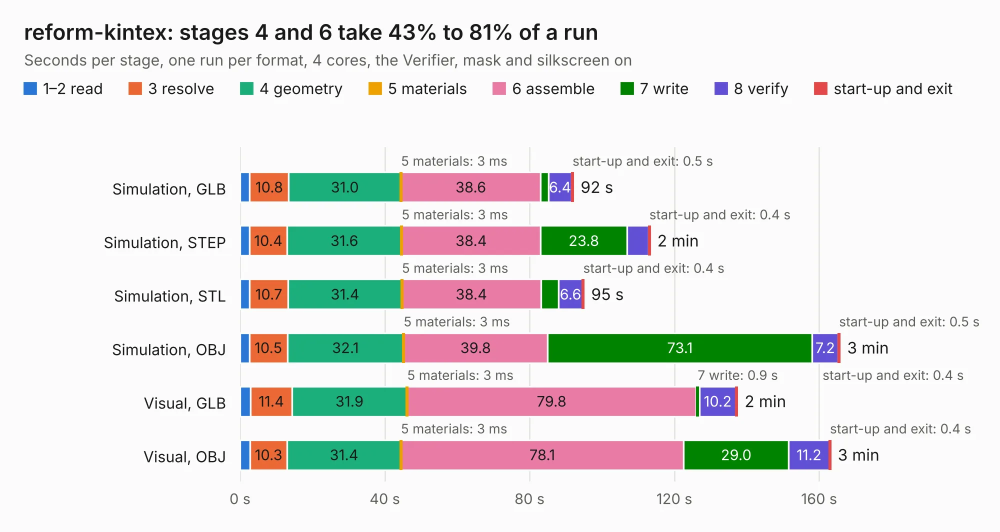

# 1433. reform-kintex

Board 1,433 of the 3,100 of [Corpus Testing](../Corpus-Testing.md), on [Corpus Page 14](../CorpusTestingPages/Corpus-Testing-14.md#1433-reform-kintex).

| Mode and format | 1–2 read | 3 resolve | 4 geometry | 5 materials | 6 assemble | 7 write | 8 verify | start-up and exit | Total |
|---|---:|---:|---:|---:|---:|---:|---:|---:|---:|
| Simulation, GLB | 2.7 | 10.8 | 31.0 | 3&nbsp;ms | 38.6 | 2.2 | 6.4 | 0.5 | 92.1 |
| Simulation, STEP | 2.6 | 10.4 | 31.6 | 3&nbsp;ms | 38.4 | 23.8 | 6.0 | 0.4 | 113.3 |
| Simulation, STL | 2.6 | 10.7 | 31.4 | 3&nbsp;ms | 38.4 | 4.9 | 6.6 | 0.4 | 95.0 |
| Simulation, OBJ | 2.6 | 10.5 | 32.1 | 3&nbsp;ms | 39.8 | 73.1 | 7.2 | 0.5 | 165.8 |
| Visual, GLB | 3.0 | 11.4 | 31.9 | 3&nbsp;ms | 79.8 | 0.9 | 10.2 | 0.4 | 137.4 |
| Visual, OBJ | 2.7 | 10.3 | 31.4 | 3&nbsp;ms | 78.1 | 29.0 | 11.2 | 0.4 | 163.2 |

<table align="center"><tr><td valign="top">

| Board | Repo: [kitspace-forks/reform-kintex-som](https://github.com/kitspace-forks/reform-kintex-som) Board: `reform-kintex.kicad_pcb` |
|---|---|
| Complexity | 407&nbsp;/&nbsp;1000 (size&nbsp;337, features&nbsp;70) |
| KESE&nbsp;features | through vias, rounded, trapezoid or chamfered pads, arc tracks, filled zones, curved board outline |
| Tested | 9th November 2026 |
| Copper&nbsp;layers | 8 |
| File&nbsp;format | KiCad 6 (20211014) |
| Parts,&nbsp;tracks,&nbsp;vias | 277, 14,859, 1,145 |
| Triangles,&nbsp;simulation | 10,654,866 in 669 parts |
| Verifier | PASS in all six runs |

</td><td valign="top">

<table>
<tr><th>File type</th><th>File size</th><th>Peak memory used</th></tr>
<tr><th colspan="3" align="left">Simulation</th></tr>
<tr><td>GLB</td><td align="right">361&nbsp;MB</td><td align="right">2.4&nbsp;GB</td></tr>
<tr><td>STEP</td><td align="right">1.3&nbsp;GB</td><td align="right">3.2&nbsp;GB</td></tr>
<tr><td>STL</td><td align="right">533&nbsp;MB</td><td align="right">2.3&nbsp;GB</td></tr>
<tr><td>OBJ</td><td align="right">1.1&nbsp;GB</td><td align="right">6.7&nbsp;GB</td></tr>
<tr><th colspan="3" align="left">Visual</th></tr>
<tr><td>GLB</td><td align="right">169&nbsp;MB</td><td align="right">2.9&nbsp;GB</td></tr>
<tr><td>OBJ</td><td align="right">563&nbsp;MB</td><td align="right">3.8&nbsp;GB</td></tr>
</table>

</td></tr></table>

| Previous | Next |
|:---|---:|
| [1432. reform-kintex-edp](b1432b_reform-kintex-som_reform-kintex-edp.md) | [1434. meko](b1434b_meko_meko.md) |
