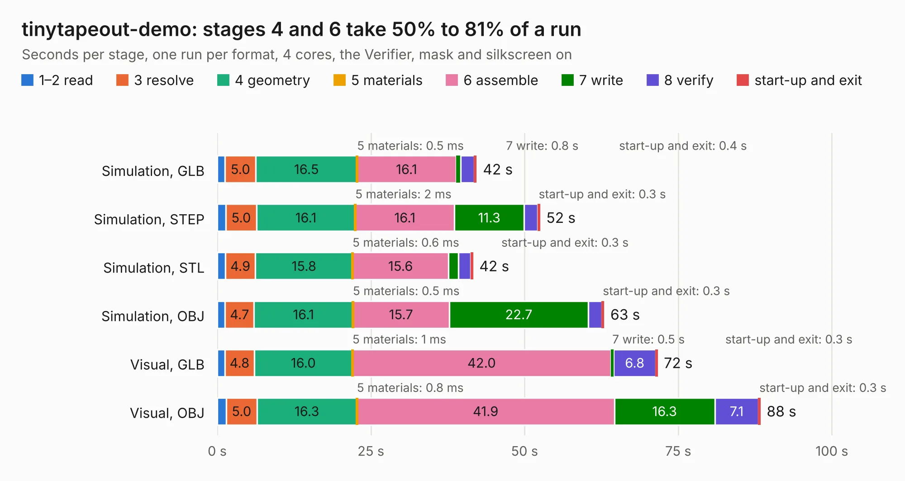

# 1435. tinytapeout-demo

Board 1,435 of the 3,105 of [Corpus Testing](../Corpus-Testing.md), on [Corpus Page 14](../CorpusTestingPages/Corpus-Testing-14.md#1435-tinytapeout-demo).

| Mode and format | 1–2 read | 3 resolve | 4 geometry | 5 materials | 6 assemble | 7 write | 8 verify | start-up and exit | Total |
|---|---:|---:|---:|---:|---:|---:|---:|---:|---:|
| Simulation, GLB | 1.3 | 5.0 | 16.5 | 0.5&nbsp;ms | 16.1 | 0.8 | 2.2 | 0.4 | 42.2 |
| Simulation, STEP | 1.4 | 5.0 | 16.1 | 2&nbsp;ms | 16.1 | 11.3 | 2.2 | 0.3 | 52.5 |
| Simulation, STL | 1.3 | 4.9 | 15.8 | 0.6&nbsp;ms | 15.6 | 1.6 | 2.0 | 0.3 | 41.6 |
| Simulation, OBJ | 1.3 | 4.7 | 16.1 | 0.5&nbsp;ms | 15.7 | 22.7 | 2.2 | 0.3 | 62.9 |
| Visual, GLB | 1.3 | 4.8 | 16.0 | 1&nbsp;ms | 42.0 | 0.5 | 6.8 | 0.3 | 71.6 |
| Visual, OBJ | 1.5 | 5.0 | 16.3 | 0.8&nbsp;ms | 41.9 | 16.3 | 7.1 | 0.3 | 88.3 |

<table align="center"><tr><td valign="top">

| Board | Repo: [KiCad/kicad-source-mirror](https://github.com/KiCad/kicad-source-mirror) Board: `tinytapeout-demo.kicad_pcb` |
|---|---|
| Folder | demos / tiny_tapeout |
| Complexity | 415&nbsp;/&nbsp;1000 (size&nbsp;260, features&nbsp;155) |
| KESE&nbsp;features | through vias, slotted holes, custom pads, rounded, trapezoid or chamfered pads, filled zones, copper drawings, curved board outline, knockout text, TrueType text, stack-up, dielectric εr and tanδ, mask and silkscreen colours |
| Tested | 9th November 2026 |
| Copper&nbsp;layers | 4 |
| File&nbsp;format | KiCad 9 (20241229) |
| Parts,&nbsp;tracks,&nbsp;vias | 140, 2,143, 405 |
| Triangles,&nbsp;simulation | 4,352,312 in 127 parts |
| Verifier | PASS in all six runs |

</td><td valign="top">

<table>
<tr><th>File type</th><th>File size</th><th>Peak memory used</th></tr>
<tr><th colspan="3" align="left">Simulation</th></tr>
<tr><td>GLB</td><td align="right">150&nbsp;MB</td><td align="right">1.3&nbsp;GB</td></tr>
<tr><td>STEP</td><td align="right">672&nbsp;MB</td><td align="right">1.7&nbsp;GB</td></tr>
<tr><td>STL</td><td align="right">218&nbsp;MB</td><td align="right">1.4&nbsp;GB</td></tr>
<tr><td>OBJ</td><td align="right">472&nbsp;MB</td><td align="right">2.8&nbsp;GB</td></tr>
<tr><th colspan="3" align="left">Visual</th></tr>
<tr><td>GLB</td><td align="right">107&nbsp;MB</td><td align="right">1.7&nbsp;GB</td></tr>
<tr><td>OBJ</td><td align="right">340&nbsp;MB</td><td align="right">2.2&nbsp;GB</td></tr>
</table>

</td></tr></table>

| Previous | Next |
|:---|---:|
| [1434. StickHub](b1434b_kicad-source-mirror_StickHub.md) | [1436. video](b1436b_kicad-source-mirror_video.md) |
