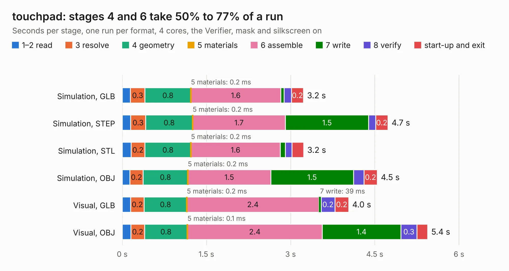

# 1435. touchpad

Board 1,435 of the 3,100 of [Corpus Testing](../Corpus-Testing.md), on [Corpus Page 14](../CorpusTestingPages/Corpus-Testing-14.md#1435-touchpad).

| Mode and format | 1–2 read | 3 resolve | 4 geometry | 5 materials | 6 assemble | 7 write | 8 verify | start-up and exit | Total |
|---|---:|---:|---:|---:|---:|---:|---:|---:|---:|
| Simulation, GLB | 0.1 | 0.3 | 0.8 | 0.2&nbsp;ms | 1.6 | 58&nbsp;ms | 0.1 | 0.2 | 3.2 |
| Simulation, STEP | 0.1 | 0.3 | 0.8 | 0.2&nbsp;ms | 1.7 | 1.5 | 0.1 | 0.2 | 4.7 |
| Simulation, STL | 0.2 | 0.2 | 0.8 | 0.2&nbsp;ms | 1.6 | 91&nbsp;ms | 0.1 | 0.2 | 3.2 |
| Simulation, OBJ | 0.1 | 0.2 | 0.8 | 0.2&nbsp;ms | 1.5 | 1.5 | 0.2 | 0.2 | 4.5 |
| Visual, GLB | 0.1 | 0.2 | 0.8 | 0.2&nbsp;ms | 2.4 | 39&nbsp;ms | 0.2 | 0.2 | 4.0 |
| Visual, OBJ | 0.2 | 0.2 | 0.8 | 0.1&nbsp;ms | 2.4 | 1.4 | 0.3 | 0.2 | 5.4 |

<table align="center"><tr><td valign="top">

| Board | Repo: [koeglike/meko](https://github.com/koeglike/meko) Board: `touchpad.kicad_pcb` |
|---|---|
| Folder | hardware / pcb_touchpad |
| Complexity | 232&nbsp;/&nbsp;1000 (size&nbsp;137, features&nbsp;95) |
| KESE&nbsp;features | through vias, rounded, trapezoid or chamfered pads, filled zones, knockout text, stack-up, dielectric εr and tanδ, mask and silkscreen colours |
| Tested | 9th November 2026 |
| Copper&nbsp;layers | 2 |
| File&nbsp;format | KiCad 10 (20260206) |
| Parts,&nbsp;tracks,&nbsp;vias | 5, 190, 90 |
| Triangles,&nbsp;simulation | 273,730 in 26 parts |
| Verifier | PASS in all six runs |

</td><td valign="top">

<table>
<tr><th>File type</th><th>File size</th><th>Peak memory used</th></tr>
<tr><th colspan="3" align="left">Simulation</th></tr>
<tr><td>GLB</td><td align="right">9.3&nbsp;MB</td><td align="right">252&nbsp;MB</td></tr>
<tr><td>STEP</td><td align="right">43&nbsp;MB</td><td align="right">276&nbsp;MB</td></tr>
<tr><td>STL</td><td align="right">14&nbsp;MB</td><td align="right">255&nbsp;MB</td></tr>
<tr><td>OBJ</td><td align="right">27&nbsp;MB</td><td align="right">253&nbsp;MB</td></tr>
<tr><th colspan="3" align="left">Visual</th></tr>
<tr><td>GLB</td><td align="right">7.7&nbsp;MB</td><td align="right">277&nbsp;MB</td></tr>
<tr><td>OBJ</td><td align="right">23&nbsp;MB</td><td align="right">276&nbsp;MB</td></tr>
</table>

</td></tr></table>

| Previous | Next |
|:---|---:|
| [1434. meko](b1434b_meko_meko.md) | [1436. H616_devboard](b1436b_allwinner-h616-devboard_H616-devboard.md) |
