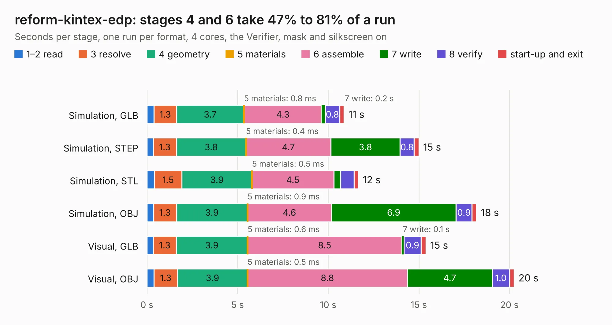

# 1435. reform-kintex-edp

Board 1,435 of the 3,103 of [Corpus Testing](../Corpus-Testing.md), on [Corpus Page 14](../CorpusTestingPages/Corpus-Testing-14.md#1435-reform-kintex-edp).

| Mode and format | 1–2 read | 3 resolve | 4 geometry | 5 materials | 6 assemble | 7 write | 8 verify | start-up and exit | Total |
|---|---:|---:|---:|---:|---:|---:|---:|---:|---:|
| Simulation, GLB | 0.4 | 1.3 | 3.7 | 0.8&nbsp;ms | 4.3 | 0.2 | 0.8 | 0.3 | 10.9 |
| Simulation, STEP | 0.4 | 1.3 | 3.8 | 0.4&nbsp;ms | 4.7 | 3.8 | 0.8 | 0.3 | 15.0 |
| Simulation, STL | 0.4 | 1.5 | 3.9 | 0.5&nbsp;ms | 4.5 | 0.4 | 0.7 | 0.2 | 11.7 |
| Simulation, OBJ | 0.4 | 1.3 | 3.9 | 0.9&nbsp;ms | 4.6 | 6.9 | 0.9 | 0.3 | 18.2 |
| Visual, GLB | 0.4 | 1.3 | 3.9 | 0.6&nbsp;ms | 8.5 | 0.1 | 0.9 | 0.3 | 15.4 |
| Visual, OBJ | 0.4 | 1.3 | 3.9 | 0.5&nbsp;ms | 8.8 | 4.7 | 1.0 | 0.3 | 20.3 |

<table align="center"><tr><td valign="top">

| Board | Repo: [kitspace-forks/reform-kintex-som](https://github.com/kitspace-forks/reform-kintex-som) Board: `reform-kintex-edp.kicad_pcb` |
|---|---|
| Folder | reform-kintex-edp-pcb |
| Complexity | 320&nbsp;/&nbsp;1000 (size&nbsp;245, features&nbsp;75) |
| KESE&nbsp;features | through vias, rounded, trapezoid or chamfered pads, filled zones, stack-up, dielectric εr and tanδ |
| Tested | 9th November 2026 |
| Copper&nbsp;layers | 4 |
| File&nbsp;format | KiCad 6 (20211014) |
| Parts,&nbsp;tracks,&nbsp;vias | 48, 715, 189 |
| Triangles,&nbsp;simulation | 1,185,508 in 100 parts |
| Verifier | PASS in all six runs |

</td><td valign="top">

<table>
<tr><th>File type</th><th>File size</th><th>Peak memory used</th></tr>
<tr><th colspan="3" align="left">Simulation</th></tr>
<tr><td>GLB</td><td align="right">39&nbsp;MB</td><td align="right">470&nbsp;MB</td></tr>
<tr><td>STEP</td><td align="right">159&nbsp;MB</td><td align="right">587&nbsp;MB</td></tr>
<tr><td>STL</td><td align="right">59&nbsp;MB</td><td align="right">493&nbsp;MB</td></tr>
<tr><td>OBJ</td><td align="right">119&nbsp;MB</td><td align="right">812&nbsp;MB</td></tr>
<tr><th colspan="3" align="left">Visual</th></tr>
<tr><td>GLB</td><td align="right">25&nbsp;MB</td><td align="right">674&nbsp;MB</td></tr>
<tr><td>OBJ</td><td align="right">77&nbsp;MB</td><td align="right">642&nbsp;MB</td></tr>
</table>

</td></tr></table>

| Previous | Next |
|:---|---:|
| [1434. video](b1434b_kicad-source-mirror_video.md) | [1436. reform-kintex](b1436b_reform-kintex-som_reform-kintex.md) |
