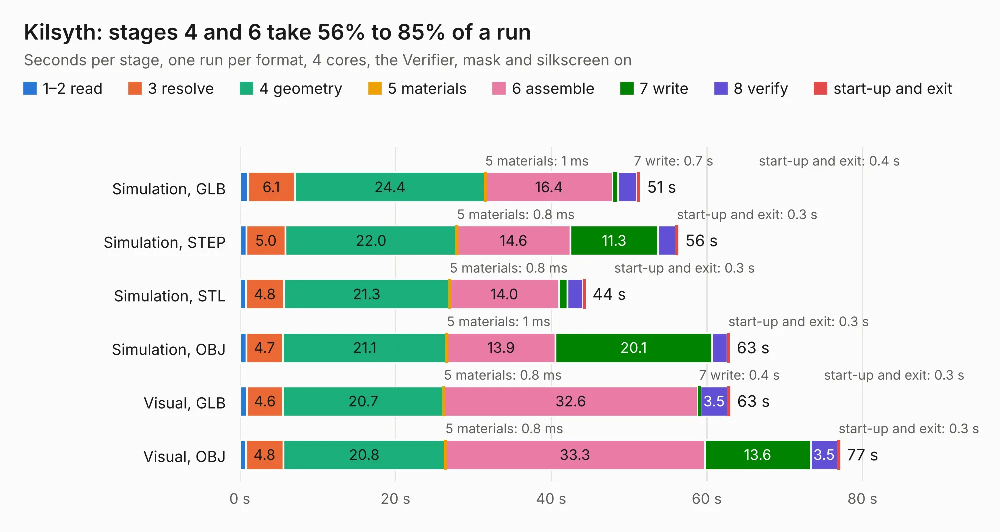

# 1438. Kilsyth

Board 1,438 of the 3,139 of [Corpus Testing](../Corpus-Testing.md), on [Corpus Page 14](../CorpusTestingPages/Corpus-Testing-14.md#1438-kilsyth).

| Mode and format | 1–2 read | 3 resolve | 4 geometry | 5 materials | 6 assemble | 7 write | 8 verify | start-up and exit | Total |
|---|---:|---:|---:|---:|---:|---:|---:|---:|---:|
| Simulation, GLB | 1.0 | 6.1 | 24.4 | 1&nbsp;ms | 16.4 | 0.7 | 2.4 | 0.4 | 51.4 |
| Simulation, STEP | 0.9 | 5.0 | 22.0 | 0.8&nbsp;ms | 14.6 | 11.3 | 2.3 | 0.3 | 56.3 |
| Simulation, STL | 0.8 | 4.8 | 21.3 | 0.8&nbsp;ms | 14.0 | 1.1 | 2.0 | 0.3 | 44.4 |
| Simulation, OBJ | 0.8 | 4.7 | 21.1 | 1&nbsp;ms | 13.9 | 20.1 | 2.0 | 0.3 | 62.9 |
| Visual, GLB | 0.9 | 4.6 | 20.7 | 0.8&nbsp;ms | 32.6 | 0.4 | 3.5 | 0.3 | 63.0 |
| Visual, OBJ | 0.8 | 4.8 | 20.8 | 0.8&nbsp;ms | 33.3 | 13.6 | 3.5 | 0.3 | 77.1 |

<table align="center"><tr><td valign="top">

| Board | Repo: [kbeckmann/Kilsyth](https://github.com/kbeckmann/Kilsyth) Board: `Kilsyth.kicad_pcb` |
|---|---|
| Folder | hardware / RevA |
| Complexity | 344&nbsp;/&nbsp;1000 (size&nbsp;279, features&nbsp;65) |
| KESE&nbsp;features | through vias, slotted holes, rounded, trapezoid or chamfered pads, filled zones, curved board outline |
| Tested | 9th November 2026 |
| Copper&nbsp;layers | 4 |
| File&nbsp;format | KiCad 5 (20171130) |
| Parts,&nbsp;tracks,&nbsp;vias | 160, 2,415, 431 |
| Triangles,&nbsp;simulation | 3,456,240 in 342 parts |
| Verifier | PASS in all six runs |

</td><td valign="top">

<table>
<tr><th>File type</th><th>File size</th><th>Peak memory used</th></tr>
<tr><th colspan="3" align="left">Simulation</th></tr>
<tr><td>GLB</td><td align="right">120&nbsp;MB</td><td align="right">1.2&nbsp;GB</td></tr>
<tr><td>STEP</td><td align="right">570&nbsp;MB</td><td align="right">1.4&nbsp;GB</td></tr>
<tr><td>STL</td><td align="right">173&nbsp;MB</td><td align="right">1.2&nbsp;GB</td></tr>
<tr><td>OBJ</td><td align="right">369&nbsp;MB</td><td align="right">2.3&nbsp;GB</td></tr>
<tr><th colspan="3" align="left">Visual</th></tr>
<tr><td>GLB</td><td align="right">76&nbsp;MB</td><td align="right">1.3&nbsp;GB</td></tr>
<tr><td>OBJ</td><td align="right">240&nbsp;MB</td><td align="right">1.6&nbsp;GB</td></tr>
</table>

</td></tr></table>

| Previous | Next |
|:---|---:|
| [1437. Pro_V2](b1437b_Lily58_Pro-V2.md) | [1439. Kilsyth](b1439b_Kilsyth_hardware-RevB_Kilsyth.md) |
