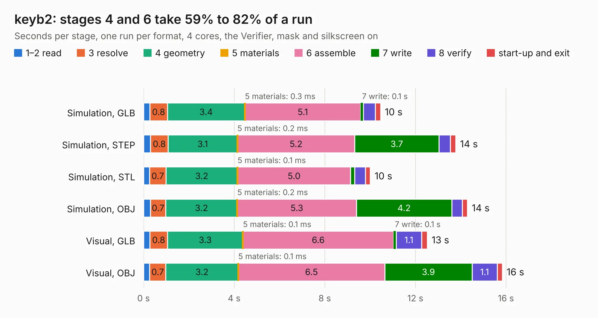

# 1439. keyb2

Board 1,439 of the 3,101 of [Corpus Testing](../Corpus-Testing.md), on [Corpus Page 14](../CorpusTestingPages/Corpus-Testing-14.md#1439-keyb2).

| Mode and format | 1–2 read | 3 resolve | 4 geometry | 5 materials | 6 assemble | 7 write | 8 verify | start-up and exit | Total |
|---|---:|---:|---:|---:|---:|---:|---:|---:|---:|
| Simulation, GLB | 0.3 | 0.8 | 3.4 | 0.3&nbsp;ms | 5.1 | 0.1 | 0.5 | 0.2 | 10.5 |
| Simulation, STEP | 0.3 | 0.8 | 3.1 | 0.2&nbsp;ms | 5.2 | 3.7 | 0.5 | 0.2 | 13.8 |
| Simulation, STL | 0.3 | 0.7 | 3.2 | 0.1&nbsp;ms | 5.0 | 0.2 | 0.5 | 0.2 | 10.0 |
| Simulation, OBJ | 0.3 | 0.7 | 3.2 | 0.2&nbsp;ms | 5.3 | 4.2 | 0.5 | 0.2 | 14.3 |
| Visual, GLB | 0.3 | 0.8 | 3.3 | 0.1&nbsp;ms | 6.6 | 0.1 | 1.1 | 0.3 | 12.5 |
| Visual, OBJ | 0.3 | 0.7 | 3.2 | 0.1&nbsp;ms | 6.5 | 3.9 | 1.1 | 0.2 | 15.8 |

<table align="center"><tr><td valign="top">

| Board | Repo: [krzys9876/ZX_Spectrum_diy](https://github.com/krzys9876/ZX_Spectrum_diy) Board: `keyb2.kicad_pcb` |
|---|---|
| Folder | Kicad4 / keyb2 |
| Complexity | 218&nbsp;/&nbsp;1000 (size&nbsp;173, features&nbsp;45) |
| KESE&nbsp;features | through vias, filled zones, copper text |
| Tested | 9th November 2026 |
| Copper&nbsp;layers | 2 |
| File&nbsp;format | KiCad 4 (4) |
| Parts,&nbsp;tracks,&nbsp;vias | 59, 667, 94 |
| Triangles,&nbsp;simulation | 676,712 in 30 parts |
| Verifier | PASS in all six runs |

</td><td valign="top">

<table>
<tr><th>File type</th><th>File size</th><th>Peak memory used</th></tr>
<tr><th colspan="3" align="left">Simulation</th></tr>
<tr><td>GLB</td><td align="right">24&nbsp;MB</td><td align="right">420&nbsp;MB</td></tr>
<tr><td>STEP</td><td align="right">135&nbsp;MB</td><td align="right">476&nbsp;MB</td></tr>
<tr><td>STL</td><td align="right">34&nbsp;MB</td><td align="right">430&nbsp;MB</td></tr>
<tr><td>OBJ</td><td align="right">70&nbsp;MB</td><td align="right">466&nbsp;MB</td></tr>
<tr><th colspan="3" align="left">Visual</th></tr>
<tr><td>GLB</td><td align="right">21&nbsp;MB</td><td align="right">519&nbsp;MB</td></tr>
<tr><td>OBJ</td><td align="right">64&nbsp;MB</td><td align="right">555&nbsp;MB</td></tr>
</table>

</td></tr></table>

| Previous | Next |
|:---|---:|
| [1438. ovio_core](b1438b_ovio-core_ovio-core.md) | [1440. keyb2_nofill](b1440b_ZX-Spectrum-diy_keyb2-nofill.md) |
