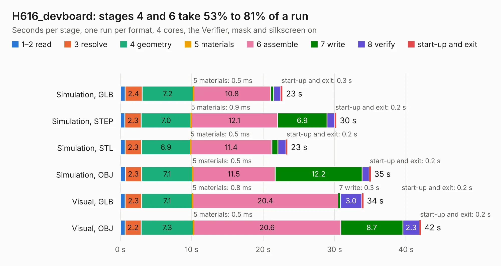

# 1439. H616_devboard

Board 1,439 of the 3,103 of [Corpus Testing](../Corpus-Testing.md), on [Corpus Page 14](../CorpusTestingPages/Corpus-Testing-14.md#1439-h616_devboard).

| Mode and format | 1–2 read | 3 resolve | 4 geometry | 5 materials | 6 assemble | 7 write | 8 verify | start-up and exit | Total |
|---|---:|---:|---:|---:|---:|---:|---:|---:|---:|
| Simulation, GLB | 0.7 | 2.4 | 7.2 | 0.5&nbsp;ms | 10.8 | 0.4 | 1.0 | 0.3 | 22.7 |
| Simulation, STEP | 0.6 | 2.3 | 7.0 | 0.9&nbsp;ms | 12.1 | 6.9 | 1.1 | 0.2 | 30.2 |
| Simulation, STL | 0.7 | 2.3 | 6.9 | 0.5&nbsp;ms | 11.4 | 0.8 | 1.1 | 0.2 | 23.4 |
| Simulation, OBJ | 0.7 | 2.3 | 7.1 | 0.5&nbsp;ms | 11.5 | 12.2 | 1.0 | 0.2 | 35.1 |
| Visual, GLB | 0.7 | 2.3 | 7.1 | 0.8&nbsp;ms | 20.4 | 0.3 | 3.0 | 0.2 | 34.0 |
| Visual, OBJ | 0.7 | 2.2 | 7.3 | 0.5&nbsp;ms | 20.6 | 8.7 | 2.3 | 0.2 | 42.1 |

<table align="center"><tr><td valign="top">

| Board | Repo: [kononenko-k/allwinner_h616_devboard](https://github.com/kononenko-k/allwinner_h616_devboard) Board: `H616_devboard.kicad_pcb` |
|---|---|
| Folder | Hardware / H616_DDR3 |
| Complexity | 411&nbsp;/&nbsp;1000 (size&nbsp;286, features&nbsp;125) |
| KESE&nbsp;features | through vias, slotted holes, rounded, trapezoid or chamfered pads, arc tracks, filled zones, curved board outline, stack-up, dielectric εr and tanδ, copper finish |
| Tested | 9th November 2026 |
| Copper&nbsp;layers | 4 |
| File&nbsp;format | KiCad 8 (20240108) |
| Parts,&nbsp;tracks,&nbsp;vias | 112, 4,034, 406 |
| Triangles,&nbsp;simulation | 2,861,090 in 279 parts |
| Verifier | PASS in all six runs |

</td><td valign="top">

<table>
<tr><th>File type</th><th>File size</th><th>Peak memory used</th></tr>
<tr><th colspan="3" align="left">Simulation</th></tr>
<tr><td>GLB</td><td align="right">97&nbsp;MB</td><td align="right">1.0&nbsp;GB</td></tr>
<tr><td>STEP</td><td align="right">451&nbsp;MB</td><td align="right">1.3&nbsp;GB</td></tr>
<tr><td>STL</td><td align="right">143&nbsp;MB</td><td align="right">1.0&nbsp;GB</td></tr>
<tr><td>OBJ</td><td align="right">300&nbsp;MB</td><td align="right">1.9&nbsp;GB</td></tr>
<tr><th colspan="3" align="left">Visual</th></tr>
<tr><td>GLB</td><td align="right">73&nbsp;MB</td><td align="right">1.4&nbsp;GB</td></tr>
<tr><td>OBJ</td><td align="right">229&nbsp;MB</td><td align="right">1.6&nbsp;GB</td></tr>
</table>

</td></tr></table>

| Previous | Next |
|:---|---:|
| [1438. touchpad](b1438b_meko_touchpad.md) | [1440. ovio_core](b1440b_ovio-core_ovio-core.md) |
