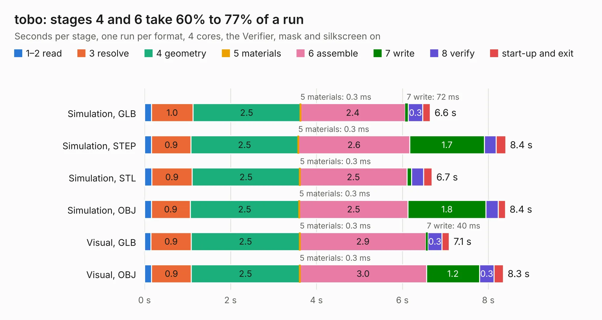

# 1439. tobo

Board 1,439 of the 3,130 of [Corpus Testing](../Corpus-Testing.md), on [Corpus Page 14](../CorpusTestingPages/Corpus-Testing-14.md#1439-tobo).

| Mode and format | 1–2 read | 3 resolve | 4 geometry | 5 materials | 6 assemble | 7 write | 8 verify | start-up and exit | Total |
|---|---:|---:|---:|---:|---:|---:|---:|---:|---:|
| Simulation, GLB | 0.2 | 1.0 | 2.5 | 0.3&nbsp;ms | 2.4 | 72&nbsp;ms | 0.3 | 0.2 | 6.6 |
| Simulation, STEP | 0.2 | 0.9 | 2.5 | 0.3&nbsp;ms | 2.6 | 1.7 | 0.3 | 0.2 | 8.4 |
| Simulation, STL | 0.2 | 0.9 | 2.5 | 0.3&nbsp;ms | 2.5 | 0.1 | 0.3 | 0.2 | 6.7 |
| Simulation, OBJ | 0.2 | 0.9 | 2.5 | 0.3&nbsp;ms | 2.5 | 1.8 | 0.3 | 0.2 | 8.4 |
| Visual, GLB | 0.2 | 0.9 | 2.5 | 0.3&nbsp;ms | 2.9 | 40&nbsp;ms | 0.3 | 0.2 | 7.1 |
| Visual, OBJ | 0.2 | 0.9 | 2.5 | 0.3&nbsp;ms | 3.0 | 1.2 | 0.3 | 0.2 | 8.3 |

<table align="center"><tr><td valign="top">

| Board | Repo: [kelu124/echomods](https://github.com/kelu124/echomods) Board: `tobo.kicad_pcb` |
|---|---|
| Folder | retired / tobo / source / Kicad |
| Complexity | 156&nbsp;/&nbsp;1000 (size&nbsp;141, features&nbsp;15) |
| KESE&nbsp;features | through vias |
| Tested | 9th November 2026 |
| Copper&nbsp;layers | 2 |
| File&nbsp;format | KiCad 4 (4) |
| Parts,&nbsp;tracks,&nbsp;vias | 23, 227, 6 |
| Triangles,&nbsp;simulation | 443,022 in 60 parts |
| Verifier | PASS in all six runs |

</td><td valign="top">

<table>
<tr><th>File type</th><th>File size</th><th>Peak memory used</th></tr>
<tr><th colspan="3" align="left">Simulation</th></tr>
<tr><td>GLB</td><td align="right">16&nbsp;MB</td><td align="right">290&nbsp;MB</td></tr>
<tr><td>STEP</td><td align="right">67&nbsp;MB</td><td align="right">344&nbsp;MB</td></tr>
<tr><td>STL</td><td align="right">22&nbsp;MB</td><td align="right">286&nbsp;MB</td></tr>
<tr><td>OBJ</td><td align="right">46&nbsp;MB</td><td align="right">375&nbsp;MB</td></tr>
<tr><th colspan="3" align="left">Visual</th></tr>
<tr><td>GLB</td><td align="right">11&nbsp;MB</td><td align="right">324&nbsp;MB</td></tr>
<tr><td>OBJ</td><td align="right">31&nbsp;MB</td><td align="right">334&nbsp;MB</td></tr>
</table>

</td></tr></table>

| Previous | Next |
|:---|---:|
| [1438. goblin](b1438b_echomods_goblin.md) | [1440. CM5_MINIMA_3](b1440b_kicad-source-mirror_CM5-MINIMA-3.md) |
