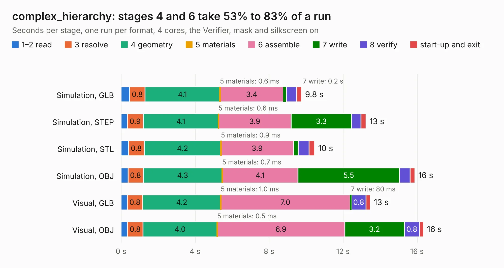

# 1440. complex_hierarchy

Board 1,440 of the 3,129 of [Corpus Testing](../Corpus-Testing.md), on [Corpus Page 14](../CorpusTestingPages/Corpus-Testing-14.md#1440-complex_hierarchy).

| Mode and format | 1–2 read | 3 resolve | 4 geometry | 5 materials | 6 assemble | 7 write | 8 verify | start-up and exit | Total |
|---|---:|---:|---:|---:|---:|---:|---:|---:|---:|
| Simulation, GLB | 0.5 | 0.8 | 4.1 | 0.6&nbsp;ms | 3.4 | 0.2 | 0.6 | 0.3 | 9.8 |
| Simulation, STEP | 0.3 | 0.9 | 4.1 | 0.6&nbsp;ms | 3.9 | 3.3 | 0.5 | 0.3 | 13.2 |
| Simulation, STL | 0.4 | 0.8 | 4.2 | 0.9&nbsp;ms | 3.9 | 0.3 | 0.6 | 0.3 | 10.5 |
| Simulation, OBJ | 0.4 | 0.8 | 4.3 | 0.7&nbsp;ms | 4.1 | 5.5 | 0.6 | 0.3 | 15.9 |
| Visual, GLB | 0.3 | 0.8 | 4.2 | 1.0&nbsp;ms | 7.0 | 80&nbsp;ms | 0.8 | 0.2 | 13.5 |
| Visual, OBJ | 0.3 | 0.8 | 4.0 | 0.5&nbsp;ms | 6.9 | 3.2 | 0.8 | 0.2 | 16.3 |

<table align="center"><tr><td valign="top">

| Board | Repo: [KiCad/kicad-source-mirror](https://github.com/KiCad/kicad-source-mirror) Board: `complex_hierarchy.kicad_pcb` |
|---|---|
| Folder | demos / complex_hierarchy |
| Complexity | 244&nbsp;/&nbsp;1000 (size&nbsp;159, features&nbsp;85) |
| KESE&nbsp;features | rounded, trapezoid or chamfered pads, drill offsets, filled zones, copper text, stack-up, dielectric εr and tanδ, mask and silkscreen colours |
| Tested | 9th November 2026 |
| Copper&nbsp;layers | 2 |
| File&nbsp;format | KiCad 9 (20241229) |
| Parts,&nbsp;tracks,&nbsp;vias | 68, 364, 0 |
| Triangles,&nbsp;simulation | 932,774 in 63 parts |
| Verifier | PASS in all six runs |

</td><td valign="top">

<table>
<tr><th>File type</th><th>File size</th><th>Peak memory used</th></tr>
<tr><th colspan="3" align="left">Simulation</th></tr>
<tr><td>GLB</td><td align="right">32&nbsp;MB</td><td align="right">450&nbsp;MB</td></tr>
<tr><td>STEP</td><td align="right">148&nbsp;MB</td><td align="right">515&nbsp;MB</td></tr>
<tr><td>STL</td><td align="right">47&nbsp;MB</td><td align="right">418&nbsp;MB</td></tr>
<tr><td>OBJ</td><td align="right">94&nbsp;MB</td><td align="right">677&nbsp;MB</td></tr>
<tr><th colspan="3" align="left">Visual</th></tr>
<tr><td>GLB</td><td align="right">19&nbsp;MB</td><td align="right">523&nbsp;MB</td></tr>
<tr><td>OBJ</td><td align="right">55&nbsp;MB</td><td align="right">538&nbsp;MB</td></tr>
</table>

</td></tr></table>

| Previous | Next |
|:---|---:|
| [1439. CM5_MINIMA_3](b1439b_kicad-source-mirror_CM5-MINIMA-3.md) | [1441. ecc83-pp](b1441b_kicad-source-mirror_ecc83-pp.md) |
