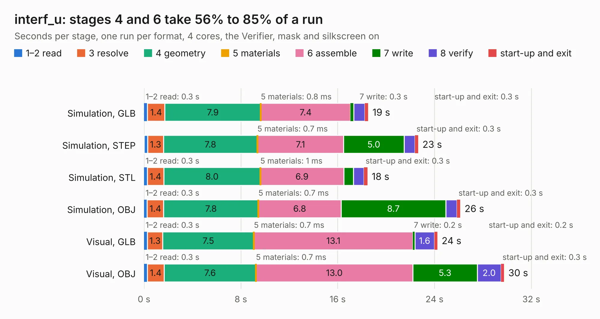

# 1442. interf_u

Board 1,442 of the 3,128 of [Corpus Testing](../Corpus-Testing.md), on [Corpus Page 14](../CorpusTestingPages/Corpus-Testing-14.md#1442-interf_u).

| Mode and format | 1–2 read | 3 resolve | 4 geometry | 5 materials | 6 assemble | 7 write | 8 verify | start-up and exit | Total |
|---|---:|---:|---:|---:|---:|---:|---:|---:|---:|
| Simulation, GLB | 0.3 | 1.4 | 7.9 | 0.8&nbsp;ms | 7.4 | 0.3 | 0.9 | 0.3 | 18.5 |
| Simulation, STEP | 0.3 | 1.3 | 7.8 | 0.7&nbsp;ms | 7.1 | 5.0 | 0.9 | 0.3 | 22.6 |
| Simulation, STL | 0.3 | 1.4 | 8.0 | 1&nbsp;ms | 6.9 | 0.8 | 0.9 | 0.3 | 18.5 |
| Simulation, OBJ | 0.3 | 1.4 | 7.8 | 0.7&nbsp;ms | 6.8 | 8.7 | 0.9 | 0.3 | 26.1 |
| Visual, GLB | 0.3 | 1.3 | 7.5 | 0.7&nbsp;ms | 13.1 | 0.2 | 1.6 | 0.2 | 24.2 |
| Visual, OBJ | 0.3 | 1.4 | 7.6 | 0.7&nbsp;ms | 13.0 | 5.3 | 2.0 | 0.3 | 29.7 |

<table align="center"><tr><td valign="top">

| Board | Repo: [KiCad/kicad-source-mirror](https://github.com/KiCad/kicad-source-mirror) Board: `interf_u.kicad_pcb` |
|---|---|
| Folder | demos / interf_u |
| Complexity | 245&nbsp;/&nbsp;1000 (size&nbsp;165, features&nbsp;80) |
| KESE&nbsp;features | through vias, filled zones, copper text, stack-up, dielectric εr and tanδ, mask and silkscreen colours |
| Tested | 9th November 2026 |
| Copper&nbsp;layers | 2 |
| File&nbsp;format | KiCad 9 (20241229) |
| Parts,&nbsp;tracks,&nbsp;vias | 24, 731, 84 |
| Triangles,&nbsp;simulation | 1,806,582 in 184 parts |
| Verifier | PASS in all six runs |

</td><td valign="top">

<table>
<tr><th>File type</th><th>File size</th><th>Peak memory used</th></tr>
<tr><th colspan="3" align="left">Simulation</th></tr>
<tr><td>GLB</td><td align="right">60&nbsp;MB</td><td align="right">680&nbsp;MB</td></tr>
<tr><td>STEP</td><td align="right">248&nbsp;MB</td><td align="right">817&nbsp;MB</td></tr>
<tr><td>STL</td><td align="right">90&nbsp;MB</td><td align="right">714&nbsp;MB</td></tr>
<tr><td>OBJ</td><td align="right">185&nbsp;MB</td><td align="right">1.2&nbsp;GB</td></tr>
<tr><th colspan="3" align="left">Visual</th></tr>
<tr><td>GLB</td><td align="right">35&nbsp;MB</td><td align="right">812&nbsp;MB</td></tr>
<tr><td>OBJ</td><td align="right">107&nbsp;MB</td><td align="right">790&nbsp;MB</td></tr>
</table>

</td></tr></table>

| Previous | Next |
|:---|---:|
| [1441. ecc83-pp_v2](b1441b_kicad-source-mirror_ecc83-pp-v2.md) | [1443. kit-dev-coldfire-xilinx_5213](b1443b_kicad-source-mirror_kit-dev-coldfire-xilinx-5213.md) |
