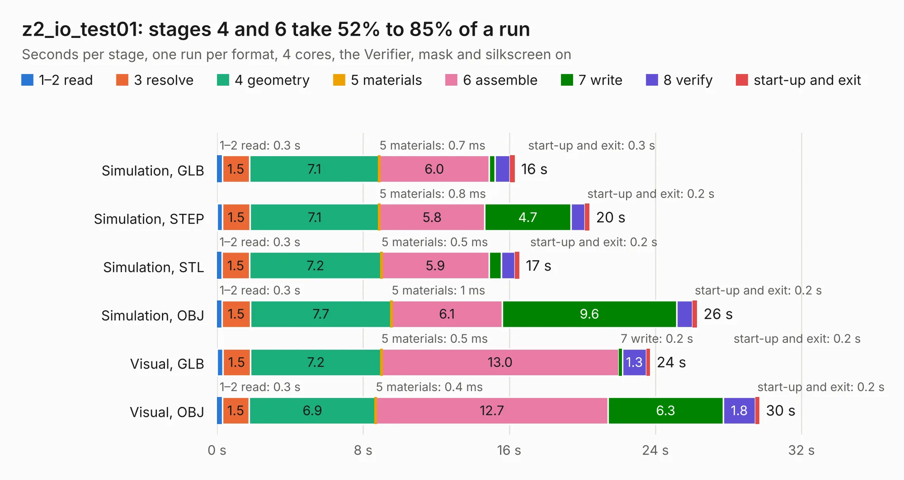

# 1443. z2_io_test01

Board 1,443 of the 3,102 of [Corpus Testing](../Corpus-Testing.md), on [Corpus Page 14](../CorpusTestingPages/Corpus-Testing-14.md#1443-z2_io_test01).

| Mode and format | 1–2 read | 3 resolve | 4 geometry | 5 materials | 6 assemble | 7 write | 8 verify | start-up and exit | Total |
|---|---:|---:|---:|---:|---:|---:|---:|---:|---:|
| Simulation, GLB | 0.3 | 1.5 | 7.1 | 0.7&nbsp;ms | 6.0 | 0.3 | 0.8 | 0.3 | 16.3 |
| Simulation, STEP | 0.3 | 1.5 | 7.1 | 0.8&nbsp;ms | 5.8 | 4.7 | 0.8 | 0.2 | 20.4 |
| Simulation, STL | 0.3 | 1.5 | 7.2 | 0.5&nbsp;ms | 5.9 | 0.7 | 0.8 | 0.2 | 16.6 |
| Simulation, OBJ | 0.3 | 1.5 | 7.7 | 1&nbsp;ms | 6.1 | 9.6 | 0.9 | 0.2 | 26.3 |
| Visual, GLB | 0.3 | 1.5 | 7.2 | 0.5&nbsp;ms | 13.0 | 0.2 | 1.3 | 0.2 | 23.7 |
| Visual, OBJ | 0.3 | 1.5 | 6.9 | 0.4&nbsp;ms | 12.7 | 6.3 | 1.8 | 0.2 | 29.7 |

<table align="center"><tr><td valign="top">

| Board | Repo: [krzys9876/ZX_Spectrum_diy](https://github.com/krzys9876/ZX_Spectrum_diy) Board: `z2_io_test01.kicad_pcb` |
|---|---|
| Folder | Kicad5 / z2_io |
| Complexity | 209&nbsp;/&nbsp;1000 (size&nbsp;184, features&nbsp;25) |
| KESE&nbsp;features | through vias, rounded, trapezoid or chamfered pads |
| Tested | 9th November 2026 |
| Copper&nbsp;layers | 2 |
| File&nbsp;format | KiCad 5 (20171130) |
| Parts,&nbsp;tracks,&nbsp;vias | 67, 1,203, 138 |
| Triangles,&nbsp;simulation | 1,836,454 in 107 parts |
| Verifier | PASS in all six runs |

</td><td valign="top">

<table>
<tr><th>File type</th><th>File size</th><th>Peak memory used</th></tr>
<tr><th colspan="3" align="left">Simulation</th></tr>
<tr><td>GLB</td><td align="right">63&nbsp;MB</td><td align="right">742&nbsp;MB</td></tr>
<tr><td>STEP</td><td align="right">302&nbsp;MB</td><td align="right">823&nbsp;MB</td></tr>
<tr><td>STL</td><td align="right">92&nbsp;MB</td><td align="right">812&nbsp;MB</td></tr>
<tr><td>OBJ</td><td align="right">192&nbsp;MB</td><td align="right">1.2&nbsp;GB</td></tr>
<tr><th colspan="3" align="left">Visual</th></tr>
<tr><td>GLB</td><td align="right">39&nbsp;MB</td><td align="right">921&nbsp;MB</td></tr>
<tr><td>OBJ</td><td align="right">120&nbsp;MB</td><td align="right">1.0&nbsp;GB</td></tr>
</table>

</td></tr></table>

| Previous | Next |
|:---|---:|
| [1442. z2_io](b1442b_ZX-Spectrum-diy_z2-io.md) | [1444. z2_io_test02](b1444b_ZX-Spectrum-diy_z2-io-test02.md) |
