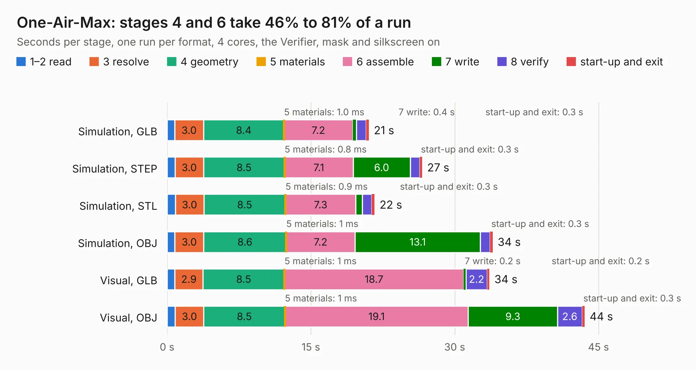

# 1443. One-Air-Max

Board 1,443 of the 3,121 of [Corpus Testing](../Corpus-Testing.md), on [Corpus Page 14](../CorpusTestingPages/Corpus-Testing-14.md#1443-one-air-max).

| Mode and format | 1–2 read | 3 resolve | 4 geometry | 5 materials | 6 assemble | 7 write | 8 verify | start-up and exit | Total |
|---|---:|---:|---:|---:|---:|---:|---:|---:|---:|
| Simulation, GLB | 0.8 | 3.0 | 8.4 | 1.0&nbsp;ms | 7.2 | 0.4 | 1.0 | 0.3 | 21.0 |
| Simulation, STEP | 0.8 | 3.0 | 8.5 | 0.8&nbsp;ms | 7.1 | 6.0 | 1.0 | 0.3 | 26.6 |
| Simulation, STL | 0.9 | 3.0 | 8.5 | 0.9&nbsp;ms | 7.3 | 0.7 | 1.0 | 0.3 | 21.6 |
| Simulation, OBJ | 0.8 | 3.0 | 8.6 | 1&nbsp;ms | 7.2 | 13.1 | 1.0 | 0.3 | 34.0 |
| Visual, GLB | 0.8 | 2.9 | 8.5 | 1&nbsp;ms | 18.7 | 0.2 | 2.2 | 0.2 | 33.6 |
| Visual, OBJ | 0.8 | 3.0 | 8.5 | 1&nbsp;ms | 19.1 | 9.3 | 2.6 | 0.3 | 43.6 |

<table align="center"><tr><td valign="top">

| Board | Repo: [KiCad/kicad-source-mirror](https://github.com/KiCad/kicad-source-mirror) Board: `One-Air-Max.kicad_pcb` |
|---|---|
| Folder | demos / openair-max |
| Complexity | 361&nbsp;/&nbsp;1000 (size&nbsp;221, features&nbsp;140) |
| KESE&nbsp;features | through vias, slotted holes, custom pads, arc tracks, filled zones, copper drawings, curved board outline, stack-up, dielectric εr and tanδ, copper finish |
| Tested | 9th November 2026 |
| Copper&nbsp;layers | 4 |
| File&nbsp;format | KiCad 9 (20241229) |
| Parts,&nbsp;tracks,&nbsp;vias | 199, 1,654, 410 |
| Triangles,&nbsp;simulation | 2,177,588 in 169 parts |
| Verifier | PASS in all six runs |

</td><td valign="top">

<table>
<tr><th>File type</th><th>File size</th><th>Peak memory used</th></tr>
<tr><th colspan="3" align="left">Simulation</th></tr>
<tr><td>GLB</td><td align="right">76&nbsp;MB</td><td align="right">790&nbsp;MB</td></tr>
<tr><td>STEP</td><td align="right">294&nbsp;MB</td><td align="right">1.0&nbsp;GB</td></tr>
<tr><td>STL</td><td align="right">109&nbsp;MB</td><td align="right">775&nbsp;MB</td></tr>
<tr><td>OBJ</td><td align="right">230&nbsp;MB</td><td align="right">1.4&nbsp;GB</td></tr>
<tr><th colspan="3" align="left">Visual</th></tr>
<tr><td>GLB</td><td align="right">55&nbsp;MB</td><td align="right">963&nbsp;MB</td></tr>
<tr><td>OBJ</td><td align="right">170&nbsp;MB</td><td align="right">1.2&nbsp;GB</td></tr>
</table>

</td></tr></table>

| Previous | Next |
|:---|---:|
| [1442. multichannel_mixer](b1442b_kicad-source-mirror_multichannel-mixer.md) | [1444. pic_programmer](b1444b_kicad-source-mirror_pic-programmer.md) |
