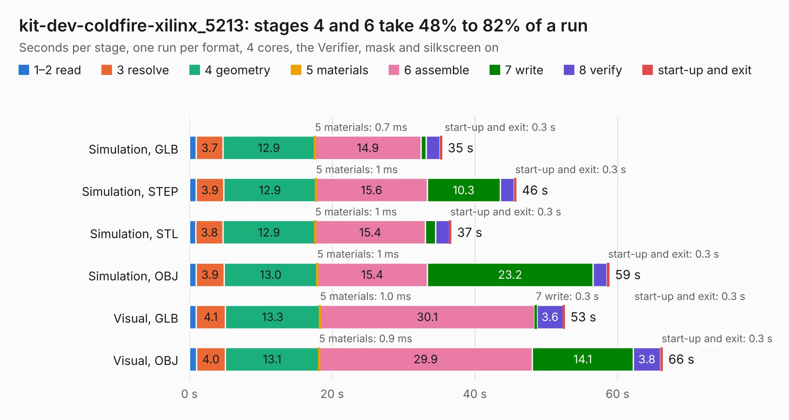

# 1443. kit-dev-coldfire-xilinx_5213

Board 1,443 of the 3,128 of [Corpus Testing](../Corpus-Testing.md), on [Corpus Page 14](../CorpusTestingPages/Corpus-Testing-14.md#1443-kit-dev-coldfire-xilinx_5213).

| Mode and format | 1–2 read | 3 resolve | 4 geometry | 5 materials | 6 assemble | 7 write | 8 verify | start-up and exit | Total |
|---|---:|---:|---:|---:|---:|---:|---:|---:|---:|
| Simulation, GLB | 1.0 | 3.7 | 12.9 | 0.7&nbsp;ms | 14.9 | 0.7 | 1.9 | 0.3 | 35.4 |
| Simulation, STEP | 0.9 | 3.9 | 12.9 | 1&nbsp;ms | 15.6 | 10.3 | 1.9 | 0.3 | 45.8 |
| Simulation, STL | 0.9 | 3.8 | 12.9 | 1&nbsp;ms | 15.4 | 1.5 | 1.9 | 0.3 | 36.7 |
| Simulation, OBJ | 0.9 | 3.9 | 13.0 | 1&nbsp;ms | 15.4 | 23.2 | 2.0 | 0.3 | 58.9 |
| Visual, GLB | 1.0 | 4.1 | 13.3 | 1.0&nbsp;ms | 30.1 | 0.3 | 3.6 | 0.3 | 52.6 |
| Visual, OBJ | 1.0 | 4.0 | 13.1 | 0.9&nbsp;ms | 29.9 | 14.1 | 3.8 | 0.3 | 66.3 |

<table align="center"><tr><td valign="top">

| Board | Repo: [KiCad/kicad-source-mirror](https://github.com/KiCad/kicad-source-mirror) Board: `kit-dev-coldfire-xilinx_5213.kicad_pcb` |
|---|---|
| Folder | demos / kit-dev-coldfire-xilinx_5213 |
| Complexity | 384&nbsp;/&nbsp;1000 (size&nbsp;269, features&nbsp;115) |
| KESE&nbsp;features | through vias, slotted holes, rounded, trapezoid or chamfered pads, filled zones, copper text, stack-up, dielectric εr and tanδ, copper finish, mask and silkscreen colours |
| Tested | 9th November 2026 |
| Copper&nbsp;layers | 4 |
| File&nbsp;format | KiCad 9 (20241229) |
| Parts,&nbsp;tracks,&nbsp;vias | 154, 2,935, 253 |
| Triangles,&nbsp;simulation | 3,721,378 in 292 parts |
| Verifier | PASS in all six runs |

</td><td valign="top">

<table>
<tr><th>File type</th><th>File size</th><th>Peak memory used</th></tr>
<tr><th colspan="3" align="left">Simulation</th></tr>
<tr><td>GLB</td><td align="right">126&nbsp;MB</td><td align="right">1.0&nbsp;GB</td></tr>
<tr><td>STEP</td><td align="right">487&nbsp;MB</td><td align="right">1.4&nbsp;GB</td></tr>
<tr><td>STL</td><td align="right">186&nbsp;MB</td><td align="right">1.1&nbsp;GB</td></tr>
<tr><td>OBJ</td><td align="right">392&nbsp;MB</td><td align="right">2.4&nbsp;GB</td></tr>
<tr><th colspan="3" align="left">Visual</th></tr>
<tr><td>GLB</td><td align="right">76&nbsp;MB</td><td align="right">1.5&nbsp;GB</td></tr>
<tr><td>OBJ</td><td align="right">240&nbsp;MB</td><td align="right">1.6&nbsp;GB</td></tr>
</table>

</td></tr></table>

| Previous | Next |
|:---|---:|
| [1442. interf_u](b1442b_kicad-source-mirror_interf-u.md) | [1444. microwave](b1444b_kicad-source-mirror_microwave.md) |
