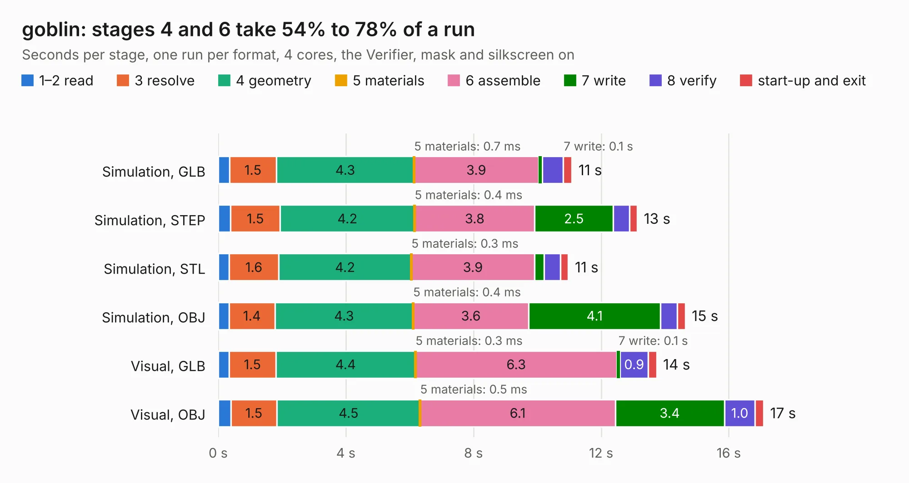

# 1444 goblin

Board 1,444 of the 3,138 of [Corpus Testing](../Corpus-Testing.md), on [Corpus Page 14](../CorpusTestingPages/Corpus-Testing-14.md#1444-goblin).

| Mode and format | 1–2 read | 3 resolve | 4 geometry | 5 materials | 6 assemble | 7 write | 8 verify | start-up and exit | Total |
|---|---:|---:|---:|---:|---:|---:|---:|---:|---:|
| Simulation, GLB | 0.4 | 1.5 | 4.3 | 0.7&nbsp;ms | 3.9 | 0.1 | 0.6 | 0.3 | 11.1 |
| Simulation, STEP | 0.4 | 1.5 | 4.2 | 0.4&nbsp;ms | 3.8 | 2.5 | 0.5 | 0.2 | 13.1 |
| Simulation, STL | 0.3 | 1.6 | 4.2 | 0.3&nbsp;ms | 3.9 | 0.3 | 0.5 | 0.3 | 11.0 |
| Simulation, OBJ | 0.3 | 1.4 | 4.3 | 0.4&nbsp;ms | 3.6 | 4.1 | 0.5 | 0.3 | 14.6 |
| Visual, GLB | 0.3 | 1.5 | 4.4 | 0.3&nbsp;ms | 6.3 | 0.1 | 0.9 | 0.3 | 13.7 |
| Visual, OBJ | 0.4 | 1.5 | 4.5 | 0.5&nbsp;ms | 6.1 | 3.4 | 1.0 | 0.3 | 17.1 |

<table align="center"><tr><td valign="top">

| Board | Repo: [kelu124/echomods](https://github.com/kelu124/echomods) Board: `goblin.kicad_pcb` |
|---|---|
| Folder | goblin / source / Kicad |
| Complexity | 198&nbsp;/&nbsp;1000 (size&nbsp;163, features&nbsp;35) |
| KESE&nbsp;features | through vias, filled zones |
| Tested | 9th November 2026 |
| Copper&nbsp;layers | 2 |
| File&nbsp;format | KiCad 4 (4) |
| Parts,&nbsp;tracks,&nbsp;vias | 60, 459, 12 |
| Triangles,&nbsp;simulation | 718,532 in 94 parts |
| Verifier | PASS in all six runs |

</td><td valign="top">

<table>
<tr><th>File type</th><th>File size</th><th>Peak memory used</th></tr>
<tr><th colspan="3" align="left">Simulation</th></tr>
<tr><td>GLB</td><td align="right">25&nbsp;MB</td><td align="right">376&nbsp;MB</td></tr>
<tr><td>STEP</td><td align="right">123&nbsp;MB</td><td align="right">462&nbsp;MB</td></tr>
<tr><td>STL</td><td align="right">36&nbsp;MB</td><td align="right">370&nbsp;MB</td></tr>
<tr><td>OBJ</td><td align="right">74&nbsp;MB</td><td align="right">553&nbsp;MB</td></tr>
<tr><th colspan="3" align="left">Visual</th></tr>
<tr><td>GLB</td><td align="right">20&nbsp;MB</td><td align="right">471&nbsp;MB</td></tr>
<tr><td>OBJ</td><td align="right">58&nbsp;MB</td><td align="right">504&nbsp;MB</td></tr>
</table>

</td></tr></table>

| Previous | Next |
|:---|---:|
| [1443 doj_v2](b1443b_echomods_doj-v2.md) | [1445 tobo](b1445b_echomods_tobo.md) |
