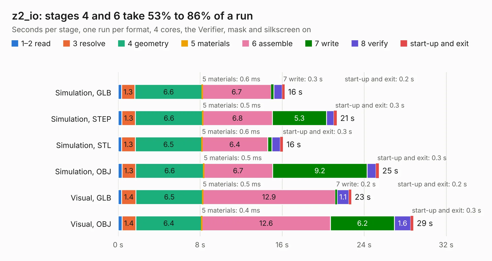

# 1446. z2_io

Board 1,446 of the 3,106 of [Corpus Testing](../Corpus-Testing.md), on [Corpus Page 14](../CorpusTestingPages/Corpus-Testing-14.md#1446-z2_io).

| Mode and format | 1–2 read | 3 resolve | 4 geometry | 5 materials | 6 assemble | 7 write | 8 verify | start-up and exit | Total |
|---|---:|---:|---:|---:|---:|---:|---:|---:|---:|
| Simulation, GLB | 0.3 | 1.3 | 6.6 | 0.6&nbsp;ms | 6.7 | 0.3 | 0.8 | 0.2 | 16.2 |
| Simulation, STEP | 0.4 | 1.3 | 6.6 | 0.5&nbsp;ms | 6.8 | 5.3 | 0.7 | 0.3 | 21.3 |
| Simulation, STL | 0.3 | 1.3 | 6.5 | 0.6&nbsp;ms | 6.4 | 0.4 | 0.8 | 0.3 | 16.1 |
| Simulation, OBJ | 0.4 | 1.3 | 6.6 | 0.5&nbsp;ms | 6.7 | 9.2 | 0.9 | 0.3 | 25.4 |
| Visual, GLB | 0.3 | 1.4 | 6.5 | 0.5&nbsp;ms | 12.9 | 0.2 | 1.1 | 0.2 | 22.7 |
| Visual, OBJ | 0.4 | 1.4 | 6.4 | 0.4&nbsp;ms | 12.6 | 6.2 | 1.6 | 0.3 | 28.8 |

<table align="center"><tr><td valign="top">

| Board | Repo: [krzys9876/ZX_Spectrum_diy](https://github.com/krzys9876/ZX_Spectrum_diy) Board: `z2_io.kicad_pcb` |
|---|---|
| Folder | Kicad5 / z2_io |
| Complexity | 221&nbsp;/&nbsp;1000 (size&nbsp;186, features&nbsp;35) |
| KESE&nbsp;features | through vias, rounded, trapezoid or chamfered pads, copper text |
| Tested | 9th November 2026 |
| Copper&nbsp;layers | 2 |
| File&nbsp;format | KiCad 5 (20171130) |
| Parts,&nbsp;tracks,&nbsp;vias | 65, 1,620, 97 |
| Triangles,&nbsp;simulation | 1,643,896 in 104 parts |
| Verifier | PASS in all six runs |

</td><td valign="top">

<table>
<tr><th>File type</th><th>File size</th><th>Peak memory used</th></tr>
<tr><th colspan="3" align="left">Simulation</th></tr>
<tr><td>GLB</td><td align="right">54&nbsp;MB</td><td align="right">582&nbsp;MB</td></tr>
<tr><td>STEP</td><td align="right">240&nbsp;MB</td><td align="right">732&nbsp;MB</td></tr>
<tr><td>STL</td><td align="right">82&nbsp;MB</td><td align="right">579&nbsp;MB</td></tr>
<tr><td>OBJ</td><td align="right">168&nbsp;MB</td><td align="right">1.1&nbsp;GB</td></tr>
<tr><th colspan="3" align="left">Visual</th></tr>
<tr><td>GLB</td><td align="right">38&nbsp;MB</td><td align="right">1.0&nbsp;GB</td></tr>
<tr><td>OBJ</td><td align="right">114&nbsp;MB</td><td align="right">828&nbsp;MB</td></tr>
</table>

</td></tr></table>

| Previous | Next |
|:---|---:|
| [1445. keyb2_nofill](b1445b_ZX-Spectrum-diy_keyb2-nofill.md) | [1447. z2_io_test01](b1447b_ZX-Spectrum-diy_z2-io-test01.md) |
