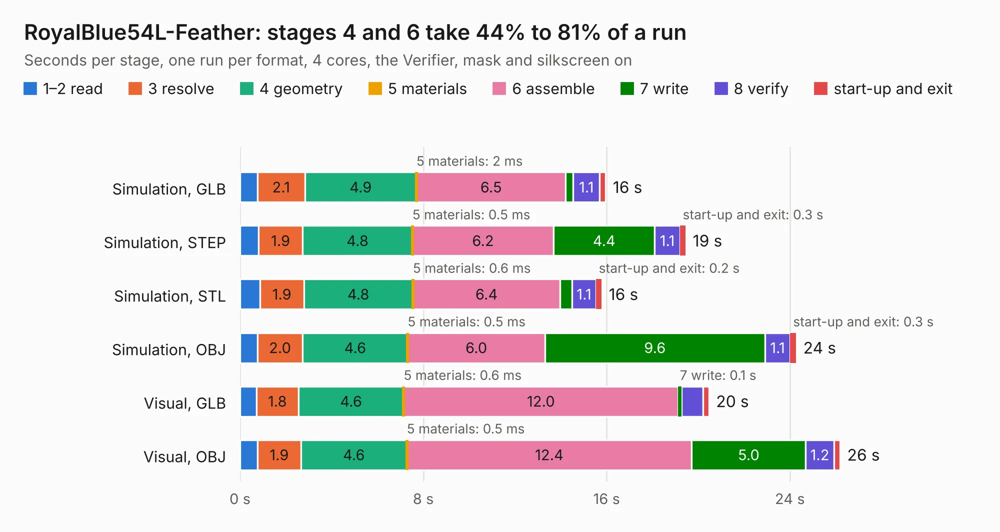

# 1446. RoyalBlue54L-Feather

Board 1,446 of the 3,121 of [Corpus Testing](../Corpus-Testing.md), on [Corpus Page 14](../CorpusTestingPages/Corpus-Testing-14.md#1446-royalblue54l-feather).

| Mode and format | 1–2 read | 3 resolve | 4 geometry | 5 materials | 6 assemble | 7 write | 8 verify | start-up and exit | Total |
|---|---:|---:|---:|---:|---:|---:|---:|---:|---:|
| Simulation, GLB | 0.8 | 2.1 | 4.9 | 2&nbsp;ms | 6.5 | 0.3 | 1.1 | 0.3 | 16.0 |
| Simulation, STEP | 0.8 | 1.9 | 4.8 | 0.5&nbsp;ms | 6.2 | 4.4 | 1.1 | 0.3 | 19.4 |
| Simulation, STL | 0.9 | 1.9 | 4.8 | 0.6&nbsp;ms | 6.4 | 0.5 | 1.1 | 0.2 | 15.8 |
| Simulation, OBJ | 0.8 | 2.0 | 4.6 | 0.5&nbsp;ms | 6.0 | 9.6 | 1.1 | 0.3 | 24.3 |
| Visual, GLB | 0.7 | 1.8 | 4.6 | 0.6&nbsp;ms | 12.0 | 0.1 | 0.9 | 0.3 | 20.5 |
| Visual, OBJ | 0.8 | 1.9 | 4.6 | 0.5&nbsp;ms | 12.4 | 5.0 | 1.2 | 0.3 | 26.2 |

<table align="center"><tr><td valign="top">

| Board | Repo: [KiCad/kicad-source-mirror](https://github.com/KiCad/kicad-source-mirror) Board: `RoyalBlue54L-Feather.kicad_pcb` |
|---|---|
| Folder | demos / royalblue54L_feather |
| Complexity | 500&nbsp;/&nbsp;1000 (size&nbsp;270, features&nbsp;230) |
| KESE&nbsp;features | blind and buried vias, slotted holes, custom pads, rounded, trapezoid or chamfered pads, drill offsets, arc tracks, filled zones, copper drawings, curved board outline, TrueType text, stack-up, dielectric εr and tanδ, copper finish, mask and silkscreen colours, castellated pads |
| Tested | 9th November 2026 |
| Copper&nbsp;layers | 8 |
| File&nbsp;format | KiCad 9 (20241229) |
| Parts,&nbsp;tracks,&nbsp;vias | 54, 943, 183 |
| Triangles,&nbsp;simulation | 1,623,990 in 115 parts |
| Verifier | PASS in all six runs |

</td><td valign="top">

<table>
<tr><th>File type</th><th>File size</th><th>Peak memory used</th></tr>
<tr><th colspan="3" align="left">Simulation</th></tr>
<tr><td>GLB</td><td align="right">56&nbsp;MB</td><td align="right">547&nbsp;MB</td></tr>
<tr><td>STEP</td><td align="right">233&nbsp;MB</td><td align="right">667&nbsp;MB</td></tr>
<tr><td>STL</td><td align="right">81&nbsp;MB</td><td align="right">550&nbsp;MB</td></tr>
<tr><td>OBJ</td><td align="right">171&nbsp;MB</td><td align="right">1.1&nbsp;GB</td></tr>
<tr><th colspan="3" align="left">Visual</th></tr>
<tr><td>GLB</td><td align="right">27&nbsp;MB</td><td align="right">708&nbsp;MB</td></tr>
<tr><td>OBJ</td><td align="right">82&nbsp;MB</td><td align="right">652&nbsp;MB</td></tr>
</table>

</td></tr></table>

| Previous | Next |
|:---|---:|
| [1445. RoyalBlue54L-NFC-Antenna](b1445b_kicad-source-mirror_RoyalBlue54L-NFC-Antenna.md) | [1447. sonde xilinx](b1447b_kicad-source-mirror_sonde-xilinx.md) |
