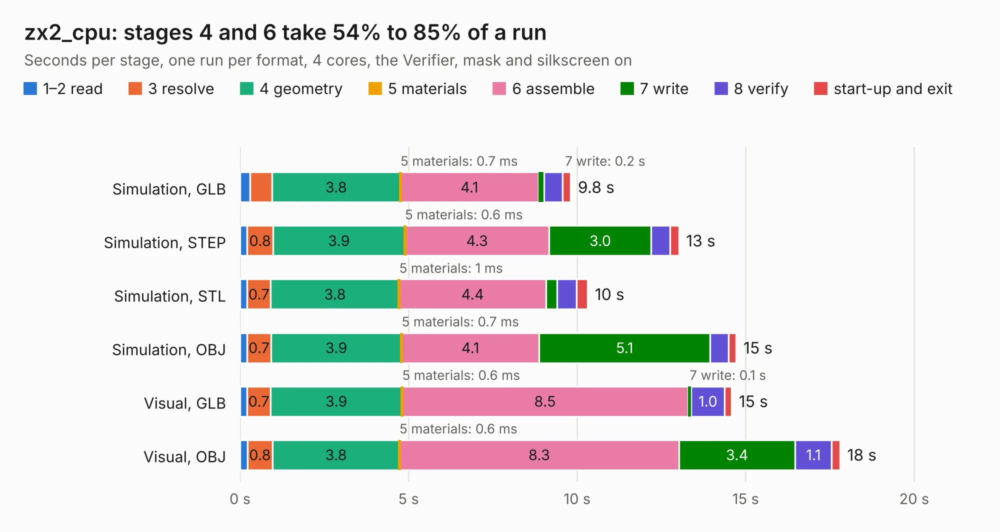

# 1447. zx2_cpu

Board 1,447 of the 3,101 of [Corpus Testing](../Corpus-Testing.md), on [Corpus Page 14](../CorpusTestingPages/Corpus-Testing-14.md#1447-zx2_cpu).

| Mode and format | 1–2 read | 3 resolve | 4 geometry | 5 materials | 6 assemble | 7 write | 8 verify | start-up and exit | Total |
|---|---:|---:|---:|---:|---:|---:|---:|---:|---:|
| Simulation, GLB | 0.3 | 0.7 | 3.8 | 0.7&nbsp;ms | 4.1 | 0.2 | 0.5 | 0.2 | 9.8 |
| Simulation, STEP | 0.2 | 0.8 | 3.9 | 0.6&nbsp;ms | 4.3 | 3.0 | 0.6 | 0.3 | 13.0 |
| Simulation, STL | 0.2 | 0.7 | 3.8 | 1&nbsp;ms | 4.4 | 0.3 | 0.6 | 0.3 | 10.3 |
| Simulation, OBJ | 0.2 | 0.7 | 3.9 | 0.7&nbsp;ms | 4.1 | 5.1 | 0.5 | 0.2 | 14.7 |
| Visual, GLB | 0.2 | 0.7 | 3.9 | 0.6&nbsp;ms | 8.5 | 0.1 | 1.0 | 0.2 | 14.6 |
| Visual, OBJ | 0.2 | 0.8 | 3.8 | 0.6&nbsp;ms | 8.3 | 3.4 | 1.1 | 0.2 | 17.8 |

<table align="center"><tr><td valign="top">

| Board | Repo: [krzys9876/ZX_Spectrum_diy](https://github.com/krzys9876/ZX_Spectrum_diy) Board: `zx2_cpu.kicad_pcb` |
|---|---|
| Folder | Kicad5 / zx2_cpu |
| Complexity | 213&nbsp;/&nbsp;1000 (size&nbsp;158, features&nbsp;55) |
| KESE&nbsp;features | through vias, rounded, trapezoid or chamfered pads, filled zones, copper text |
| Tested | 9th November 2026 |
| Copper&nbsp;layers | 2 |
| File&nbsp;format | KiCad 5 (20171130) |
| Parts,&nbsp;tracks,&nbsp;vias | 18, 716, 32 |
| Triangles,&nbsp;simulation | 1,132,234 in 83 parts |
| Verifier | PASS in all six runs |

</td><td valign="top">

<table>
<tr><th>File type</th><th>File size</th><th>Peak memory used</th></tr>
<tr><th colspan="3" align="left">Simulation</th></tr>
<tr><td>GLB</td><td align="right">37&nbsp;MB</td><td align="right">481&nbsp;MB</td></tr>
<tr><td>STEP</td><td align="right">164&nbsp;MB</td><td align="right">580&nbsp;MB</td></tr>
<tr><td>STL</td><td align="right">57&nbsp;MB</td><td align="right">470&nbsp;MB</td></tr>
<tr><td>OBJ</td><td align="right">113&nbsp;MB</td><td align="right">762&nbsp;MB</td></tr>
<tr><th colspan="3" align="left">Visual</th></tr>
<tr><td>GLB</td><td align="right">26&nbsp;MB</td><td align="right">684&nbsp;MB</td></tr>
<tr><td>OBJ</td><td align="right">80&nbsp;MB</td><td align="right">657&nbsp;MB</td></tr>
</table>

</td></tr></table>

| Previous | Next |
|:---|---:|
| [1446. zx2_clock_test01](b1446b_ZX-Spectrum-diy_zx2-clock-test01.md) | [1448. zx2_cpu_test01](b1448b_ZX-Spectrum-diy_zx2-cpu-test01.md) |
