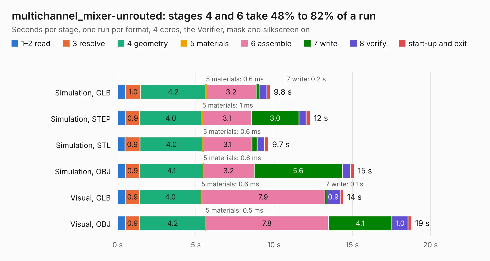

# 1447. multichannel_mixer-unrouted

Board 1,447 of the 3,130 of [Corpus Testing](../Corpus-Testing.md), on [Corpus Page 14](../CorpusTestingPages/Corpus-Testing-14.md#1447-multichannel_mixer-unrouted).

| Mode and format | 1–2 read | 3 resolve | 4 geometry | 5 materials | 6 assemble | 7 write | 8 verify | start-up and exit | Total |
|---|---:|---:|---:|---:|---:|---:|---:|---:|---:|
| Simulation, GLB | 0.5 | 1.0 | 4.2 | 0.6&nbsp;ms | 3.2 | 0.2 | 0.5 | 0.2 | 9.8 |
| Simulation, STEP | 0.5 | 0.9 | 4.0 | 1&nbsp;ms | 3.1 | 3.0 | 0.5 | 0.3 | 12.3 |
| Simulation, STL | 0.5 | 0.9 | 4.0 | 0.6&nbsp;ms | 3.1 | 0.3 | 0.5 | 0.3 | 9.7 |
| Simulation, OBJ | 0.5 | 0.9 | 4.1 | 0.6&nbsp;ms | 3.2 | 5.6 | 0.5 | 0.2 | 15.1 |
| Visual, GLB | 0.5 | 0.9 | 4.0 | 0.6&nbsp;ms | 7.9 | 0.1 | 0.9 | 0.2 | 14.4 |
| Visual, OBJ | 0.5 | 0.9 | 4.2 | 0.5&nbsp;ms | 7.8 | 4.1 | 1.0 | 0.2 | 18.8 |

<table align="center"><tr><td valign="top">

| Board | Repo: [KiCad/kicad-source-mirror](https://github.com/KiCad/kicad-source-mirror) Board: `multichannel_mixer-unrouted.kicad_pcb` |
|---|---|
| Folder | demos / multichannel |
| Complexity | 251&nbsp;/&nbsp;1000 (size&nbsp;196, features&nbsp;55) |
| KESE&nbsp;features | through vias, slotted holes, rounded, trapezoid or chamfered pads, filled zones |
| Tested | 9th November 2026 |
| Copper&nbsp;layers | 11 |
| File&nbsp;format | KiCad 9 (20241030) |
| Parts,&nbsp;tracks,&nbsp;vias | 114, 140, 19 |
| Triangles,&nbsp;simulation | 941,284 in 88 parts |
| Verifier | PASS in all six runs |

</td><td valign="top">

<table>
<tr><th>File type</th><th>File size</th><th>Peak memory used</th></tr>
<tr><th colspan="3" align="left">Simulation</th></tr>
<tr><td>GLB</td><td align="right">32&nbsp;MB</td><td align="right">466&nbsp;MB</td></tr>
<tr><td>STEP</td><td align="right">148&nbsp;MB</td><td align="right">526&nbsp;MB</td></tr>
<tr><td>STL</td><td align="right">47&nbsp;MB</td><td align="right">477&nbsp;MB</td></tr>
<tr><td>OBJ</td><td align="right">95&nbsp;MB</td><td align="right">673&nbsp;MB</td></tr>
<tr><th colspan="3" align="left">Visual</th></tr>
<tr><td>GLB</td><td align="right">23&nbsp;MB</td><td align="right">637&nbsp;MB</td></tr>
<tr><td>OBJ</td><td align="right">69&nbsp;MB</td><td align="right">623&nbsp;MB</td></tr>
</table>

</td></tr></table>

| Previous | Next |
|:---|---:|
| [1446. microwave](b1446b_kicad-source-mirror_microwave.md) | [1448. multichannel_mixer](b1448b_kicad-source-mirror_multichannel-mixer.md) |
